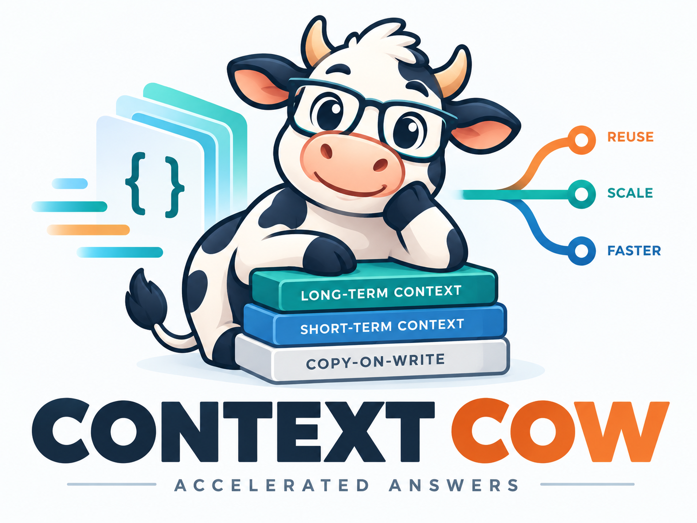

<p align="center"></p>

# Context COW v0.1.2-rc2 — experimental release candidate

**Read a prefix once. Explore independent futures. Keep the history.**

## Start here: open the app and see an equation

**[Follow the beginner setup and first-chat guide](docs/context-cow/START_HERE.md).**
It explains each step, including Python installation and the private `.venv`
folder. You do not need an AI assistant or Git.

**[Use chats, forks, branches, retry and clear](docs/context-cow/CHAT_WORKSPACE_GUIDE.md).**
The **Paths** viewer shows saved-message progress, shared beginnings and branch
endings. Click a name to switch paths, or a dot to preview messages.
[See the viewer and executed checks](docs/context-cow/BRANCH_VIEWER.md).
[The dynamic viewer](docs/context-cow/DYNAMIC_BRANCH_VIEWER.md) keeps the map
beside chat on wide screens and above it on smaller screens, with grouped tips,
animated curves, zoom and pan.
The current interface saves its branch-aware history in SQLite and labels model
execution as replay mode. Native GPU COW checkpoint integration remains separate.

The default interface uses compact icons and delayed tooltips. The book button
shows teaching labels. [1K/4K cached tests and their exact-output failures](docs/context-cow/SLEEK_UI_AND_LONG_CONTEXT.md)
are reported separately from the passing interface tests.

- **Try the app first:** run a small, clearly labelled sample with a fixed
  answer. No model download or GPU is needed.
- **Talk to a real model:** run `START-HERE.bat` on Windows or `bash setup.sh`
  on Linux. Setup checks the computer and downloads the model you select.
- **See math:** open Chat → Sampling and thinking → Render math.
  Choose KaTeX or MathJax. Math changes take effect immediately.


The screenshot is a real Q8 model answer served from llm-60 and viewed on a
Windows PC. This older screenshot has a **Strata** header; the current header says
**COW**. The web chat uses ordinary
serving; the experimental COW branch/checkpoint runners are a separate path.
See [what was tested](docs/context-cow/WEB_START_VALIDATION.md).

## What Context COW adds

Context COW adds immutable branching histories and reusable GPU, RAM and disk
checkpoints to [Strata](https://github.com/Niko1221/Strata). Its focus is GPU
copy-on-write: retain a shared prefix, prepare private tail pages, and change
a continuation without changing its parent or siblings.

Based on Strata, with its ancestry and MIT license preserved. Compatible
changes are intended to be proposed upstream over time. This release is an
experimental research prototype; it does not imply upstream acceptance or
complete G1–G5 certification. Original Strata documentation is in [STRATA.md](STRATA.md).

[Build and run](docs/context-cow/GETTING_STARTED.md) ·
[Results and limits](docs/context-cow/RESULTS.md) ·
[All runners](docs/context-cow/RUNNERS.md) ·
[Priorities](docs/context-cow/ROADMAP.md) ·
[Raw reports](docs/context-cow/results/)

The opt-in [image-context CLI guide](docs/context-cow/vision-cli.md) covers
uploaded PNG/JPEG inputs, shared image prefixes, independent text questions and
disk restoration in a new server process. Its bounded Q4 validation and remaining
vision work are separate from the web interface and full gate certification.

**New in v0.1.2:** [LaTeX math rendering](docs/WEB_MATH.md) with both KaTeX and
MathJax behind a shared core and viewer selector. Enable **Render math** in
Chat's Sampling drawer and choose a **Math viewer**. These controls update
existing answers immediately, without Apply or another model request. Assets are bundled
locally; source is preserved in history, exports and model requests.
[Release scope and validation](docs/context-cow/V0.1.2.md).

The [v0.1.1 release candidate](docs/context-cow/V0.1.1-PLAN.md) adds an explicit
[caller-managed write-integrity experiment](docs/context-cow/EXTERNAL_WRITE_INTEGRITY.md).
Fresh paired reruns show **6.4–6.6% higher native TPS on COW lanes**, with the
caller assuming the sealed-page mutation guarantee. COW A reached 50.63 TPS
versus 47.49 for the guarded v0.1.0 control. The original v0.1.0 release/tag and
its measurements remain available; the guarded path remains the default build.

## Measured, with the guards still on

On an RTX PRO 6000 Blackwell with Qwen3.8-Flash-Next Q8_0 and FP16 KV:

- **8,192 saved prefix tokens + 512 changed suffix tokens + 128 outputs.**
- Resident A/B, RAM and disk continuations: **516 full-logit comparisons, maximum error 0.0** against independent fresh full-history inference.
- GPU write preparation: **1.66 → 0.191 seconds** over 128 outputs, about **8.7× faster**, with the same sealed bytes checked.
- Native COW decode: **43.5–47.4 TPS**; RAM control: **51.6 TPS** in the same four-lane run.
- Complete instrumented durable API: **6.8–8.0 TPS**. Controller, verification and per-token publication costs are included in this separate clock.
- **Zero prefix recomputation**, measured copy counters, unchanged parent byte audits, and real CUDA corruption/sanitizer checks.

These are bounded serial measurements, not a general speed guarantee. All 128
outputs were produced in these runs. The evidence includes failed and partial
experiments as well as successful runs.


The improvement reserves verification scratch ahead of decode and checks an
ordered list of sealed pages in one GPU launch before preparing the tails.
Every sealed byte is still checked. Speculatively preparing a future writable
window is a next step, not a claim about this release.

## What is immutable

```text
                     +-- suffix A -- generated A
saved prefix P ------+
                     +-- suffix B -- generated B
```

A canonical parent-linked history and complete controller state are the source
of truth. Branch references move; numerical checkpoints can be kept in GPU
memory, RAM or disk, or rebuilt. An output becomes a committed snapshot only
after its token is consumed and its state is durably published.

The current experiment uses real **batched prefill**. Changes after a saved
prefix require computation of the changed suffix. It does not attempt to
repair later state after an earlier edit with RoPE/YaRN transformations.

## Read the boundaries

Arbitrary batched-prefix splits and ordinary-serving token repeatability remain
open. The demonstrated prefix boundary is aligned at 8K. Disk restoration here
uses a warm filesystem and does not certify crash recovery. Native Windows
locking, HIP/SYCL, multi-request serving, the complete gate matrix and the long
soak remain unqualified. See [the full results](docs/context-cow/RESULTS.md)
for the counterexamples, fingerprints and exact scope.

## Reproduce and contribute

Start with [the Linux/CUDA build and demo](docs/context-cow/GETTING_STARTED.md).
The repository includes COW, RAM, ordinary serving, split-prefill, state-machine,
recovery, mutation and sanitizer runners. Reports are machine-readable; all
four publication figures have reproducible plotting code and source hashes.

The [roadmap](docs/context-cow/ROADMAP.md) follows the measurements: optimize
preparation while preserving isolation, resolve batching/parity gaps, reduce
complete API publication costs, then scale context sizes and propose compatible
changes upstream. The [mathematical contract](experimental/branching_context/spec/branching-context-api.md)
and registered assertions remain authoritative.

Strata and this code are distributed under the retained [MIT license](LICENSE).
