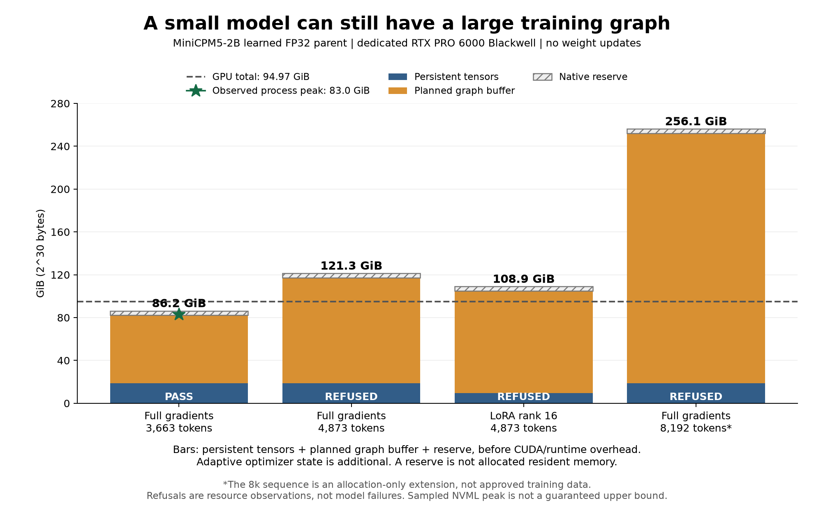

# Real MiniCPM action-training memory findings

**The real learned MiniCPM parent completed a 3,663-token full-gradient probe on
llm-60. All 381 parameter-gradient tensors were finite and nonzero.** The sampled
process peak was 84,946 MiB, about 83.0 GiB. Its weights remained unchanged.

The longer 4,873-token full and rank-16 LoRA probes exceeded this implementation's
one-card graph budget. The native allocator refused those buffers before trying
to allocate them. An independent synthetic 8k allocation probe was also refused.
These are resource findings, rather than wrong answers, failed learning or GPU
out-of-memory crashes. No real weight updates were performed in these probes.

| Probe | Graph buffer alone | Persistent tensors + graph + 4 GiB reserve | Result |
| --- | ---: | ---: | --- |
| Full gradients, 3,663 tokens / 108 selected targets | 63.5 GiB | 86.2 GiB | Completed; sampled whole-process peak 83.0 GiB |
| Full gradients, 4,873 tokens / 19 selected targets | 98.5 GiB | 121.3 GiB | Resource refusal |
| LoRA rank 16, 4,873 tokens / 19 selected targets | 95.4 GiB | 108.9 GiB | Resource refusal |
| Full gradients, 8,192 tokens / 19 selected targets | 233.3 GiB | 256.1 GiB | Allocation-only synthetic extension; resource refusal |

The dedicated GPU was an NVIDIA RTX PRO 6000 Blackwell, nominally a 96 GB card;
the runtime reported about 94.97 GiB total. Bars include the configured reserve,
which is not allocated resident memory. Their totals exclude runtime overhead
and adaptive optimizer state. Sampled NVML peaks are observations, not upper
bounds. The 8k filler extension is not approved training data.

## Plain-language meaning

Small model files do not guarantee small training memory. This native backend
keeps large intermediate attention tensors so it can differentiate the whole
model. Longer inputs make those tensors grow quickly. LoRA saves parameter
gradients and optimizer state, but it still needs to differentiate through the
model's attention over the context.

These are costs of the current ordinary-backprop implementation. They are not
intrinsic minimum VRAM requirements for every way of training a 2B model.
Memory-efficient attention/recomputation and model-parallel placement are separate
engineering paths; this report does not claim either has already solved it.

The existing 512-token study remains unchanged. It uses much shorter training
inputs, which is why it can run the same model with smaller memory footprints.

## Master's / research interpretation

The ordinary attention graph materializes quadratic intermediates across layers.
Their leading storage term scales with layers × query heads × context length²,
while parameter and optimizer-state storage scale with parameter count. Sparse
loss masks do not automatically remove the cost of propagating gradients through
the context. The current output projection also computes logits across the full
sequence before selecting supervised columns.

Consequently, parameter-efficient adaptation can reduce one term substantially
while the activation term dominates. Here the 4,873-token graph buffers were
98.5 GiB for full gradients and 95.4 GiB for rank-16 LoRA. That comparison does
not rank their learning quality or compute efficiency; neither probe completed
on this one GPU.

The independent native persistent-admission probes reported about **37.5 GiB for
full AdamW** and **30.1 GiB for full Muon**, including weights, gradients and
optimizer state, before the graph allocation. Those were metadata/admission
checks with no weight load or optimizer step. Passing persistent admission must
not be presented as proof that the complete update fits.

The earlier graph-planning defect was separate: a deep-model node-arena guard
still enforced 512 tokens. The [8k profile guide](DENSE-LLAMA-ACTION-TRAINING.md)
documents its correction and the distinguishing 42-layer/long-context tests.
Correcting graph bookkeeping did not eliminate the actual quadratic tensor cost.

## Applied next steps

Use the measured graph requirement together with the selected optimizer's
persistent requirement and per-device reserves when choosing placement. The
successful SGD-style gradient probe does not establish that AdamW fits on the
same card. A multi-device run must also validate actual partition placement and
the existing standard-backprop scheduler; summing free VRAM alone is insufficient.

Keep the original successful probe and refusals. Continue independent work with
its own resource and completion records. Candidate training, BW workflow gains,
retention measurements, acceptance and named GGUF preservation remain the next
learning-loop phases. A memory result is not an accepted model.

The [machine-readable ledger](../validation/native-action-real-memory-20261026.json)
contains exact model/executable/source identities, native result and stderr
hashes, planned allocations and sampled peaks. The [plot source](../validation/plot_native_action_memory.py)
reproduces the figure without inference. Source contexts came from independently
checked scripted BW practice, matched to the real parent's tokenizer. They do
not establish that the model generated a successful tool trajectory. Raw prompts,
machine handoffs and model files remain private.
