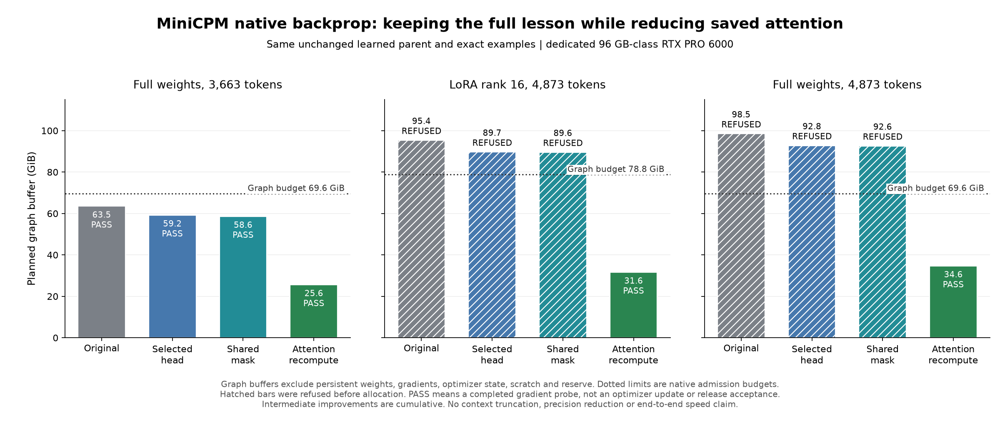

# Real MiniCPM: the entire action block now fits one card for gradients

The new opt-in attention-recompute path completed all four real action-lesson
gradient probes on the dedicated 96 GB-class RTX PRO 6000. The longest,
4,873-token rank-16 LoRA probe used a sampled process peak of **41.88 GiB**.
Its required graph buffer fell from **95.35 GiB** in the original
path to **31.61 GiB**: about **66.9% less**.
The original graph was resource-refused before allocation; its bar is required
memory, not a measured resident-memory peak.

These are standard whole-graph backward probes through actual learned MiniCPM
weights. They are not new training updates or an improved BW score. All probes
used the same unchanged parent, exact original context/targets/masks and qualified
FP32 math. No context or lesson was shortened. The old 68-update comparison and
its native executables remain unchanged.

| LoRA input tokens | Selected targets | Planned graph GiB | Sampled process peak GiB | Gradient probe |
| ---: | ---: | ---: | ---: | --- |
| 3029 | 14 | 18.96 | 29.24 | PASS |
| 3663 | 108 | 23.28 | 33.55 | PASS |
| 4278 | 88 | 27.47 | 37.74 | PASS |
| 4873 | 19 | 31.61 | 41.88 | PASS |

Every LoRA probe exposed 590 finite tensor gradients. With B initialized to zero,
295 B gradients were nonzero and A gradients were zero, as expected from the
product rule. The tiny two-update tests separately verify A/B continuation.
Full-weight probes also passed: 381 finite, nonzero tensor gradients at both
3,663 and 4,873 tokens. Their sampled process peaks were **45.03 GiB** and
**54.11 GiB**, respectively. The full 4,873-token planned graph was **34.64 GiB**.

## ELI5

The engine had been keeping a large attention worksheet for every layer until
it worked backward. It now recalculates those worksheets when needed. The lesson,
the model and the answers being taught stay the same. More calculation replaces
a large amount of saved GPU memory. The longest lesson can now get through its
backward calculation on this one card.

## Master's and PhD level

The first change projected selected hidden columns instead of all context columns
through the vocabulary head. It helped, but did not fit the longest lesson. The
next change shared the causal-mask input and used scaled/masked softmax. A tiny
42-layer graph showed about 30% less allocation, but the real longest LoRA graph
fell only from 96,270,881,792 to 96,155,779,456 bytes. Both still exceeded admission.
That tiny-fixture improvement did not predict the real model's peak.

The rematerialized graph retains the original automatic derivative expressions,
Q/K dependencies, accumulators and root-one loss seed. Its backward consumers
read recomputed softmax probabilities instead of all saved forward probabilities.
The real 42-layer gradient probes recorded 42 recomputed probability tensors and
84 rewritten backward reads. It uses ordinary full-graph backprop, FP32 operators
and the same loss, rather than a manually supplied section adjoint.

At 3,663 tokens, the new full-weight loss differed from the preserved original
dense-head loss by 1.49e-7. All 381 gradient-tensor L2 norms passed unchanged
rtol=1e-4, atol=1e-5; the largest absolute norm difference was 1.76e-5.
Norm agreement is not componentwise equivalence. Independent FP64 scalar checks,
full/LoRA saved-update comparisons and old-profile compatibility on generated
weights provide the separate operator-level evidence in the
[native qualification](ATTENTION-RECOMPUTE-TRAINING.md).

## Applied meaning and remaining gates

This removes the single-card gradient-memory blocker for the complete four-lesson
block. It does not yet establish adaptive training with resident AdamW/Muon moments:
the optimizer entries in the receipt are persistent-only plans, without loaded
states or a step. Actual chosen optimizer residency, approved S³ lesson membership,
native candidate/reload completion, BW workflow evaluation, mixed-review retention
and accept/reject decisions remain required.

The source examples here remain explicitly **not production-training-approved**.
They exercise faithful rendered action contexts and independent artifact checking;
their scripted capture identity must not be relabelled as a real model identity.
No model weights, optimizer checkpoints or raw protected responses were published.

The [comparison receipt](../validation/attention-recompute-real-memory-20261026.json)
retains per-case native results, planned buffers, sampled peaks, source hashes and
original parent identity. The [shared-mask real result](../validation/selected-head-shared-mask-real-memory-20261026.json)
keeps that intermediate outcome too. NVML peaks are samples, not proven upper
bounds. Allocator budgets include separate persistent/reserve/scratch allowances;
the graph bars exclude those. These dedicated-card memory measurements make no
end-to-end speed claim and do not reuse shared-A100 wall times as a benchmark.
