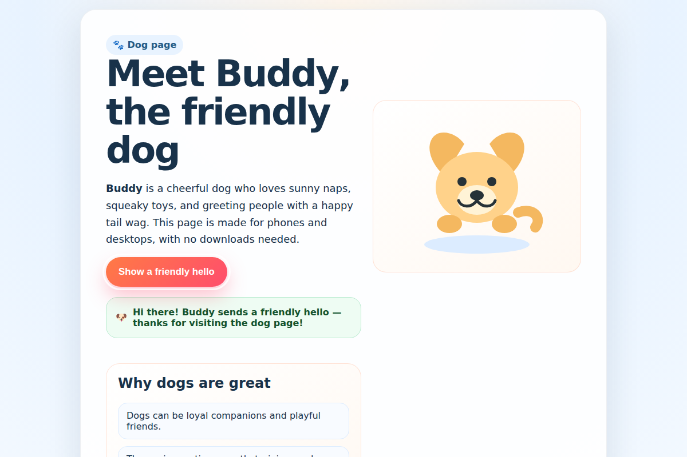
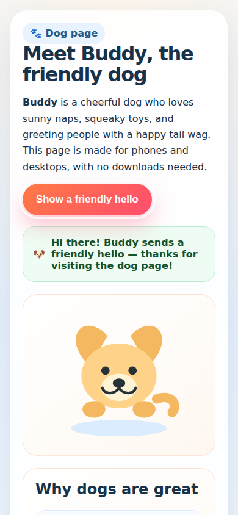

# Put Context COW on your desktop and BranchWrite on your laptop

You can use two Linux computers on the same home network:

- **Desktop / server:** runs the AI model and keeps its saved context.
- **Laptop / client:** runs BranchWrite and holds the files you want to change.

You do not need an AI agent to follow these steps. You need Internet access for
installation. Read the hardware and download size before starting.

## Before you download

This guide uses the Q4 model tested with Context COW. It is a large model:
**about 111.3 GB to download**, plus about 1.4 GiB for its prepared model pack.
Allow **200 GB of free disk space** for the model, build and default disk cache.
Use a fast SSD. The laptop does not download the model.

The tested server has Linux, **128 GB of system RAM** and an NVIDIA RTX PRO 6000
Blackwell with **96 GB of graphics memory**. This describes the tested machine,
not a claim that every gaming PC must have that card or that every smaller card
will work. A usual 16/32 GB RAM gaming PC is not this tested Q4 setup. Other GPU
and memory combinations still need their own check.

A smaller-server trial now also exists: **RTX 4090, 24 GB VRAM, 32 GB RAM**.
Automatic installation, model loading, prefix preparation and generation worked,
and a short CLI chat completed in 228 seconds. Its coding task did not finish
within a ten-minute trial. It paused safely.
That is **not** a recommendation for interactive use with this large model.
The 128 GB RAM / 32 GB RTX 5090 combination has not yet been tested.

These copy-and-paste instructions target 64-bit Intel/AMD Ubuntu 24.04 or newer.
Here, Intel/AMD describes the **CPU**. The server still needs an NVIDIA **GPU**.
AMD Radeon GPUs cannot run this COW server yet. Its HIP build does not include
the `strata-branch` inference driver and COW snapshot-session integration.
Installing NVIDIA tools on an AMD-only computer will not fix that.
[See the executed RX 7900 XTX check](https://github.com/CC-David-CC/Private_Context_COW/blob/main/validation/amd-cow-preflight-20261021/README.md).

The server needs a working NVIDIA driver and the CUDA Toolkit. CUDA is NVIDIA's
software for building and running GPU programs. The installer does not replace
your graphics driver or install the CUDA compiler automatically.

### Optional: choose a smaller model

Q4 stays the default. These two alternatives download fewer bytes:

| Setup choice | Model preparation | Model download |
|---|---|---:|
| Default, or `--model UD-Q4_K_XL` | Unsloth Q4 | 111.3 GB |
| `--model IQ3_XXS` | ISTA-DASLab GSQ-RCO | 75.8 GB |
| `--model IQ2_XS` | ISTA-DASLab GSQ-RCO | 68.0 GB |

They are different model preparations, so compare useful answers as well as
speed. A smaller download does not guarantee that a PC can keep the model in
memory or run the full coding workflow quickly. These models still need NVIDIA
and CUDA for Context COW.

When the steps below reach `./cow-setup`, you may use this instead:

```bash
./cow-setup --model IQ2_XS --data-dir "$HOME/ContextCOW-IQ2"
```

Then start that server with:

```bash
./cow-start "$HOME/ContextCOW-IQ2"
```

For IQ3, use `--model IQ3_XXS` and a folder such as
`"$HOME/ContextCOW-IQ3"` in both commands. Allow at least 120 GB free for either
smaller model, its build and its default disk pool. Setup checks the measured
space before it downloads. It verifies the files against pinned SHA-256 hashes.

The corrected IQ2 setup completed a 22K shared-context test and a simple
BranchWrite chat on the 32 GB RAM / RTX 4090 machine. This does not prove that
it can finish a coding project there. The earlier coding runs timed out or
stopped at a memory-pool limit. Resuming one failed request still needs a fix.
[Read the measured results and limits](https://github.com/CC-David-CC/Private_Context_COW/tree/main/validation/lower-quants-llm49-20261021).

Keep each model in a separate data folder. Changing the model creates a new
model identity; an old model's saved computation cannot be restored into it.
Setup refuses to replace a configured server with an explicitly different model.
Run `./cow-start` with your existing folder to use that server again.

## Part A — on the desktop

### 1. Check NVIDIA and CUDA

On Ubuntu, press Ctrl+Alt+T to open Terminal on the desktop. Run these commands one at a time:

```sh
nvidia-smi
/usr/local/cuda/bin/nvcc --version
free -h
df -h "$HOME"
```

The first command should show your NVIDIA card. The second should show a CUDA
compiler version. The last two show RAM and free disk space. If the first or
second command fails, fix the NVIDIA/CUDA installation before continuing.
Do not start the model download hoping that it will install the driver.

A working graphics driver does not necessarily include the CUDA compiler.
For a missing toolkit, follow [NVIDIA's Linux installation guide](https://docs.nvidia.com/cuda/cuda-installation-guide-linux/)
and [CUDA download page](https://developer.nvidia.com/cuda-downloads).
Select your Linux distribution and follow its toolkit instructions. The measured
server build used CUDA 13.2. This guide does not automatically change your driver.

### 2. Install the small build tools

```sh
sudo apt update
sudo apt install -y git curl ca-certificates build-essential cmake python3-venv
```

`sudo` lets Linux install system packages. Type your Linux password if asked.
You will not see letters while you type the password. That is normal.

### 3. Download Context COW

```sh
mkdir -p ~/Apps
cd ~/Apps
git clone https://github.com/CC-David-CC/Private_Context_COW.git ContextCOW
cd ContextCOW
```

### 4. Run automatic setup

```sh
./cow-setup
```

Setup reads the server's available RAM, GPU memory and CPU count. It shows
its starting settings and download size. Type `YES` to continue. It creates
its own Python environment, installs the packages, builds the engine, downloads
and verifies the pinned Q4 model, prepares the model pack, and makes a server
configuration and API key. A **Python environment** is a separate folder that
holds this app's Python packages. You do not need to activate it.

The initial context limit is 32,768 tokens with FP16 KV. Setup selects an
8,192-token prefill batch with at least 20 GiB free GPU memory, or a
2,048-token batch below that. The smaller batch is a policy choice that still
needs its own GPU qualification. The RAM pool and expert
RAM budget are separate and are chosen from available RAM. The disk checkpoint
pool initially allows 16 GiB. These are starting budgets, not a promise of
performance on every PC. Setup also keeps a positive free-RAM guard: 8 GiB on smaller-RAM hosts and
16 GiB on larger hosts. It budgets native engine overhead separately. If other
programs use that headroom later, requests can stop with a clear capacity error
instead of silently exceeding the budget.

Model size is unchanged: the current supported model
still needs about 111.3 GB of files. A disk-backed engine can read model data
that is not resident in RAM; that can be much slower on a small machine.

Setup does not replace your graphics driver or install CUDA. It reports missing
build tools before starting the large model download. Long steps print a
heartbeat and a log path. If installation stops, read the named log and run
`./cow-setup` again after fixing the cause. Complete model files are checked;
partial downloads resume. Existing completed server settings and keys are kept.

For a preview without installing or downloading anything, use:

```sh
./cow-setup --check
```

### 5. Start your server

```sh
./cow-start
```

Keep this terminal open. Setup completion does not mean the model is running.
Wait for the server's ready message. In a second desktop terminal, run:

```sh
hostname -I
cat "$HOME/ContextCOW-data/server/api-key.txt"
```

The API key is the password for this service. Copy it privately. If the desktop's
LAN address is `192.168.1.50`, the laptop will use `http://192.168.1.50:8099`.
Use your own address. `127.0.0.1` means “this computer”; on the laptop it points
at the laptop. `0.0.0.0` is a listening setting, not a client connection address.

Keep this HTTP service on your trusted LAN. Do not forward port 8099 through your
router to the Internet. Only project content sent to this server is used by it;
choose a server you trust.

## Part B — on the laptop

### 6. Install BranchWrite

Open Terminal on the laptop. Install its small system tools:

```sh
sudo apt update
sudo apt install -y curl git ca-certificates bubblewrap util-linux
```

Then install BranchWrite as your normal user, without `sudo`:

```sh
curl -fsSL https://raw.githubusercontent.com/CC-David-CC/BranchWrite/lan-preview-2026-10-21/install.sh -o "$HOME/branchwrite-install.sh" && sh "$HOME/branchwrite-install.sh"
```

Wait for **BranchWrite is installed**. It downloads its own Python and client
packages. It does not install a GPU engine or download the model onto the laptop.

### 7. Open a project folder and connect

```sh
mkdir -p ~/my-first-website
cd ~/my-first-website
~/.local/bin/bw
```

At **Server address**, type the desktop address from step 5, including `http://`
and `:8099`. At **API key**, paste the desktop's key and press Enter. The key
stays in memory for this session. It is not saved unless you choose `--save-api`.

BW works on the folder where you started it. It can read, create and change the
project files. Keep passwords and private keys outside this project folder.

### 8. Make something and change your mind

Type:

> Make a pretty website about dogs. Make it work on a phone. Add a button that
> shows a friendly greeting. Keep everything in one file and do not download
> anything.

When BW finishes, type `/preview` to view its saved website. Then ask:

> Make the dog names bold. Keep the greeting button working.

You do not need to know HTML or choose exact file names. Work mode makes the
changes and keeps saved file versions. Open the same folder and run BW again to
return to its saved session.

### 9. Talk while it works

- **Enter:** send a request or add new information while it is working.
- **Tab:** queue a note for the next turn. Queued follow-ups are combined.
- **Esc:** ask it to stop at a safe boundary.
- **Ctrl+R:** search your earlier input.
- **/plan:** discuss a change without editing files.
- **/work:** return to editing.
- **/aside your question:** ask a side question without changing the main tip.
- **/exit:** save and leave.

The browser worker has its own optional setup. The standard client installer does
not yet enable automatic screenshot-driven website inspection. `/preview` lets
you inspect the result in your own browser.

## If the laptop cannot connect

1. Check that the desktop server terminal is still open and says ready.
2. Check the address and port. Do not use `127.0.0.1` for another computer.
3. Put both computers on the same LAN; guest Wi-Fi may block other devices.
4. Copy the key again without adding spaces or quotation marks.
5. If a desktop firewall is enabled, allow TCP port 8099 from the laptop's LAN
   address. Do not open the port to the entire Internet.

If a download stops, rerun automatic setup. If a hash fails, the preparation command names
the bad file and stops; it does not silently accept it. If a build or model load
fails, keep its error text. “Setup installed” and “the model is running” are
different results.

## Stop and return tomorrow

Exit BW with `/exit`. On the desktop, press Ctrl+C in the server terminal.
To return, open the desktop terminal and run:

```sh
cd ~/Apps/ContextCOW
./cow-start
```

Then start `~/.local/bin/bw` from the same laptop project folder. Do not delete the
server folder or its source checkout to update in place while saved work uses it.

## What has actually been tested

A fresh Linux client installation, connection to a real Q4 server, website creation,
follow-up edits and resuming after a server-process restart have passed bounded
checks. The latest separate-client trial made the dogs website and then made the dog
names bold. Those complete turns took 292 and 238 seconds on the larger Q4
server. An independent Chromium check clicked the button and checked bold
names and page width at phone and desktop sizes. These are workflow timings,
not decode tokens per second.

The resource-preparation helper has separate download-resume, hash and
pack-publication tests. Its real Q4 pack check is reported in the setup evidence.
The complete 111 GB Internet download has not been repeated for this guide.
A different gaming PC still needs its own build, load and capability checks.
This guide does not establish full G1–G5 numerical or release certification.

## What the tested page looked like

These screenshots are from the actual CLI-created page after the follow-up edit
and a real button click. The first client-VM render exposed missing emoji fonts;
that client dependency was installed before the final render.





If emoji appear as empty boxes on a minimal Linux client, install its fonts:

```sh
sudo apt install -y fonts-noto-color-emoji
```

The standard BW installer does not include the optional model-driven browser
worker. Independent validation here used the separately configured, sandboxed
browser worker; see [browser setup](https://github.com/CC-David-CC/BranchWrite/blob/feat/browser-client-linux/docs/BROWSER-CLIENT-SETUP.md) in BranchWrite.
