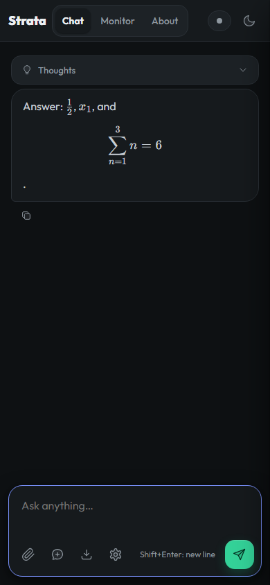
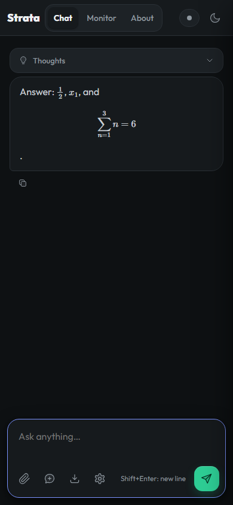

# LaTeX math in Context COW chat

Open **Chat → Sampling**, enable **Render math**, choose **KaTeX** or **MathJax**
in **Math viewer**. These two controls update existing answers immediately;
no **Apply** is needed. The browser remembers both choices. Other sampling
settings still use Apply.
Rendering starts off; KaTeX is the initial viewer selection. Both viewers and
their fonts are bundled locally, so normal use needs no CDN, npm or TeX install.

Inline math accepts `\(x_1\)` and `$x_1$`. Display math accepts `\[...\]` and
`$$...$$`, including multiline expressions. Use backslash delimiters for
ambiguous dollar text: currency such as `$5 and $10`, escaped dollars and code
blocks remain literal. Only assistant answer text is typeset.

For example:

```text
The next logits are \(\ell_t\).

\[
\ell(P\Vert A)=\operatorname{Fresh}(P\Vert A)
\]
```

Copy, Markdown export, browser history and subsequent model requests preserve
the original source. Viewer selection is a display preference and is excluded
from shared model sampling defaults. Switching viewers during an answer keeps
the streaming message element alive. An older conversion cannot replace a
newer message or inject a result after the viewer changes.

Malformed, incomplete, unsupported or unavailable equations stay as readable
source. The shared parser protects math before Markdown processing, serializes
conversions, limits source to 16 KiB of UTF-8 and caches up to 256 source/display
pairs. Changing the viewer invalidates that cache. Initialization has a ten-second
deadline and asynchronous conversion a fifteen-second deadline; an engine that
ignores cancellation must finish before the next conversion starts. Browser
timers cannot interrupt synchronous JavaScript, so both engines retain bounded
macro expansion and equation-local macro state.

## Included implementations and provenance

| Component | Pinned implementation | Bundled bytes, including license/provenance |
|---|---|---:|
| Shared core | [Strata PR #1829](https://github.com/Niko1221/Strata/pull/1829), patch `56063f31` | Shared scripts/fixtures, separate from engine assets |
| KaTeX | [Strata PR #1830](https://github.com/Niko1221/Strata/pull/1830), KaTeX 0.19.0 | 558,806 |
| MathJax + fonts | [Strata PR #1832](https://github.com/Niko1221/Strata/pull/1832), MathJax/New Computer Modern 4.1.3 | 3,204,457 |

Total engine assets are 3,763,263 bytes (decimal units). The selected viewer
loads lazily. The measured fixture transferred 345,581 vendor bytes with KaTeX
and 1,138,821 with MathJax; these are corpus-specific transfers, not every
possible font/extension combination.

<p>
</p>

The screenshots show the same equation source in Chromium with each viewer.

The original PRs supplied alternative replacement adapters. This integration
registers both and adds the selector, cache invalidation and an epoch check for
late hydration. KaTeX emits HTML plus semantic MathML. MathJax emits CommonHTML
plus assistive MathML, with local dynamic font data; require/autoload and its
speech/explorer workers remain disabled. Original package licenses and archive
SHA-512 provenance are retained under `serve/web/vendor`.

These are browser math viewers for supported TeX fragments. The isolated full
TeX compiler from PR #1833 is outside this release. The inherited Strata chat
frontend gains rendering; native Context COW inference and branching-store
sources are unchanged from the v0.1.1 candidate.

## Executed validation

Both viewers passed the shared acceptance suite in Chromium, Firefox and
Playwright WebKit: six complete suites, 60 equation-fixture observations.
Fractions, integrals, sums, matrices, cases, alignment and the Unicode fixture
rendered; invalid syntax, an unknown command and recursive macros were rejected.
The suite also checks parser streaming boundaries, currency/code handling,
macro isolation, limits/deadlines, stale results, semantic markup, source copying,
export, persistence, API source, themes and narrow layouts.

Three dual-viewer suites passed 25 named check observations each, including
KaTeX → MathJax → KaTeX, switching with work in flight, serialization across
switches, persisted choice, unknown-choice fallback and source preservation.
All 50 server/security/chunked-body/frontend regression methods passed, with
zero skips. These are actual browser tests using a mock model service; they make
no new GPU or G1–G5 certification claim. WebKit is not a physical Safari/iPhone
test, and semantic markup checks are not a manual screen-reader audit.

The expected initial failure (no selector) is retained. An early integration
fixture also tried to read an in-progress assistant from `apiMessages()`;
the existing API deliberately excludes that pending turn. The fixture now
checks source while streaming and API source after completion, preserving that
boundary. Both failed attempts remain in the results.

[Summary and executed IDs](context-cow/results/web-math-20261013/SUMMARY.json)
and [source/asset/dependency fingerprints](context-cow/results/web-math-20261013/integration-profile.json)
are included. Timing observations were collected during concurrent browser runs;
they are diagnostics rather than a renderer performance benchmark.

## Reproduce

Use the existing Strata chat launch instructions in [STRATA.md](../STRATA.md)
or [AI_SETUP.md](AI_SETUP.md). No model changes are needed for rendering.
For model-free browser validation:

```text
python -m venv .venv
```

Activate the virtual environment (Windows: `.venv\Scripts\Activate.ps1`;
Linux: `. .venv/bin/activate`) before running:

```text
python -m pip install playwright==1.63.0 jinja2==3.1.6
python -m playwright install chromium firefox webkit
python tools/test_web_math.py --browser chromium --engine katex --output results/katex-chromium
python tools/test_web_math.py --browser chromium --engine mathjax --output results/mathjax-chromium
python tools/test_web_math_engines.py --browser chromium --output results/dual-chromium
python -m unittest serve.test_security serve.test_chunked_body serve.test_frontend -v
```

Use `python` on Windows. Repeat the browser
commands with `firefox` and `webkit` for the full matrix. The tests start a
temporary loopback service, block external requests and shut it down afterward.
`tools/vendor_math.py katex` and `tools/vendor_math.py mathjax` reproduce the
pinned assets from npm with registry SHA-512 verification; end users do not run
those packaging commands.
