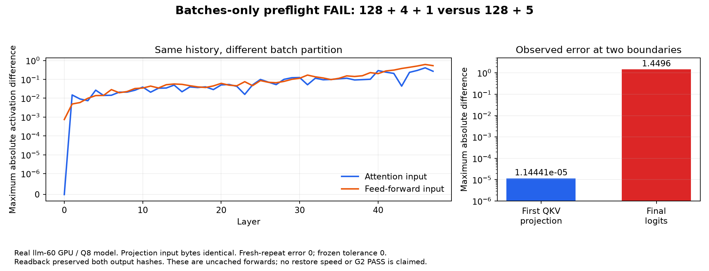

# Batches-only durable resume: accepted schedule restriction

The matching-schedule prototype is governed by PROFILE_BOUND_RESUME.md.
Cross-partition arithmetic disagreement below is a retained limitation, not a
blocker for that restricted contract. The reference/checkpoint receipt changes
are implemented privately in `bc2de8f5`; the campaign now passed through 8K
under the deterministic greedy, identical-batch contract. Read current STATUS.md
and results/matching-resume-20261014/FINAL.md for measured results and limits.
The older proposed projection investigation below is historical.

The restart mechanism previously reproduced its uninterrupted continuation,
including zero saved-prefix forward work. That result remains bounded evidence
for its measured execution profile. It does not establish fresh-history
equivalence for the new batches-only profile.

The user selected native batched Prefill for prefix, changed suffix and consumed
generated tokens. Normal verifier decode is excluded from this milestone. It is
a separate research track, with further investigation/fixes not started. Earlier
exploratory normal-decode measurements are retained in DURABLE_RESUME.md.
Autoregressive selection still needs each selected output to be consumed before
selecting another. A one-row call to native Prefill is not the debug step operator.

## What actually ran

On llm-60, three independently fresh CUDA processes tested the same 133 token
IDs: the 128-token prefix, four forced suffix IDs and selected token 198.

| Execution | Native Prefill batches | Result |
|---|---|---|
| Continue after the prepared suffix | 128, 4, 1 | Next top token 320 |
| Fresh complete history | 128, 5 | Next top token 309 |
| Repeat fresh complete history | 128, 5 | Exactly the same full logits as the prior fresh run |

Fresh-repeat max error was zero; the independently derived tolerance remains
atol=0, rtol=0. Continuation versus full history failed at max logit error
**1.4495954513549805**. The preflight took 217.33 seconds, dominated by roughly
72-second fresh-process startup. Native first-output consumption through Prefill
took 0.02245 seconds in the first observation. This is not COW serving throughput.
The restart campaign, 1K and 8K cases did not start after the failure.

No checkpoints or branching store were imported in this preflight. It therefore
reproduces the discrepancy without disk restore or COW ownership transitions.

## The first unequal operation

Three subsequent pairs of diagnostic CUDA processes traced the same two layouts:
48 layers, two mixed activation boundaries per layer, then eight GDN operation
boundaries in layer 0. Every diagnostic preserved both original logit hashes.

The first layer's attention mixed input was exact. Its actual FP16 and BF16
projection input images were also bit-identical: 10,240 bytes per trace, SHA-256
`5373e0d2da128b2be72aefa538f756294902db629afbcd3f98b5c6152a04e177`.
The first unequal measured result was the QKV projection, max error
`1.1444091796875e-05`. The first layer's FFN mixed input differed by
`0.0007425844669342041`. Later activations and final logits differ more.

The inspected native call chain is `native_proj` -> `Gemm::native` ->
`Gemm::f16` -> `cublasGemmEx`, with FP16 input/dequantized weights and FP32
output. The two calls have different token-row counts. The measurements prove
this projection path is not batch-partition invariant here. We have not captured
the particular cuBLAS kernels or established every subsequent source of error.
There is no evidence of omitted expert work from this test: the first measured
difference precedes the first expert layer.



## Status, evidence and fingerprints

- G0: 51 PASS. Linux supplemental controller/reporter/work tests: 14 PASS.
- Windows diagnostic trace-reader tests: 2 PASS. Windows store tests cannot run
  because the store requires POSIX fcntl; this remains a separate known limit.
- Real artifact audit: BP-001 and BP-002 PASS; BP-003 batch partition invariance
  FAIL. Three methods executed, zero errors/skips. The failing test compares all
  248,320 logits with the frozen zero tolerance.
- Batches-only resume milestone: **BLOCKED**. No current-profile restart or G2
  PASS. The registered 85-case acceptance matrix has not been qualified by this
  campaign; earlier cumulative G2 stopped at missing G1-profile setup.
- No nonzero RNG/grammar/pending decoder, real crash matrix, eviction target,
  power-loss test, larger fixture or peak RAM/VRAM qualification in this run.

Hardware: RTX PRO 6000 Blackwell, GPU UUID
`GPU-2d2b1358-9abf-ef75-fc3b-892135ea6e58`, driver 595.91.07,
97,887 MiB reported VRAM. Qwen3.8-Flash-Next Q8_0, FP16 KV, capacity 12,288,
native prefill chunk 128 and resident expert budget 40 GiB. The full GPU was
available to the isolated job. Peak process memory was not instrumented.

Model content identity:
`846b74d30a22552ad8cc2fabe5b17103049fe68ffdacf56daa457db8ecaa356f`.
Execution profile:
`0135e6dcd0125825520ae3500c1588baa8deb7d24a40d0b6bb3e9235e14639ae`.
All model shards/pack fingerprints are reused from the earlier full hash receipt;
this run did not rehash 189 GB. Raw evidence includes model/build receipts and
per-executable SHA-256 hashes, finite full frontiers, token fixtures, generated
diagnostic source and actual copy/readback witnesses. Native executables, model
weights, checkpoint payloads and private server credentials are excluded.

Raw data: `results/batched-resume-20261014/raw-batch-diagnostics.zip` and
`inventory.json`; machine-readable reports sit beside the archive. Diagnostic
coordinator PASS means the diagnostic command exited successfully, not numerical
equivalence. The numerical comparison is explicitly FAIL.

The chat server was restored with its original configuration and authenticated
HTTP 200, Python PID 1441826, native PID 1441828. No GPU diagnostic was left running.
All work stays on `box-git:/srv/data/git/private_context_cow.git`.

## The next test-first ticket

Reproduce batch-size 1 versus 5 dense projection on these identical saved input
images and the pinned QKV weight, independently of GDN/COW. Require the same
per-row arithmetic result while retaining batched execution. Measure the selected
implementation's latency and work; do not silently replace batched prefill with
the debug token-step operator. Then rerun this fresh-history preflight with a new
pinned build and independent baseline. Only after it passes, run the tiny durable
restart campaign, advanced controller/crash cases, 1K and 8K/512/up-to-128.
Do not change tolerance to absorb this projection discrepancy.

Reproduce on the retained host, with the chat server stopped and one GPU job:

```sh
cd /home/dflanag3/branching-g3/batched-resume-20261014/experimental/branching_context
python3 scripts/batched_continuation_preflight.py --profile ../../profile.json --output ../../preflight-new
CTT_BATCH_RUN=/home/dflanag3/branching-g3/batched-resume-20261014 PYTHONPATH=src python3 -m unittest discover -s tests/real_resume -p test_batched_preflight.py -v
```

The second command currently fails BP-003 as documented. Use `python` on Windows;
these GPU/store commands are for the verified Linux host.
