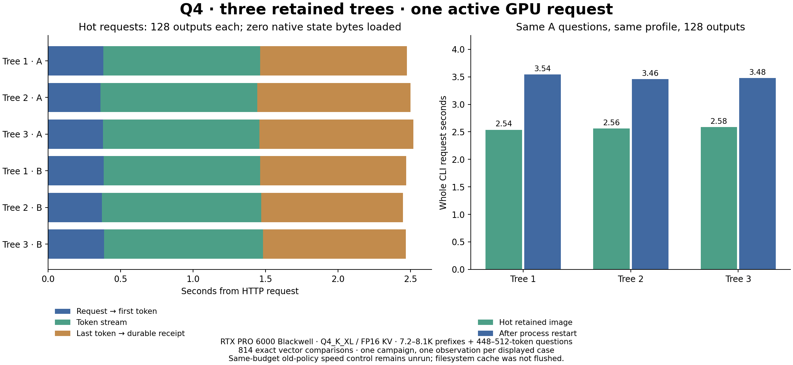

# Bounded hot-tree retention candidate

2026-10-16 follow-up: the same-budget control and repeated pair are now executed.
See [all timings and attribution](TREE_RETENTION_SAME_BUDGET_20261016.md).
Retention removes native loads, but the quiet pair shows only0.44% lower total
time and4.27% worse median latency; no general end-to-end speedup is claimed.
The historical single-campaign results below retain their original scope.

Status: **FOCUSED GPU PASS; not integrated**. Work is isolated on
`work/bounded-tree-retention-20261016`; the preceding qualified main branch
remains at `7c97c1d70889a5830eec9b6eb9f29055499863f4`.

The completed Q4 CLI benchmark repeatedly loaded 306,935,540–329,290,836 native
file bytes when switching source trees; consecutive use of the same hot root
loaded zero. These native load counters include staging from RAM and must not
be described as disk reads. The coordinator clears images at a root switch and
prunes to the current source/tip even when its bounded cache has spare room.

The candidate lets the existing `CheckpointCache` enforce its byte/entry LRU
limits across different trees. Unbounded adapters retain the preceding narrow
policy. No new flag, history representation, checkpoint format or hash shortcut
is added. Temporary serialized aliases still leave the cache before shared-pool
unpin; publication still receives immutable serialized bytes, not native handles.
Native images are process-local and are not transferred to the writer thread.

## Executed CPU evidence

Three new deterministic tests exercise synthetic native image metadata:

- Keep three hot roots through alternating-tree requests within a six-entry
  budget, without falling through to shared-pool loading.
- Evict under a two-entry budget and route the evicted source through the pinned
  shared pool; no serialized alias survives unpin and canonical histories stay.
- Reject an oversized image without discarding the existing cache contents.

The retention test fails against the old coordinator and passes against the
candidate. The final test fixture was rerun red after correcting its eviction
counter baseline to exclude earlier root creation. No existing tests changed.

The expanded suite ran **101 tests: 100 passed, one failed, zero skips/xfails**.
The failing old test is
`test_pool_branch_actions.CoordinatorBranchActionTests.test_checkpoint_corruption_fails_before_fork_or_rewind_publication`.
Its corrupt-payload checks pass; its later missing-manifest assertion expects
fork to reject instead of creating a canonical reference. The identical failure
reproduces on the unchanged coordinator: **six of seven branch-action tests
pass, one fails**. Newer canonical-eviction tests explicitly require missing
optional numerical checkpoints to permit metadata-only fork/retry followed by
reported reconstruction. This expectation conflict remains open; do not change
the production semantics or weaken tests to manufacture a green aggregate.

The focused retention/canonical-eviction suite passed **17/17**, no skips/xfails.
G0 subsequently passed **51/51 with command/wrapper 0/0** and a complete JSON
report. Frozen source uses an external writable `evidence/runs` target; the
preceding attempt's 51 assertions passed but evidence publication failed, so
that earlier command remains failed.

Raw attempts:
`/home/dflanag3/spatial-artifacts/q4-tree-retention-20261016-v1`.
Selected receipts: `red-command-v3` (expected failure), `green-command-v4`
(101-test failure), `baseline-branch-command-v1` (same baseline failure),
`focus-command-v6` (17-pass), `g0-command-v7` (51-pass).

Retained setup failures: extraction before a source transfer completed;
incomplete test import paths/dependency closure; subprocess PYTHONPATH omission;
and verifier output directed into readonly source. Corrected source transfer
checks exact size/hash before extraction. No GPU job ran during these attempts.

## Required GPU follow-up

Derive a new profile binding the actual candidate source and existing native
binaries; create fresh checkpoints in a fresh store. Do not retag the previous
profile's checkpoints. Qualify a cache with enough entries for three roots and
their working tips, within the existing byte budget. Compare identical native
operators and fixtures with independently initialized uncached references.

Measure loaded bytes, captures, restores, transferred/copied/hashed bytes,
end-to-end client latency and actual memory use. An old-policy control with
the same cache budget separates retention policy from a larger entry limit.
Check parent integrity, greedy controllers, FIFO publication and zero saved
prefix work. Run a bounded pressure/eviction fixture before integration.

The preceding CPU checkpoint left GPU execution unrun. The bounded campaign
below now qualifies its specified continuation/restart scope. Sustained pressure
and a same-budget old-policy speed control remain unrun. Q8 remains deferred,
chat stays off, no public push or original cumulative G1–G5 qualification.

## Executed Q4 candidate

The new profile binds the one coordinator overlay from commit
`eff02e29af5556305a8acca75d41e01d3ca276c9`. It keeps the same native binaries,
Q4 model, FP16 KV, 98,304-token capacity, 8,192-token Prefill chunk, greedy
native request protocol, 96 GiB RAM pool and 128 GiB disk pool. Its resident
image budget remains 8 GiB; entry limit increases from three to eight to hold
three roots plus working tips. The fixture text/token IDs are reused as input
data; all numerical checkpoints were produced in a fresh store under the new
profile. No previous checkpoint was retagged or imported.

The small CLI run produced eight tokens and passed 12 full-vector checks
against two new independently initialized uncached oracle processes. The larger
CLI campaign completed 16 requests, each with 128 actual outputs, plus logical
retry retaining its earlier future and three disk restores after a clean
HTTP/native restart. Its audit used twelve further independently initialized
uncached oracle processes and passed 802 full-vector checks. Combined:
**17 generations, 2,056 outputs, 814 comparisons, maximum error zero**.

All tokens, complete greedy controllers and canonical histories matched their
references. Source prefix bytes stayed unchanged. Actual forward counters
counted suffix/output work only. Numerical candidate checks cover saved-prefix
and final consumed frontiers; fresh repeats compare every dumped frontier.
This is not every-intermediate-candidate-frontier certification. All twenty
owned HTTP/native/oracle PIDs exited successfully and were confirmed absent.

| Hot measured request | Whole CLI time | Native state file bytes loaded |
|---|---:|---:|
| Tree 1, A | 2.538 s | 0 |
| Tree 2, A | 2.563 s | 0 |
| Tree 3, A | 2.584 s | 0 |
| Tree 1, B | 2.534 s | 0 |
| Tree 2, B | 2.511 s | 0 |
| Tree 3, B | 2.532 s | 0 |

These six requests produced 768 outputs in a summed 15.261-second CLI interval:
**50.32 aggregate output TPS**, median request 2.536 seconds. Token-stream
throughput was 115.61–117.83 TPS; first-token waits were 0.362–0.387 seconds.
Whole CLI time includes process startup, observer recording, snapshot capture
and durable publication; service/model startup and subsequent numerical audits
are separate. One campaign and one hot observation per displayed case; these
are not repeated statistical estimates or a clean native-only benchmark.

Native counters and pool source events identify resident image reuse, rather
than hidden RAM-file staging, on the hot path. After process restart, the same
three A requests loaded 306,935,540 / 323,022,988 / 329,290,836 native bytes and
took 3.542 / 3.460 / 3.480 seconds. The filesystem page cache was not flushed.
Native file bytes can also be staged from the RAM pool; they must not all be
described as physical disk reads. No physical peak-memory claim follows from
these counters or occasional GPU observations.

The existing byte-integrity policy remains enabled. Full-request counters,
including copied/hashed bytes and native stage nanoseconds, are in
`BOUNDED-TREE-RETENTION-Q4-PRIMARY-2026-10-16.json`. The chart separates first-token
wait, token stream and last-token-to-durable time; the latter still takes about
one second and is a useful next attribution target.

Both code retention and entry capacity differ from the earlier three-entry
profile. **Do not attribute a percentage speedup to the patch** until the
old-policy control runs with the same eight-entry/eight-GiB budget. The current
result proves the hot reloads disappeared in the tested workload and records
the resulting latency. Bounded retained-image pressure, corruption/failure
interleaving and a current-profile OOM campaign remain necessary before
integration. The 101-test baseline expectation conflict remains recorded FAIL;
the GPU result does not turn that aggregate green.

Profile SHA-256:
`107cab965436707d13db92271aa629e7829950030dbe60b884308076f8e31253`.
Execution ID:
`cdbcda67787b591695d29481ca26fa844d442358fce5574caf5e972ed35374e8`.
Native SHA-256:
`4bd5d715d460371458be8cadad28d881977dbeea57219039187d05aa12148451`.
Independent oracle SHA-256:
`f946253dfd05f58d93585d9436dae5076e306aa5feef3eca1f4b4a1b3766b129`.
Model weights aggregate:
`32759e8867f3e52a7fa559761d003950dd4449e7e970a6de1550bc11c02b8827`.

All successful GPU, reference, focused CPU, corrected G0, profile preparation,
summary, chart, transfer and readback command/wrapper receipts are 0/0.
Historical failed attempts retain their nonzero receipts. Exact scripts live
under `experimental/branching_context/evidence/reproducers/bounded-tree-retention-20261016`;
they preserve original artifact paths. The final CPU driver is installed as
`run-cpu-v4.py` remotely; older versioned drivers and staged sources remain in
the raw archive. Do not overwrite frozen runs when reproducing.

Private compact archive:
`box-git:/srv/data/git/private_context_cow.evidence/20261016-q4-bounded-tree-retention-v1/evidence.tar`.
Size 113,920,000 bytes; SHA-256
`b944c6f5fb671c9268ee3d38bc0cad7ff26d3608e84c8ce81b51536239fad803`.
Independent streaming readback verified 2,251 regular members / 111,076,617
data bytes without extraction. It preserves candidate runtime/profile, canonical
history, fixtures, failures, traces and selected exact full-vocabulary reference
boundaries. Model and native numerical `.state` files are excluded; originals
remain on llm-60. Full per-token reference arrays also remain there, with their
hashes and selected boundaries in the compact backup.
