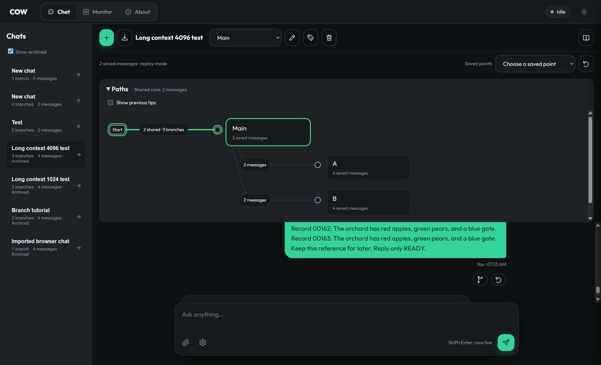
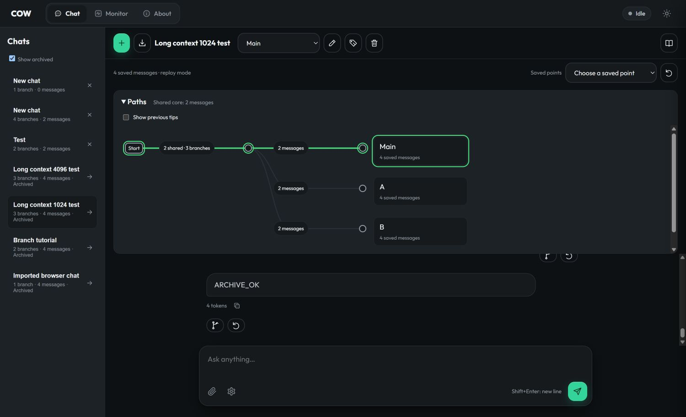
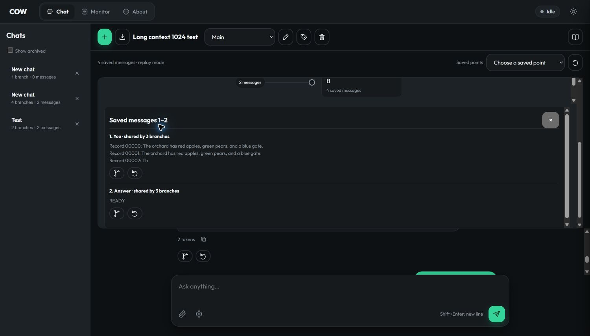

# COW history viewer: implementation and executed checks

The viewer shows canonical saved-message ancestry, branch endings and shared
prefixes. It uses the existing SQLite tables. No database migration or second
history representation was introduced.

For instructions, read [the chat and branch guide](CHAT_WORKSPACE_GUIDE.md).

The current viewer is vertical and responsive. Its updated screenshots,
motion checks and same-tip fork regression are documented in
[Dynamic chat branches and saved points](DYNAMIC_BRANCH_VIEWER.md).
The results below record the initial implementation.

## What the graph means

A chat row reports branch count and the longest current path in saved messages.
One question plus one answer is two messages. Branch revisions count moves and
are not message counts. Rewound-away messages are excluded from current progress.

The shared-core summary is the common ancestor depth of all current tips. A
single branch reads **No fork yet**. Branches sharing only the empty root read
**No shared messages**. Segment labels also show prefixes shared by smaller
groups. Identity comes from canonical history nodes, not matching message text.

The graph displays each shared section once and collapses uninterrupted runs.
Current tips have separate name badges, including tips at the same node. Previous
terminal paths can be shown as faded paths. The previous-tip view includes
abandoned terminal histories from all branch moves; it is not limited to the
30 recent moves in the older Saved points dropdown.

Draft text and attachment data survive branch switches in the same tab. Drafts
are held in browser memory, so they do not survive page reload or tab closure.
The collapse preference is stored in the browser. Selection epochs discard
outdated network responses. A rejected revision-checked edit refreshes history
and reports the conflict without retrying the mutation.

## Read interfaces

- `GET /workspace/chats`: adds `branch_count`, `max_saved_messages`, and
  `shared_prefix_messages` to the existing chat metadata.
- `GET /workspace/graph?chat=<id>`: returns `chat_id`, `root_id`, `branches`,
  `nodes`, `shared_prefix_messages`, and `previous_tips`.
- Add `&previous=true` to include abandoned paths and previous terminal tips.
- Each branch includes its ID, name, tip, revision, saved-message count and
  pending-request ID. Each node includes its ID, parent ID, depth, role,
  a preview of at most 160 characters, and its current branch count.
- Both interfaces require the server's existing authentication. A missing chat
  returns 404. Attachment and tool bodies are not included in graph responses.

Each read uses one explicit SQLite read transaction. A recursive union query
deduplicates reachable ancestor IDs. Iterative tree walks compute depth and
current sharing counts without recursion in Python or JavaScript. Previews use
SQL `substr`; complete message and attachment objects are not materialized.
Turning on previous tips additionally reads branch-move history.

The SVG and HTML layout is derived in the browser. Branches use creation-time/ID
order. A pending request shows **answering**; only its durably stored input is
counted until an answer is published. Streamed assistant text never becomes a
graph node on its own. The viewer refreshes during generation and after actions.

## Executed validation on 2026-10-13

Evidence is in [branch-viewer-20261013](results/branch-viewer-20261013/).

| Check | Executed result |
|---|---|
| Broad server regression run | 398 methods PASS; zero failures, errors or skips |
| Graph browser checks | 38 per browser: Chromium, Firefox and WebKit; 114 PASS |
| Existing workspace browser checks | 24 per browser; 72 PASS |
| Read-only live 1K and 4K histories | Counts matched direct SQLite ancestor queries |
| Large canonical store fixture | 10,000 messages, 32 branches, 10,001 returned nodes including root |
| Large graph + sidebar reads | Six SELECT/CTE statements total |
| Large isolated layout fixture | 33 points, 32 segments, previews paged ten at a time |

The broad run includes exact counts, nested subgroup sharing, identical tips,
same text on different ancestry, empty/root forks, rewind/clear/restore,
authentication, chat boundaries, pending publication, a concurrent writer during
a read snapshot, bounded previews with 1 MiB text and a 1 MiB attachment, and
database contents unchanged by reads.

Browser checks cover keyboard selection, delayed point tooltips, draft text and
attachments, previous-tip recovery, stale edits, delayed responses, graph read
failure/recovery, pending/completed answers, label collisions, visible previews,
collapse preferences and mobile overflow. Screenshots exposed two layout issues:
the graph initially scrolled away with messages, and a branch badge hid a segment
label. The graph now stays above the scrolling messages; labels use their target
lane. Initial failed evidence is retained. Tests also corrected readiness helpers
to wait for the rendered selected tip and use DOM readiness on reload.

The large store measurements in the broad run were approximately **0.564 s** for
the graph read and **0.209 s** for sidebar summaries. Isolated layout construction
took **33.6 ms** in Chromium, **75 ms** in Firefox and **51 ms** in WebKit. These
are single observations on the Windows test PC, not inference or whole-app
latency benchmarks. The layout fixture is synthetic; the store fixture uses
real SQLite and canonical nodes.

## Live deployment and limits

The app runs on llm-60 at loopback port 8097, viewed from this PC through port
18097. The deployment source is
`/home/dflanag3/branching-g3/web-review-20261013`; server PID **1300778** and log
`server-branch-viewer.log`. The native Q8 executable and server configuration were
preserved. Six prompt checkpoints and the 8 GiB conversation cache with eight
slots remain enabled. No new model generations were issued by the live smoke.







The viewer shows shared saved history. It does not report resident GPU pages,
physical memory ownership, saved prefill bytes or numerical equivalence. Native
GPU COW handles are not connected to these web branch controls. The earlier
cold-versus-cached output disagreement remains open; this work does not qualify
G1 or any other numerical gate.

## Reproduce the checks

From the repository root on Windows:

```powershell
.venv/Scripts/python tools/run_web_regressions.py --output branch-viewer-python.json serve.test_chat_workspace serve.test_workspace_graph serve.test_mcp serve.test_reasoning_tools serve.test_sample_app serve.test_security serve.test_server serve.test_tool_name_space serve.test_workspace_http
.venv/Scripts/python tools/test_branch_viewer_browser.py --browser chromium --output branch-viewer-chromium
.venv/Scripts/python tools/test_branch_viewer_browser.py --browser firefox --output branch-viewer-firefox
.venv/Scripts/python tools/test_branch_viewer_browser.py --browser webkit --output branch-viewer-webkit
```

The browser runners require the Playwright test dependencies and installed test
browsers. They use temporary databases and mock inference; no GPU or model is
needed. The app's ordinary users do not need these test tools.
