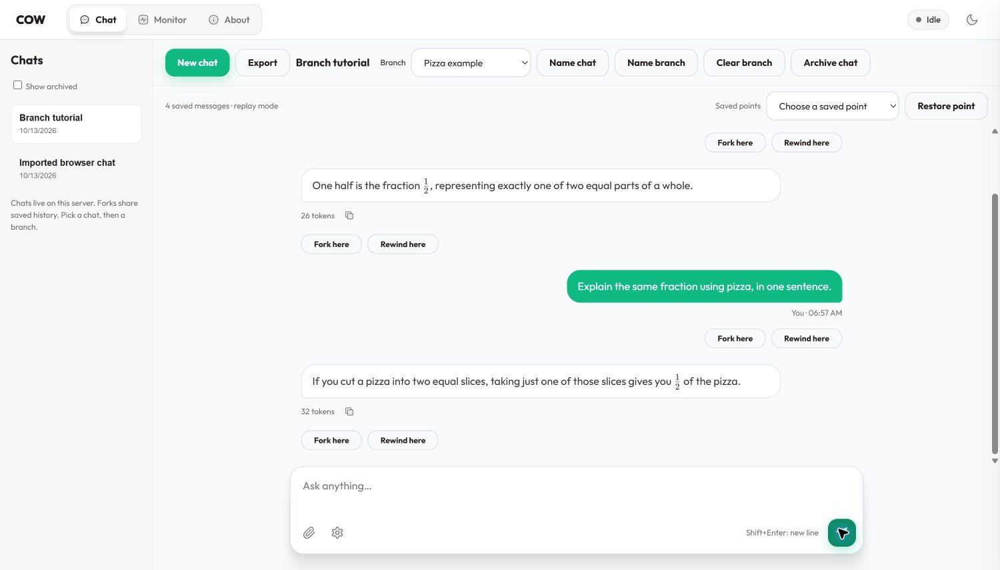
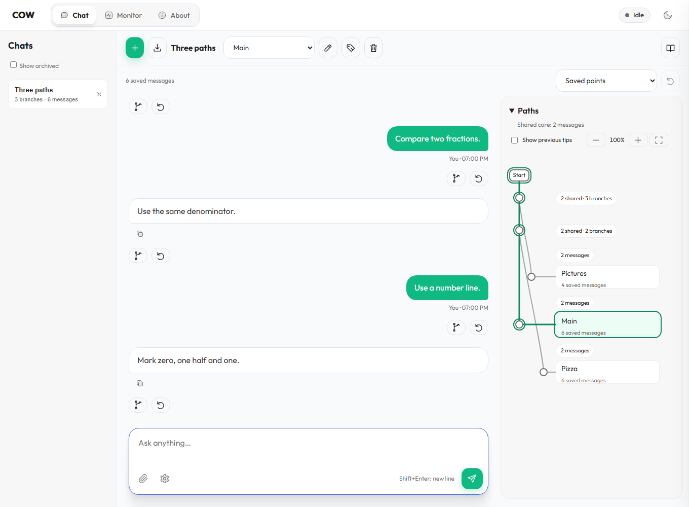
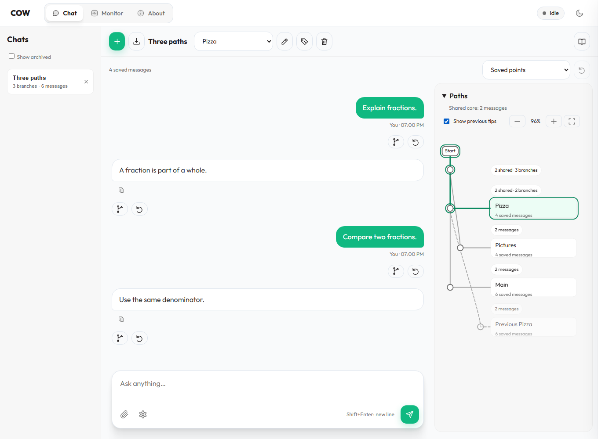
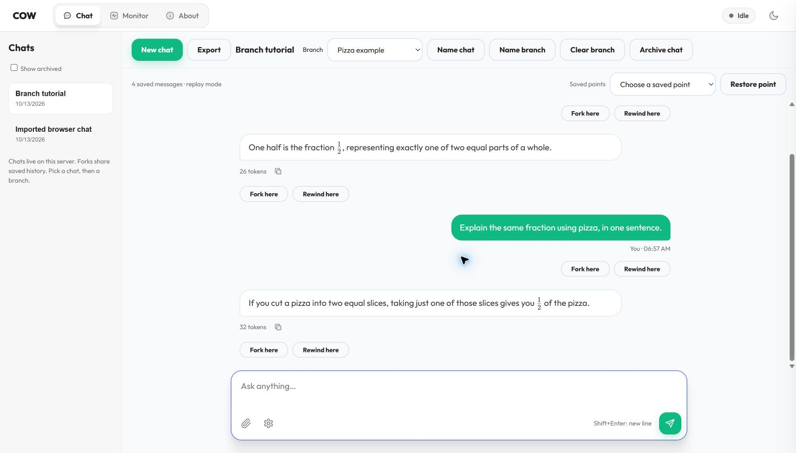

# Use chats and branches in COW

This guide's steps and screenshots describe the SQLite-backed replay interface.
For the separately qualified native GPU COW browser service, use the
[native Context COW service guide](NATIVE_SERVICE.md); its histories are backed
by the COW snapshot store, not the ordinary chat database.

First, follow [Start here](START_HERE.md) to install and open the app.
The sample app has the same controls. It gives a fixed answer, not an AI answer.

The pictures in the steps below use **teaching mode**, which shows words beside
the icons. To turn it on, click the small **open book** above the chat. Hold the
pointer over any icon for about one second to see its name. Click the book again
to use the compact view. The buttons do the same things in both views.

## Three words to know

- A **chat** is a named conversation in the list on the left.
- A **branch** is one path through a chat. Each new chat starts with **Main**.
- **Fork** means start another path from a message. Both paths keep the earlier messages.

## Start a chat

1. Click **New chat** above the messages.
2. Type a name, such as `Math homework`.
3. Click **Create chat**.
4. Type a question in the box at the bottom.
5. Click **Send**. Wait for the answer to finish.

The chat stays in the list. Click its name to open it again.
Completed messages are saved on the server. You do not need to click a Save button.
**Export** downloads a Markdown text copy of the selected branch.

## Try two different paths

1. Find the last answer you want both paths to share.
2. Click **Fork here** below that message.
3. The app opens a new branch immediately, named `Alternative 1` (or the next number).
4. To give it your own name, click the **name tag** beside the branch list. Type `Pizza example` and save.
5. Ask a different question. For example: `Explain this with a pizza.`
6. Use the **Branch** list above the messages. Select **Main**.

Main still has its original messages. The pizza question belongs to the new branch.
Select `Pizza example` to return to that path.
You can fork from a user message or an answer. Wait for an answer to finish first.

## See where the paths split

The **Paths** box stays beside the messages on a wide screen. On a smaller
screen, it moves above them. The tree reads from top to bottom in both places.
Click its heading to hide or show it. The app remembers that choice.

This example uses saved test messages about fractions:

- All three paths share the first **two messages**.
- **Main** and **Pizza** share another **two messages**. **Pictures** takes a different path earlier.
- Main and Pizza each have **six saved messages**. Pictures has **four**.
- The green outline marks the path you have open.

One question and one answer count as **two messages**. These numbers do not count
model tokens. The line lengths do not show elapsed time.

1. Click a branch name in the graph to open that path.
2. Click a dot or a message-count label to see a short preview.
3. Use the splitting arrow in the preview to fork there. Use the curled arrow to retry from there.
4. Close the preview with its **×** button.

Two branch names at the same dot mean that both paths currently end at the same
saved message. When you add an ending to one path, the map moves the cards and
lines to show the new split. The selected path has a green outline.

Use **+** or **−** to change the map size. The **four corners** button fits the
map in its box. If the map is larger than the box, scroll it. On a computer, you
can also drag its empty background. These actions do not change the chat.

Looking at a preview does not change the chat. Fork and retry act when you click
their arrow buttons. Long sections show ten previews at a time. Use **Next** or
**Previous** to see more.

Text and attachments you have not sent stay with their branch when you switch
paths in this browser tab. These drafts are held in memory. Send them before you
reload or close the tab if you want them saved on the server.

Check **Show previous tips** after a retry or clear. A faded path shows a saved
ending that is no longer current. Click its badge to preview it; use the curled
arrow in that preview to return the selected branch to that saved point.

If you see **Refresh paths**, click it before editing the branch. Another tab
may have changed the saved history, or the network may have failed. Your draft
stays in the message box. A failed stale edit does not move the branch.

## Go back, clear, or hide

- **Retry here** returns the selected branch to that saved point. It acts immediately. Send a message or continue afterward to generate a new answer. Earlier versions called this **Rewind here**; the API and CLI still use `rewind`.
- **Clear branch** immediately empties only the selected branch. It does not erase its saved history.
- To undo a clear or retry, choose the old point in **Saved points**, then click the curled **Restore point** arrow. No confirmation is needed.
- The **×** beside a chat hides it from the normal list. Check **Show archived**
  to find it again. Click its return arrow to put it back in the normal list.
- **Name chat** and **Name branch** change labels. They do not change messages.

These actions do not undo things a tool did outside the chat, such as writing a file.
Choose a saved point before you click its restore arrow. The arrow is disabled
until there is a point to restore. You can also click **Start** in the map to
fork an empty path or retry from the start.

## Show an equation

1. Ask `Show one half as a LaTeX fraction.`
2. Open **Sampling and thinking** beside the message box.
3. Turn on **Render math**.
4. Choose **KaTeX** or **MathJax** in **Math viewer**.

The equation display changes immediately. It does not ask the model again.
Turn Render math off to see the original text.

## Where the chat lives

**SQLite** is a small database stored in a file. It comes with Python; you do not
need to install a database server. The sample uses
`context-cow-data/sample.chats.sqlite3`. A configured model server uses a
`.chats.sqlite3` file beside its configuration unless `chat_database` selects another path.
Keep this file private: it contains messages, attachments and tool results.
Stop the server before copying the database and its companion files for a backup.

This interface currently says **replay mode**. It sends the selected saved
history to ordinary serving. The experimental GPU COW checkpoint runners are
separate; these buttons do not yet select native GPU snapshots.

Ordinary serving can still reuse its prompt and conversation checkpoints when
those caches are enabled. Archive keeps messages, files and tool results in
SQLite. New requests on an archived chat do not save conversation checkpoints.
Previously parked checkpoints leave the native cache through its normal eviction
policy; archive cannot immediately remove one chat's old native cache entries.

Screenshots and executed checks are in
[the interface results](results/chat-workspace-20261013/).

## The compact interface

These are the same controls you learned above, with the words hidden:

| Old label | What to look for |
|---|---|
| New chat | Plus sign |
| Export | Down arrow into a tray |
| Name chat | Pencil beside the chat title |
| Name branch | Name tag beside the branch list |
| Fork here | Arrow that splits into two paths below a message |
| Retry here / Restore point | Curled arrow |
| Clear branch | Bin (saved history stays available) |
| Archive chat | × beside the chat in the list |
| Show control labels | Open book |

Hold the pointer over an icon to check its name. The browser's keyboard and
screen-reader labels are also available when the visible words are hidden.

