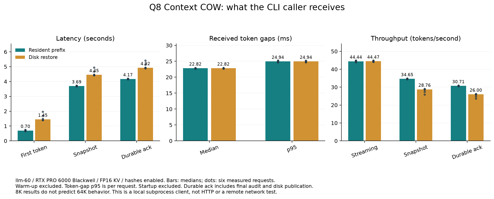

# Measure what the CLI caller receives

The private `client_stream_speed.py` runner measures the complete branching API
with a separate same-host caller process. It does not measure HTTP delivery or
remote network latency. Use a completed exact `resident_resume.py` campaign and
its pinned profile; never use an incomplete campaign as a qualified reference.

Example on llm-60, while the GPU is reserved for this job:

```sh
python3 experimental/branching_context/scripts/client_stream_speed.py client \
  --case /absolute/path/to/passed/case \
  --profile /absolute/path/to/its/profile.json \
  --output /absolute/path/to/new/measurement \
  --mode resident --warmup --repetitions 3
```

Repeat with `--mode disk` and a different output directory. The resident run
loads the prepared prefix from disk once, then uses its retained native COW image.
The disk run strictly loads it before every request. Neither mode may recompute
the prepared prefix. Engine startup and the initial load are recorded separately.

The runner copies canonical store records into its own directory and hard-links
only the immutable prefix checkpoint payload. It audits the original payload
hash before and after the campaign. New answers and durable branch moves belong
to the measurement store, not the original evidence store.

Each token event represents consumed progress. It is provisional until the
snapshot event, and the snapshot is not a durable acknowledgment. The durable
event follows checkpoint publication and the revision-checked branch move.
The stream contains token IDs; decoded answer files are also saved for review.
Final token/frontier/controller/history checks use the already qualified
independent-reference case, outside the timed generation loop. They do not
establish new every-token oracle coverage.

`client.json` reports:

- **TTFT:** request-start receipt to first token receipt. In disk mode this
  includes strict restore. Model startup is excluded and reported separately.
- **TPOT:** time between received output events, excluding the first-token wait.
  Mean, median, nearest-rank p95, maximum and sample count are recorded. A
  one-token response has no inter-token samples and no invented steady TPS.
- **Steady received TPS:** `(outputs - 1) / (last arrival - first arrival)`.
- **Request latency/TPS:** through logical snapshot receipt, including question
  prefill and final capture/publication.
- **Durable latency/TPS:** through durable receipt, also including the subsequent
  reference validation, answer export and disk publication. The worker separately
  times validation and durable save; do not attribute that whole interval to disk.

`events.jsonl` preserves the arrival timestamps. `worker.json` records native
work-counter deltas, generation/request timings, restore receipts, fingerprints
and measured versus warm-up requests. Keep individual observations; compare
the three measured repetitions without folding warm-up into the result.

Protocol measurement tests are CPU tests. They do not constitute GPU evidence.
Existing matching-native-operator qualification and original G1–G5 statuses are
separate.

## Executed results on llm-60, 2026-10-14

Q4 real-source pilot: 8,192 saved prefix tokens, distinct 527-token continuations,
128 actual outputs per branch. Client TTFT 0.49–0.65 seconds, median token gaps
9.34–9.51 ms, p95 9.49–9.65 ms, complete logical requests 1.84–1.99 seconds.
Durable acknowledgment totals 3.20–3.55 seconds including post-request audit.
One measurement per branch; no repeated-performance claim.

Q8 resident: 8,192 synthetic prefix tokens, 512-token suffixes, 128 actual outputs
each. One warm-up pair excluded; three measured repetitions per branch (six
requests). Medians across the six requests:

| Metric | Measured value |
|---|---:|
| TTFT | 0.696 seconds |
| Median received token gap | 22.82 ms |
| Per-request p95 received token gap | 24.94 ms |
| Steady received speed | 44.44 TPS |
| Logical request latency | 3.694 seconds |
| Logical request speed | 34.65 TPS |
| Durable acknowledgment latency | 4.168 seconds |
| Through durable acknowledgment | 30.71 TPS |

The gap percentile row is the median of six per-request percentiles, not a pooled
p95 across requests. TTFT ranged from 0.657 to 0.737 seconds. Matching tokens,
final full logits, history and controller records passed; actual native counters
showed suffix/output work only and no hidden disk reads during resident requests.
Hashes stayed enabled. Individual raw summaries are in
`results/native-resident-20261014/q8-client-resident.json` and its worker receipt.
These results do not predict 64K performance or HTTP behavior. The separate Q8
64K synthetic test generated 419/60 outputs and measured only 24.05/30.62 generation
TPS. Its target output length was not reached.

Q8 disk-client also passed six measured requests after its own warm-up pair.
Its median TTFT was 1.449 seconds (range 1.401–1.961), median received token gap
22.82 ms and median per-request p95 24.94 ms. Steady received speed was 44.47 TPS,
logical request latency 4.450 seconds (28.76 TPS), and durable acknowledgment
4.923 seconds (26.00 TPS), including validation. Restore added first-token delay
while streaming speed stayed similar. Each request explicitly loaded disk state;
its subsequent native forward count included only the suffix and output tokens.
Filesystem cache warmth was not controlled. These measurements do not establish
cold-storage performance. Source: `q8-client-disk.json` and its worker receipt.



The graph preserves all six observations as dots and uses medians for the bars.
`q8-client-timing-provenance.json` binds it to the measured source files.
The real-code Q8 64K campaign is still running. Two-second external GPU/RSS/CPU
resource sampling began during the client campaign, so it cannot prove the
earlier pilot's peak usage. Each sample records phase and executable to separate
inference from the eventual restored chat server.
