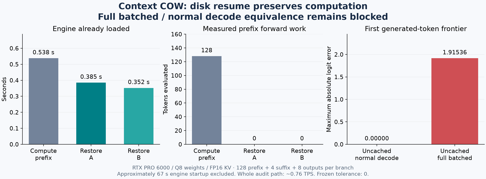

# Durable computation resume — prototype results

**Status: partial implementation; expansion blocked by backend execution equivalence.**

The real CUDA experiment restored an explicitly saved 128-token prefix in a new Python process and a new native process. Both restorations performed **zero prefix forward tokens**. Two different four-token suffixes each consumed exactly four new tokens, and both branches reproduced their uninterrupted eight-token continuations. A second restart from a consumed generated-token checkpoint reproduced the remaining continuation and controller exactly.

The complete milestone did **not** pass. After the first generated token, the restored frontier matches an independently computed normal decode exactly, but differs from completely fresh batched prefill of the same 133-token history by **1.9153637886047363 logits**. The next top token changes from 320 to 309. This discrepancy also exists between the two uncached engine paths, without COW or disk restoration. The first differing layer is not yet identified. Frozen tolerances remain `atol=0`, `rtol=0`.



## What was built

- `BranchingModel.restore_checkpoint(snapshot_id)` requires an exact durable checkpoint. It validates history, input identity, model/execution identities, positions, payload checksum and finite full-vocabulary logits. It reads actual native forward counters through the first frontier read and rejects any recomputation. Failed native imports destroy the backend before another lease can reuse partial state.
- `save_branch(name, expected_revision, snapshot_id, operation_id)` writes the checkpoint before the existing revision-checked branch move. A read lease pins canonical ancestry throughout publication. Retries validate the checkpoint and flush its directory before acknowledging the durable move.
- Publication hooks cover staged payload/manifest writes, publication, directory durability and branch acknowledgment. The existing reference transaction supplies atomic branch/receipt publication.
- Supplied suffixes reach the native batched operator as blocks. Generated tokens use the normal verifier decode operator. No token-at-a-time prefix prefill was used.
- Native copy counters increment only after completed CUDA copies. Cold restoration brackets those counters separately from capture. The native disk format is unchanged; canonical controller state and next logits remain bound by the experimental store and checkpoint envelope.

The native file alone does not contain the application sampler's RNG, grammar or next-logit frontier. The complete experimental save point consists of canonical history/controller records, branch references, and the optional native payload plus frontier and manifest. GPU handles are process-local and are not restored across processes.

## Executed measurements

Host: **llm-60**, NVIDIA RTX PRO 6000 Blackwell Workstation Edition, 97,887 MiB reported VRAM, driver 595.91.07. Model: Qwen3.8-Flash-Next Q8_0; FP16 KV; fixed 12,288-token capacity; 128-token batched chunks. The oracle creates a fresh ordinary session with no branch store, checkpoint import or prefix-cache lookup.

| Measurement | Result |
|---|---:|
| Prefix tokens | 128 |
| Different suffixes | 4 tokens each |
| Generated outputs | 8 per branch |
| Initial prefix through the API | 0.538 s |
| Durable root checkpoint save | 0.499 s |
| Disk restore A / B, engine already loaded | 0.385 / 0.352 s |
| Prefix forward work during either restore | **0 tokens** |
| Native file bytes read per restore | 121,413,624 |
| Completed CUDA copy bytes per restore | 121,417,776 |
| Complete payload including next logits | 122,406,904 bytes |
| Engine/model startup in three processes | 67.77 / 67.29 / 67.26 s |
| Whole audited Python continuation | 0.768 / 0.760 TPS |
| Restored vs uncached normal decode, first output frontier | **0 logit error** |
| Restored vs uncached full batched history, first output frontier | **1.91536 logit error — FAIL** |

Restore timing includes validation, loading, GPU transfer, native capture and the first frontier check; it excludes engine/model startup. Copy bytes include reconstructed running/window state, so they need not equal file bytes. The native engine requires a positive generation bound: the fresh oracle writes its prompt frontier before consuming one extra output token, and that extra work is recorded.

These are small-fixture measurements, not an 8K/128K speed claim. The audit-inclusive Python path is slow. Its timings include canonical history/controller processing, repeated materialization/capture and inspection. Native counters measured 235.4 ms of model computation, 95.4 ms preparing writes and 1.84 ms finishing consumed state for 16 output tokens; those are components, not whole serving throughput.

The first producer exhausted GPU memory after retaining 17 images under an experimental 16 GiB cache budget. Actual native counters recorded `cuMemCreate` error 2, one out-of-memory failure and zero integrity mismatches. Returning to the original bounded **1 GiB** derived-image cache removed the failure. Canonical history and explicit disk save points remain retained; the successful resumed process recorded zero allocation failures and zero integrity mismatches. No integrity checks were disabled.

## Tests and evidence

| Check | Executed result |
|---|---|
| G0 | 51/51 PASS |
| Supplemental publication/integrity/controller checks | 11/11 PASS |
| Evidence serialization checks | 2/2 PASS |
| Real campaign audits | 4 PASS, 1 FAIL, 0 skips |
| DR-001, DR-002, DR-008, DR-009 | PASS for this executed fixture |
| DR-003 fresh full-history agreement | FAIL at the first generated-token frontier |
| Cumulative verifier through G2 | Stopped at G1: 0 methods, 4 setup errors from missing `CTT_PROFILE`; G2 did not run |

The supplemental process-kill test executes ten publication interruption points with an already durable old save point and a distinct new history. Its native bytes are synthetic: this is filesystem/control-plane evidence, not real-GPU crash qualification. No power-loss simulation was performed.

Nonzero RNG draws, constrained grammar, a deliberately pending UTF8 decoder, the complete real crash/restart/OOM campaign, all-checkpoints-evicted validation, three target restore repetitions, and the 1K/8K/512/128 measurements remain unrun for this delivery. Whole-process RAM/VRAM peaks were not instrumented. HIP/SYCL and native Windows durability were not tested. The initial llm-49 CUDA build and full model-content hashing completed; no inference campaign ran there.

GPU evidence predates the final unsupported-controller rejection guard and evidence-writer correction. Those changes have supplemental tests; the complete current source has no new GPU qualification. The original frozen runtime remains intact on llm-60 for replaying the measured save point.

Machine-readable [summary](results/durable-resume-20261014/summary.json), [frontier diagnosis](results/durable-resume-20261014/frontier-diagnosis.json), [build receipt](results/durable-resume-20261014/cuda-counter-build.json), [test logs](results/durable-resume-20261014/test-logs/), and raw archives [01](results/durable-resume-20261014/raw-evidence-01.zip), [02](results/durable-resume-20261014/raw-evidence-02.zip), [03](results/durable-resume-20261014/raw-evidence-03.zip) are retained. [Inventory](results/durable-resume-20261014/inventory.json) and [archive hashes](results/durable-resume-20261014/archives.json) allow independent checks. Native checkpoint payloads and model weights are not in these archives; payloads remain on llm-60 with recorded SHA-256 identities.

[Independent baseline and failed attempts](results/durable-resume-20261014/baseline-and-failures.zip), [frozen runtime sources](results/durable-resume-20261014/frozen-runtime-sources.zip), their [source inventory](results/durable-resume-20261014/frozen-source-inventory.json), and [linked archive fingerprints](results/durable-resume-20261014/linked-archive-inventory.json) preserve provenance. All five ZIP archives passed CRC checks; [complete archive hashes](results/durable-resume-20261014/all-archives.json) identify the bundles.

## Run or resume the experiment

Use `python` for local Windows commands. Real CUDA execution currently runs on Linux; `python3` was verified on llm-60. Each full campaign needs a new output directory and exclusive GPU use. Do not run it beside the chat server that holds nearly all VRAM.

The runner is `experimental/branching_context/scripts/durable_resume.py`, with `prepare`, `resume`, `boundary`, `calibrate`, `compare` and `campaign` subcommands. Build the diagnostic executables with `build_fast_prefill_probe.py SOURCE OUTPUT --long-demo --restore-counters`; use `prepare_resume_profile.py` to pin the installed model and actual build. An explicit `--baseline-calibration` may reuse independent repeats only after verifying identical native oracle, numerical command, hardware, model and raw frontiers. It never increases a tolerance.

The measured Linux runtime and data are under:

```text
/home/dflanag3/branching-g3/durable-resume-20261013/
  experimental/branching_context/  # frozen GPU-run code: do not edit
  counter-binaries/                # measured CUDA executables
  tiny-bounded/                    # actual history, branches, checkpoints and reports
  reporting-api/                   # later CPU-tested guards/reporting correction
```

The retained generated-token save point can be resumed again with the frozen runtime. This repeats the tested normal continuation; it does not fix full-batched equivalence:

```bash
python3 /home/dflanag3/branching-g3/durable-resume-20261013/experimental/branching_context/scripts/durable_resume.py boundary \
  --profile /home/dflanag3/branching-g3/durable-resume-20261013/tiny-bounded/profile.json \
  --output /home/dflanag3/branching-g3/durable-resume-20261013/tiny-bounded \
  --prefix 128 --suffix 4 --generated 8
```

The chat server was restarted with its original configuration hash and returned authenticated HTTP 200. This harness adds no web Save/Resume controls and does not connect native snapshots to the SQLite chat viewer.

## Next bounded ticket

Reproduce the uncached normal-versus-batched disagreement without using Context COW. The retained 133-token fixture ends in `[117, 118, 119, 120, 198]` after the fixed 128-token prefix. Trace the first differing layer/operation under the pinned Q8/FP16 configuration. Do not replace the full-history oracle, loosen tolerance or declare a restore PASS for the complete milestone. Once the small fixture agrees, rerun the current-source tiny campaign and advanced controller/crash cases; only then expand to 1K and 8K.
