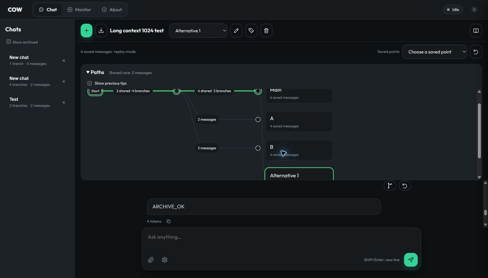
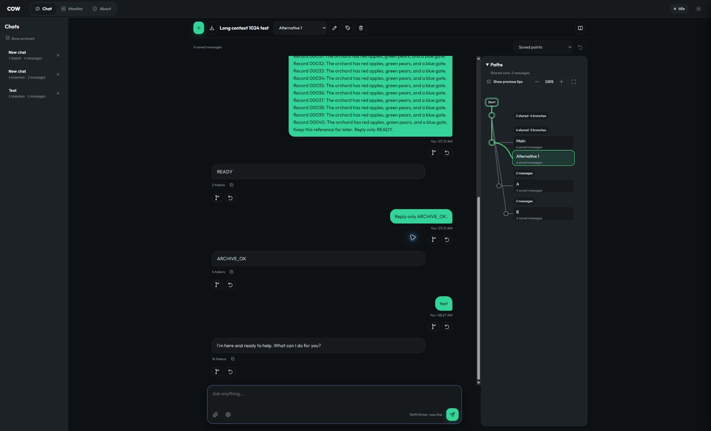
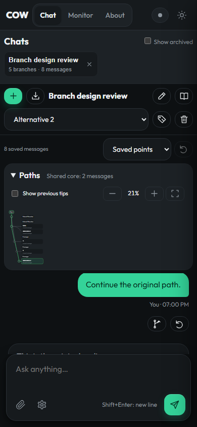

# Dynamic chat branches and saved points

The fixed-row viewer clipped a new fork and drew an ambiguous connector when
two branch references ended at the same saved node. The replacement groups
those references at one point and lays the tree out vertically.

The map sits beside chat above 1100 CSS pixels. Below that width it moves above
chat, keeping the same top-to-bottom direction. The chat and map share a centered
1360-pixel workspace on large screens. Branch cards and connecting lines move
together over 220 ms when the topology changes. Reduced-motion mode removes
the layout animation.

## Actual Chrome page

The screenshots below are from the user's existing 1K chat with four current
branches. Main and Alternative 1 have the same six-message tip; A and B have
independent four-message tips. No model request was issued by this live review.

The browser window changed size during review. The original capture was at
1500 × 912; the final capture was at 2400 × 1456. The final live DOM audit found
all four branch badges fully inside the graph viewport at **100% scale**.
The audit is [live-ui.json](results/dynamic-graph-20261013/live-ui.json).

## Interaction decisions

- References at the same node get adjacent cards attached to one dot. They do
  not receive a connector through unrelated branch endings.
- A new fork reflows existing cards and curves. An independent continuation
  creates its own visible ending. Counts still refer to saved messages.
- Automatic positioning keeps the selected ending in view after selection,
  resize and topology changes. A refresh of unchanged data preserves manual pan.
- Zoom controls provide enlargement, reduction and Fit. Dragging empty map space
  pans on a computer; touch devices keep native scrolling.
- A narrower, two-row phone toolbar leaves room for both messages and the composer.
  Successful branch actions focus the message box rather than covering it with a toast.
- Saved-point choices show known message counts/previews, or the saved time when
  a point is outside the current visible paths. Restore is disabled until a point
  is selected. The Start preview exposes fork and rewind too.
- Opening a different chat clears the old graph while its history loads. Draft
  text and attachments remain associated with their branches in the current tab.
- Model execution mode remains available in the existing tooltip and API. The
  primary status text reports saved-message progress.

## Executed checks

All final runs passed without skips:

| Browser checks | Chromium | Firefox | WebKit | Total |
|---|---:|---:|---:|---:|
| Dynamic layout, motion and same-tip forks | 28 | 28 | 28 | 84 |
| Existing graph behaviors and failure recovery | 38 | 38 | 38 | 114 |
| Existing workspace, math and archive behavior | 24 | 24 | 24 | 72 |
| Total | 90 | 90 | 90 | 270 |

The dynamic runner builds the reproduced four-branch topology in real SQLite.
It adds a fifth fork, consumes a new mock answer on that branch, and checks that
the original six-message branch stays unchanged. It checks full badge visibility,
zoom, Fit, pan retention, phone/tablet placement, readable chat space, a visible
composer, disabled unused restore, root forking and reduced motion. Its SVG
frame counter records actual animation callbacks; it is not a GPU counter or an
FPS benchmark.

The existing graph runner retains its shared-prefix, subgroup, stale edit,
delayed-response, network failure, pending-answer and 10K-layout assertions. Its
overflow assertion now accepts scrolling in either axis because the map is
vertical. The existing workspace runner retains clear/restore and math checks.

Screenshots and machine-readable results are in
[dynamic-graph-20261013](results/dynamic-graph-20261013/). Initial failed runs are
retained, including a test readiness error, mobile-space/visibility failures,
and a Windows video-export file lock. The exporter now closes its browser
context and uses Playwright's `save_as` after recording finishes.

[Watch the recorded interaction](results/dynamic-graph-20261013/portrait-dynamic/chromium-branch-motion.webm).
This video uses saved fixture messages, real SQLite and mock inference.

## Deployment and numerical limits

The live app remains on llm-60, loopback port 8097, reached from this PC through
port 18097. Server PID **1300778** remained running during this frontend update.
The six prompt checkpoints, 8 GiB conversation cache and eight slots were
preserved. Deployment fingerprints and the configuration comparison are in
[deployment.json](results/dynamic-graph-20261013/deployment.json).

Chrome retained an earlier stylesheet after a normal reload during review.
A hard refresh loaded the new assets. If an updated interface still looks old,
press **Ctrl + Shift + R** once.

This work changes the presentation layer. Backend code and reference equations
were not edited. It does not qualify G1, native GPU COW integration or numerical
cache equivalence. The earlier cold-versus-cached output disagreement remains open.
