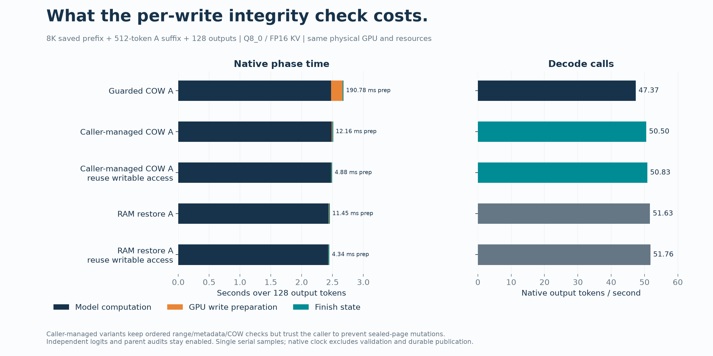
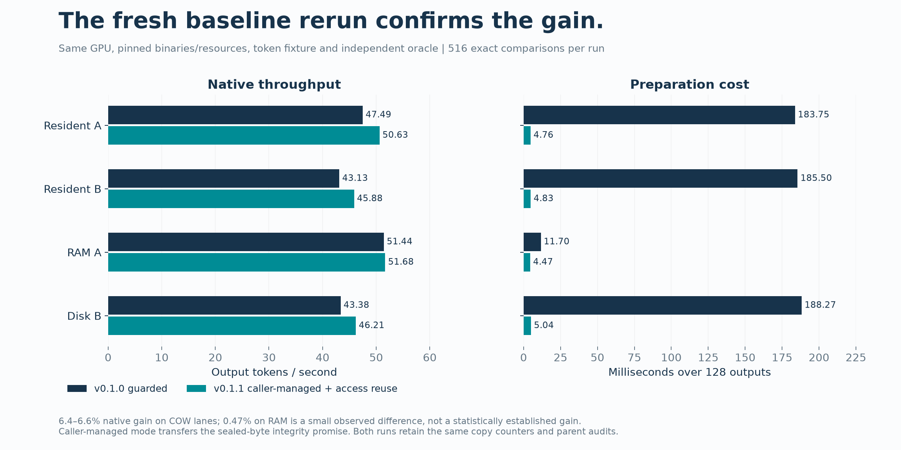

# Caller-managed write integrity: v0.1.1 candidate

This variant makes the caller responsible for keeping sealed GPU pages unchanged
between validation and continuation. GPU write preparation retains ordered
range, seal-metadata and ownership checks, and still detaches shared tails.
It does not read and hash every sealed byte before a write. Restore/capture
continue to verify bytes, and the benchmark retains independent fresh logits,
parent byte audits, checkpoint hashes and durable history/controller publication.

The variant is opt-in through the isolated probe builder. Default native engine
sources and the guarded v0.1.0 path are unchanged. It is a different execution
promise: a writable alias that corrupts a shared page can now escape detection
before a write. The four-format negative fixture demonstrates precisely that
difference; it is not reported as a pass of the original corruption guard.

## First completed measurements

One saved 8K prefix, a 512-token A suffix, and 128 generated/consumed outputs:

| Path | Write preparation over 128 outputs | Native decode TPS | Complete instrumented API TPS |
|---|---:|---:|---:|
| Guarded v0.1.0 COW | 190.777 ms | 47.37 | 7.99 |
| Caller-managed COW | 12.161 ms | 50.50 | 8.24 |
| Caller-managed COW, reuse writable access | 4.876 ms | 50.83 | 8.10 |
| Existing RAM restore | 11.446 ms | 51.63 | 7.09 |
| RAM restore, reuse writable access | 4.338 ms | 51.76 | 7.05 |

Preparation becomes 15.7x faster by omitting the write-time scan and about 39x
faster with writable-access reuse, relative to the optimized guarded COW sample.
The native COW gain is about 7.3%, because most time is model computation.
190 ms across 128 outputs is about 1.49 ms per token; 4.88 ms is about 0.038 ms
per token. These measurements do not imply a 39x overall inference speedup.

RAM already had private, unsealed GPU pages and zero hashing during decode.
Writable-access reuse eliminates repeated driver protection calls on those
already writable pages. It saves preparation work, but the observed TPS change
is small and within plausible run-to-run variation. In this pinned operator
and dispatch configuration, model work alone is about 2.4–2.5 seconds per
128 A outputs, so native rates near 52 TPS leave little preparation headroom.
This is not a universal ceiling for other Strata serving configurations.



Both initial variants passed all four resident A/B, RAM A and disk B lanes:
516 exact comparisons per run, maximum full-vocabulary logit error 0.0.
Every lane produced 128 outputs. Direct counters report zero hash kernels,
zero hashed bytes and zero integrity-page comparisons during their decode
transactions. State capture and restore still perform integrity work outside
that interval. The COW lanes retained 36 copied pages / 75,497,472 bytes per
request, unchanged parent/checkpoint hashes and suffix-only computation.

The native caller-managed fixture passed 214 checks across FP16, INT8, Q4 and
hybrid KV layouts; its guarded counterpart produced 16 expected policy
differences. Deliberate alias corruption was rejected by the guarded path,
accepted before writing by this variant, and observed by the external byte
audit. Candidate memcheck reported zero errors. These are actual CUDA fixtures,
not model forwards or certification of the original integrity requirement.

## Fresh paired baseline/candidate rerun

The v0.1.0 branching binary was rerun at its original SHA-256, followed by the
caller-managed/access-reuse candidate on the same GPU and fixture:

| Lane | v0.1.0 native TPS | Candidate native TPS | Observed native gain | Preparation: baseline → candidate |
|---|---:|---:|---:|---:|
| Resident A | 47.49 | 50.63 | 6.63% | 183.75 → 4.76 ms |
| Resident B | 43.13 | 45.88 | 6.38% | 185.50 → 4.83 ms |
| RAM A | 51.44 | 51.68 | 0.47% | 11.70 → 4.47 ms |
| Disk B | 43.38 | 46.21 | 6.54% | 188.27 → 5.04 ms |



Each rerun passed all four lanes and 516 exact comparisons with zero error.
Both produced identical tokens and parent/checkpoint fingerprints, with equal
copy counters. Guarded COW scanned 32,212,254,720 bytes (30 GiB) during each
128-token decode; the candidate scanned zero. RAM scanned zero in both.
The candidate's complete instrumented API rates were 8.10 / 7.90 / 7.19 / 7.05
TPS, compared with 8.06 / 7.85 / 7.07 / 6.86 for the fresh baseline. The native
gain is clearer than the total API gain; publication/controller costs remain.

Repeated native regressions passed 6/6 CTests; independent SHA checks passed
three unittest methods; controller and profile-input suites passed four methods
each. G0 passed 51/51, the reference demo passed and four mutants were rejected.
Four completed new model campaigns each contributed 516 exact comparisons;
those are repeated evaluations of the same two continuations, not thousands
of independent histories. Initial and paired reports remain separate.

The first attempted baseline rerun refused a stale CMake fingerprint before
model loading. It was retried with a freshly bound unqualified profile, leaving
the binary, token fixture and numerical assertions unchanged. That failure and
all successful rerun receipts are published. The bounded rerun is complete;
the larger context/sanitizer/soak certification matrix remains open.

## Reproduce

First complete [the standard build](GETTING_STARTED.md). Then:

```bash
python experimental/branching_context/scripts/build_external_integrity_probe.py \
  "$PWD" "$PWD/build-external" --reuse-private-access
python experimental/branching_context/scripts/prepare_speed_profile.py \
  --source "$PWD" --binaries "$PWD/build-external" \
  --model "$MODEL" --pack "$PACK" --expert-profile "$PWD/data/expert-profile.bin" \
  --output "$PWD/external-profile"
python experimental/branching_context/scripts/cow_speed_8k.py \
  --api "$PWD/experimental/branching_context" --profile "$PWD/external-profile/profile.json" \
  --binaries "$PWD/build-external" --fixture "$PWD/external-profile/fixture.json" \
  --output "$PWD/external-results"
```

Omit `--reuse-private-access` to measure the no-scan variant alone. Use the
standard probe builder for the guarded control. `ram_speed_8k.py` can use any
of these explicitly fingerprinted binaries. Build/profile/report receipts name
the selected integrity policy and private-page access strategy. The fresh
oracle is linked with the original objects and remained byte-identical:
`347a14026e57706bc9572c02d99cb8a48406766fee3f2c6a98093ce65432bade`.

Caller-managed branch binary:
`4a88d08f2da856b2f6645e11e89674ce622d3af71d4c6e5e84276efb1b19e963`.
Caller-managed plus writable-access reuse:
`e2b19e2c9318d0ba2f42ba3f62cd6265a29f93397bd289c111222f08d8c2ff4a`.
Source checkpoint: `0bb06645`. The measured hardware/model/fixture/resource
settings match [v0.1.0's report](RESULTS.md). Recorded oracle traces were reused
only after matching their fingerprints, arguments, hardware and model contract.

Raw results are in [the external-integrity evidence directory](results/external-integrity-20261013/).
Figure sources are bound in [EXTERNAL_PROVENANCE.json](figures/EXTERNAL_PROVENANCE.json).
See [the candidate plan](V0.1.1-PLAN.md) for the repeated baseline/candidate
campaign. Both integrity policies remain numerically unqualified experimental
profiles; no cumulative G1–G5 certification is claimed.
