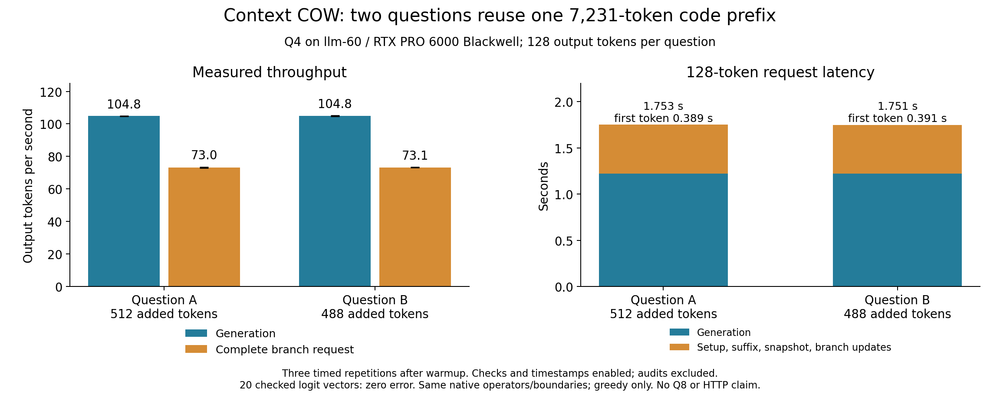

# Longer grammar-constrained requests: executed Q4 results

Two code-review questions reused one prepared 7,231-token engine-source prefix.
Question A added 512 tokens; B added 488. Both generated the full 128-token limit.
This is a bounded greedy, matching-native-operator result on llm-60, not release
certification or an HTTP benchmark. The REVIEW grammar permits a JSON string;
the outputs are capped, incomplete JSON, not completed tool actions.

| Median of three measured runs | A | B |
|---|---:|---:|
| Generation | 104.80 tokens/s | 104.81 tokens/s |
| Complete branch workflow | 73.03 tokens/s | 73.08 tokens/s |
| Complete branch workflow latency | 1.753 s | 1.751 s |
| First consumed-token callback | 0.389 s | 0.391 s |
| Median interval between consumed tokens | 9.511 ms | 9.498 ms |
| Largest interval, median across runs | 11.514 ms | 11.323 ms |

Generation includes grammar masking, native legal argmax, native token ingestion
and timestamp callbacks. The request adds validation, suffix prefill, final
capture and immutable publication. The workflow adds branch-reference reset and
publication. Initial engine/model startup (17.643 s), initial prefix creation
(1.616 s), full parent-byte audits, fresh reference runs and warmup are excluded
from these medians. First-token timing is provisional consumed progress, before
the final snapshot is published. It is not a durable-save acknowledgment.

## What was checked

An independently initialized Python/native pair for each question consumed P,
then its suffix, then generated tokens. It used only native feed, normal-verifier
decode, full-logit reads, statistics and shutdown. It imported no checkpoint,
issued no cache commands and selected grammar-legal tokens on the host. The COW
candidate selected legal tokens through the native finite-mask selector.

The two references and candidate used the same pinned numerical executable,
tokens and native operator boundaries. This is the accepted execution-profile
contract. It does not resolve cross-arrangement fresh-full-prefill disagreement.

The candidate ran one separately audited A/B pair, one warmup pair, then three
measured pairs. Every request matched reference tokens, full controller records,
canonical history and stopped/completion flags exactly. The audit compared full
logit vectors at P, after each suffix, and after consumed generated tokens
1/16/64/128. Warmup and measured runs checked final vectors. All 20 comparisons
were byte-identical: maximum absolute logit error 0. This is sampled frontier
coverage, not an every-token fresh-oracle campaign.

Every reused request evaluated only its suffix plus 128 generated tokens, with
one capture, no disk load/write and no prefix recomputation. Total candidate
work was 13,511 forward tokens: 7,231 initial tokens, 5,000 suffix tokens and
1,280 generated tokens. Native counts recorded 11 captures and 10 restores.
Both whole parent audits matched SHA-256
`8b243dff4c9e7ef58123363eecf1a4bfa53b9df5e2038564875ca0fc267b2d37`.
The audited image occupied 345,577,772 serialized bytes, including padding.
Three derived native images remained in the candidate cache. Native live-byte
accounting ended at 452,984,832 bytes; it is not whole-process RAM/VRAM usage.

All three Python children and three native processes exited successfully and
were absent after completion. CPU regressions passed 343/343 and G0 passed
51/51, with zero failures, errors, skips or expected failures. The CPU result
records exact test IDs and an unchanged-source manifest.

## Run and evidence

Source base: `db7135455dddeb08ac4d9318192f94f019b6e6ae` plus the five new harness,
grammar and test files in this ticket. Production API/numerical source is
unchanged. Qwen3.8-Flash-Next UD-Q4_K_XL, FP16 KV, capacity 98,304, Prefill8192
and normal-verifier-decode ran on GPU 0, RTX PRO 6000 Blackwell. Profile ID:
`a5ab941d46e174db9a9748ea26c0231d0bcf0b5d8d38b4ae6b342a7066bed3e3`.
Executable SHA-256:
`2b58e8e872e46705805bf119bf7c7b382c85b63114b03f7f00f61f2452b225dc`.
Complete model/build/hardware/API/fixture fingerprints are in
[the machine-readable qualification](../../experimental/branching_context/evidence/GRAMMAR-LONG-QUALIFICATION-2026-10-16.json).

The executed launcher is
`llm-60:/home/dflanag3/spatial-artifacts/grammar-long-20261016-v1/run_grammar_long_gpu_v1.sh`.
It owns the GPU lock and uses separate fresh reference and candidate subprocesses.
Do not repeat that exact launcher/output directory: it deliberately refuses an
existing run. For a new run, choose new command and campaign output directories.
Use the pinned interpreter and isolated llguidance dependency directory recorded
there. The harness supports `--stage campaign` with `--runtime-root`, `--profile`,
`--fixture`, `--grammar`, `--run-dir` and `--max-outputs`.

Raw results, full comparison vectors, native command receipts and frozen sources:
`llm-60:/home/dflanag3/spatial-artifacts/grammar-long-20261016-v1/`.
Private backup: `box-git:/srv/data/git/private_context_cow.evidence/20261016-grammar-long-v1/evidence.tar`,
70,103,040 bytes, SHA-256
`d4843707c7d045a14c91cf4b56e4e6bf8159cc002387ffdcf66723aed97210c5`.
Independent streamed readback verified all 1,136 members/68,832,366 data bytes
without extraction. The numerical executable and grammar dependency closure
remain in the preceding verified native-selector/grammar-first archives.

## Failures retained and remaining scope

The new measurement validator initially confused Python boolean and integer
controller values. Its deterministic regression went red, then passed with
canonical JSON/type checks. Review caught a result-field mismatch before GPU
launch. Two lifecycle tests reproduced a detached native process escaping outer
timeout cleanup; removing its detached session and targeting only its owned
process fixed both. A reporting-only KeyError was corrected using the frozen
source hash. All failed attempts remain in the private archive; no model
tolerance, registered test or reference equation changed. Before committing,
two trailing spaces were removed from the new reference tests. Python ASTs were
identical and the normalized suite passed 15/15 again; the separate
GRAMMAR-LONG-TEST-NORMALIZATION-2026-10-16.json receipt maps tested/repository
hashes. Production and GPU harness bytes remain exactly those in the frozen run.

No matched native-only end-to-end overhead control was run; the slow host-choice
references cannot establish an 8% validation-overhead threshold. Q8 remains
deferred. Min-P/nonzero RNG, broader controller settings, normal-serving grammar
integration, larger-context/current-profile restart and original cumulative
G1-G5 qualification remain outstanding. This run adds no new disk-restart claim.

The user also requested cache idle expiry. A subsequent one-time cleanup removed
265,317,737,620 bytes of old derived checkpoint/manifest files from 165 inactive
dated test stores through the production disk-pool eviction path. Canonical
before/after hashes matched. Payloads were not rehashed for deletion; retained
manifests contain their declared identities. Current-day checkpoint exemplars,
models, source, binaries and result summaries remained. The new configurable
30-minute idle-expiry feature is separate work, not claimed by this result.
