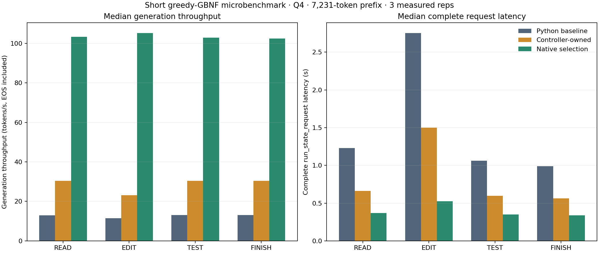

# Native legal-token selection

The constrained request path now sends the grammar's legal-token mask to the
native worker. The worker already holds the current logits. It checks every
float for NaN/infinity, including masked-out positions, and returns the greatest
legal raw score with the lowest token ID breaking ties. No tokens are evaluated
and no numerical or controller state changes during selection.

This removes the per-token full-vocabulary Python scan and full-logit file
transfer. It keeps sealed-byte hashing and complete controller validation at
restore/publication. The grammar matcher and progress remain private to the
branch request; only a transient mask crosses the native boundary. The selected
token still goes through checked grammar consumption and the existing native
consumed-token receipt before any final snapshot can be published.

## Executed measurements

llm-60 GPU0: RTX PRO 6000 Blackwell, pinned Qwen3.8-Flash-Next UD-Q4_K_XL,
FP16 KV, capacity98,304, Prefill8192 and normal-verifier generated-token operator.
The same7,231-token code prefix and READ/EDIT/TEST/FINISH definitions were used.
Each version has one excluded warmup, three measured repetitions per state and
a separate instrumented repetition. Native selection also has a separate slow
audit repetition, excluded from the speed medians.

| State | Original Python generation TPS | Owned-controller TPS | Native-selection TPS | Complete request before / after native selection |
|---|---:|---:|---:|---:|
| READ | 12.96 | 30.33 | 103.40 | 0.661 / 0.369 s |
| EDIT | 11.49 | 23.14 | 105.18 | 1.500 / 0.524 s |
| TEST | 13.09 | 30.45 | 102.98 | 0.596 / 0.350 s |
| FINISH | 13.06 | 30.35 | 102.51 | 0.562 / 0.339 s |

[Raw median/sample CSV](measurements/grammar-selection-20261016/grammar-selection-comparison.csv)
and [vector chart](measurements/grammar-selection-20261016/grammar-selection-comparison.svg).
The chart was rendered and visually inspected. Plotting packages were installed
in an isolated artifact-only target; the inference environment was unchanged.
Git copies use LF and remove generated SVG trailing whitespace. CSV data and SVG
attribute tokens were compared before/after; raw artifacts remain unchanged in
the archive. `repository-copies.json` maps raw and normalized SHA256 identities.

These are short greedy GBNF actions:13/29/11/10 consumed output tokens including
EOS. No tools were executed. Generation TPS measures selection through token
consumption; it excludes setup, final capture and publication. Complete request
times include those operations, but exclude CLI/HTTP and durable disk save.
This does not establish long-output/context, ordinary-serving or Q8 throughput.

READ mask preparation plus selection averaged0.380ms/token, of which the backend
selector call was0.311ms. Native token consumption averaged9.005ms/token.
EDIT selection averaged0.431ms/token; native consumption8.804ms. These are
inclusive wall timers with overlapping nested values, not GPU-event timings.
The current data does not isolate a validation tax against a matched native-only
whole-request control; it does not certify the user's8% overhead target.

Each instrumented action made exactly one full-frontier read and one capture,
instead of a full-frontier read per generated token. Native selection counters
equal actual output counts. At vocabulary248,320, each choice checked993,280
logit bytes inside the worker and read31,040 mask bytes. Forward counters equal
only generated outputs. Parent bytes remain unchanged; integrity mismatches0.

## Executed correctness and restart

- Final combined CPU/filesystem/HTTP/CLI suite:320/320, no failure/error/skip/xfail.
  Includes12 new adapter/controller/request methods and four native helper/builder
  methods. The C++ helper is compiled with the production host flags and checked
  against seeded Python results, ties/signed zeros, masked NaN/Inf, width/padding,
  empty support and consumed-position errors. G0:51/51 PASS.
- Native choices matched independent host legal-argmax calculation at all63
  consumed boundaries in the separate audit. All63 full vectors and masks are
  retained. This tests selection on the current model frontier; it is not a
  separate fresh-history inference oracle.
- All24 completed actions matched the preceding qualified matching-operator
  reference in tokens, full controllers and final full-logit vectors, error0.
- Process-separated prepare/resume passed. Saving READ after four consumed
  outputs, exiting Python/native and restoring in new processes preserved the
  remaining output, controller and frontier. Strict P and partial restores
  each computed0forward tokens. Five final-vector comparisons had error0.
- All owned native processes and restart Python children exited0 and were absent
  on readback. The chat server remains off.

Root test-first red12 retained3failed+9error before the new API existed. Initial
green46 had one incomplete synthetic fixture missing `process.pid`; the fixture
was corrected without weakening production checks. Final320 passes. Builder
anchor/setup failures and CPU exploratory report/setup failures are retained;
they are not presented as inference failures. Read-only review found no blocking
defect; its suggested overlong-mask case is included in the final regression.

## Build and compatibility

Base`b139911e6fbe28de4553d3a000f156f700faa6fb`, private branch
`work/grammar-native-select-20261016`, local folder
`C:\Users\dflanag3\Documents\fleet\context-cow-grammar-native-select`.

`scripts/build_grammar_selector_probe.py` adds the driver command and readiness
capability `finite-mask-argmax-v1`, compiles one driver translation unit and
relinks the recorded unchanged numerical objects/libraries. The pure C++ helper
is `native/grammar_select.h`. It checks IEEE binary32 exponent bits so finite
checking does not depend on finite-math compiler assumptions. The command reads
the authoritative `session.logits()`, not a stale temporary vector.

Profiles explicitly bind `grammar_selection_protocol`. Readiness, consumed
position, mask extent/padding, token membership and receipt dimensions are
checked. Missing/incompatible capabilities fail before generation. Profiles
without this optional capability retain the preceding correct host-selection
path. No controller/checkpoint format or alternate history was introduced;
read-only selections do not become consumed execution-schedule events.

Execution profile:`a5ab941d46e174db9a9748ea26c0231d0bcf0b5d8d38b4ae6b342a7066bed3e3`.
Profile SHA:`997324f1b8dc441d106b470eedd8d79ddc529f8119e78e07a717c7a1582631a4`.
ELF SHA:`2b58e8e872e46705805bf119bf7c7b382c85b63114b03f7f00f61f2452b225dc`.
Model aggregate:`32759e8867f3e52a7fa559761d003950dd4449e7e970a6de1550bc11c02b8827`.
Full build/model/API pins, executed IDs, counters and receipts are in
`experimental/branching_context/evidence/GRAMMAR-NATIVE-SELECTION-QUALIFICATION-2026-10-16.json`.
Raw root:`/home/dflanag3/spatial-artifacts/grammar-select-20261016-v1/`.

Private evidence archive:
`box-git:/srv/data/git/private_context_cow.evidence/20261016-grammar-native-select-v1/evidence.tar`,
223,324,160bytes, SHA256
`c14ddd7225fbf14d607133ce4e99653d6ba6117be295271070ab5f820df03f05`.
Streamed readback verified4,412 members without extraction. Final ELF/source,
build receipts,63 raw vectors/masks, prior failures and chart data are included.
Installed plotting packages, compiled objects, old duplicate ELFs and derived
.state payloads are excluded. Dependency/version/hash receipts are retained.

Space recovery used the production disk pool to evict only obsolete first-grammar
v3 numerical states, freeing615,964,554bytes. Their manifests, vectors and failure
evidence had a verified private backup. Canonical file hashes were unchanged.
The newer preceding speed-ticket checkpoints, current restart checkpoints and
original three codebase roots remain. Derived .state payloads are deliberately
excluded from the evidence archive; exact deleted-file hashes are recorded.

FOCUSED-PASS only. Original cumulative G1-G5 unqualified. No broad sampled/adaptive
controller matrix, Min-P, ordinary-serving grammar, HIP/SYCL or Q8 qualification.
Global peak RAM/VRAM was not sampled; native memory counters are retained without
claiming whole-system peaks. Native-speed behavior here covers short actions at
this one context length. Next: longer constrained output and representative tree
requests, then long-context control-plane attribution; keep Q8 deferred.
