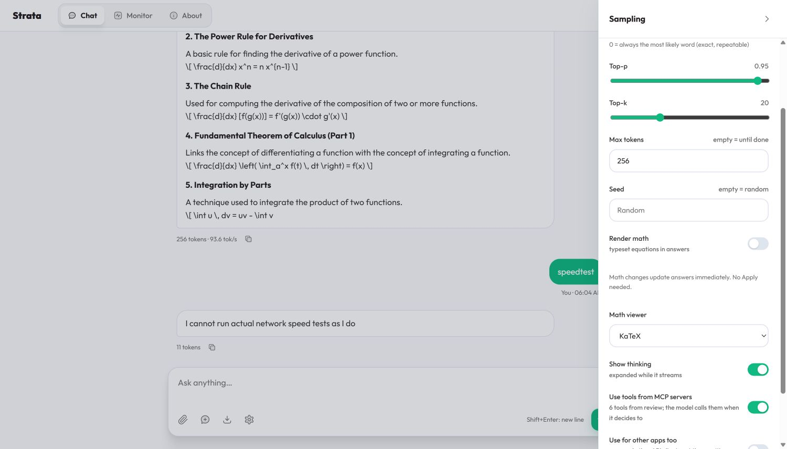

# Math controls update immediately

The user reported that disabling math or changing the viewer appeared not to
work. The live app reproduced the issue: changing Render math to Off left
nine equations formatted. They changed to raw Markdown only after Apply.
The controls had been pending form values, and Apply was below the visible
part of the settings drawer.

Render math and Math viewer now update existing answers immediately and save
the choice. Reset also resets math immediately. Other model sampling settings
still require Apply. Math display changes do not submit a model request or
change message source. A message element used by a streaming answer stays alive.
The drawer explains that no Apply is needed for math.

The test-first regression failed on the old code. Final real-browser runs in
Chromium, Firefox and WebKit passed **16 immediate-control checks each (48)**,
including disable, re-enable, switch, reset, persistence, source preservation,
streaming element preservation and isolation from unapplied model settings.
The existing dual-viewer suites also passed **25 checks each (75)**. Final
batches have 123 checks, no failures or skips. All reports and the red attempt
are in [the evidence directory](results/math-controls-20261013/).

On the user's existing conversation in Chrome, the patched live server showed
nine MathJax equations, then nine KaTeX equations after switching, then zero
formatted equations after disabling. No Apply or new prompt was used. The
conversation and original TeX source remained available. The server is still
on llm-60; the static assets were updated without restarting its resident model.

KaTeX and MathJax can look similar for simple equations. The checks inspect
the actual renderer elements, not only the menu selection. An incomplete
formula remains source: the last calculus response in this conversation hit
its 256-token limit partway through an equation. A viewer switch cannot finish
the model's truncated answer.

These are UI checks. They do not change the native COW code, inference
equations, numerical tolerances or G1-G5 qualification. The automated browser
fixtures use a mock engine and confirm zero model requests for display changes;
the live observations use answers already produced by the real model.
