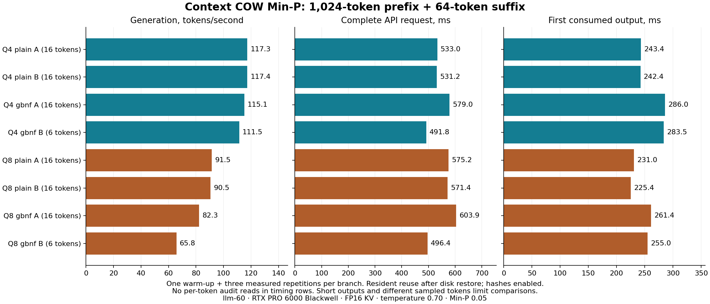

# Min-P branching and durable resume: bounded results, 2026-10-16

Q4 and Q8 passed Min-P alone and Min-P combined with the REVIEW GBNF grammar on llm-60. The preset is temperature 0.70, Min-P 0.05, Top-K 0, Top-P 1.0, repetition penalty 1.0. Inference uses the real RTX PRO 6000 Blackwell and FP16 KV.

The successful campaigns made 226 audited full-vector comparisons, all with zero logit error, and 32 further exact final-vector checks outside timing. All 15 strict restores reported zero native forward-token work. Tokens, complete controllers, saved RNG progress and canonical histories matched. Parent byte audits remained unchanged.

The independent references start fresh native processes, consume the same prefix/suffix batches and select tokens using the separate Python full-vocabulary Min-P implementation. They never read checkpoints or call the native sampler. The candidate saves a fully consumed four-token boundary, exits both Python and native inference, and restores in new processes.

Final CPU checks: 403 combined implementation tests, four observer tests, and G0 51/51. No final failures, skips or expected failures. Registered G1–G5 qualification remains separate.

## Resident measurements

Each row uses a 1,024-token shared prefix and a distinct 64-token suffix. Values are medians of three measured repetitions following one warm-up per branch. All timed requests keep backend integrity checks enabled, reuse a resident prefix, and assert no disk load or prefix computation. Per-token full-logit audit reads and whole-parent byte audits are outside these timing rows.

| Model | Mode | Branch | Actual outputs | Generation TPS | Complete request (s) | First consumed output (ms) | Median interval (ms) |
|---|---|---|---:|---:|---:|---:|---:|
| Q4 | plain | A | 16 | 117.28 | 0.533 | 243.4 | 8.51 |
| Q4 | plain | B | 16 | 117.36 | 0.531 | 242.4 | 8.51 |
| Q4 | gbnf | A | 16 | 115.11 | 0.579 | 286.0 | 8.58 |
| Q4 | gbnf | B | 6 | 111.46 | 0.492 | 283.5 | 8.66 |
| Q8 | plain | A | 16 | 91.46 | 0.575 | 231.0 | 10.77 |
| Q8 | plain | B | 16 | 90.53 | 0.571 | 225.4 | 10.94 |
| Q8 | gbnf | A | 16 | 82.33 | 0.604 | 261.4 | 11.58 |
| Q8 | gbnf | B | 6 | 65.81 | 0.496 | 255.0 | 16.11 |

These short sampled responses differ across modes and quantizations. The table is an observed workload result, not a controlled measurement of quantization cost or grammar overhead. Generation TPS excludes prefix/suffix handling, controller publication and other request costs. A six-token completed answer must not be reported as a 16-token answer. Startup, checkpoint save and disk restore are retained separately in raw receipts; they are excluded from resident TPS.

## Failures and limits

The first 128-prefix/4-suffix fixture selected the ordinary end-of-turn token immediately. It had truncated away the assistant boundary and could not exercise a four-token save. Its failed result, one actual output and exact observer source are retained. The successful tiny Q4 fixture uses 128 prefix IDs and the original last 64 suffix IDs; the 1K fixtures preserve that same assistant boundary. This is a fixture change, not a tolerance change.

Review found a missing execution-EOS binding check for plain sampled resume. A failing test reproduced it; the final implementation rejects altered stop tokens before materialization. Boolean repetition counts and RNG cursor exhaustion also have checked regressions. Pending sampled-but-unconsumed state is not publishable.

Review also strengthened observer checks for actual native sampling byte counters. The final validator checks retained before/after measurements for every audit and timing row. These are logical full-vector and mask input sizes, not measured memory traffic: the selector makes multiple passes. The native arithmetic timer excludes mask-file I/O and protocol costs. No complete RAM/VRAM peak measurement or matched native-only validation-tax comparison was made in this bounded campaign.

The numerical forward objects were not changed. The native build recompiles the generated driver translation unit to add a read-only full-vocabulary sampler. The usual engine startup banner may say greedy for its default generate command; this path explicitly invokes sample_mask with the requested temperature, Min-P and branch draw. Actual sampler-call and input-byte counters are checked.

Exactness is bound to the model, execution profile, RNG stream/cursor and native operator/batch boundaries. Different random streams may give different answers. Cross-arrangement equivalence remains an accepted prototype limitation. There is no new long-context Min-P, ordinary-server/CLI sampler integration, power-loss, broad grammar or full gate certification claim. Real-GPU idle expiry remains a separate unrun check.

## Reproducibility

See `experimental/branching_context/evidence/MIN-P-QUALIFICATION-2026-10-16.json` for all executed test IDs, source manifests, model/build/profile fingerprints, work counters, process exits and raw artifact paths. The API guide is [MIN_P_SAMPLING.md](MIN_P_SAMPLING.md). All code and evidence remain private.

Native ELF SHA-256: `1fe97c40fc9cf5ca4918cac34ee15492ee59529d679a51bc1046dec921f7f271`.

Q4 execution profile: `5089221626452201a14a215b6d4e23478e44004f9852533136f153ded8f5e9dc`; weights: `32759e8867f3e52a7fa559761d003950dd4449e7e970a6de1550bc11c02b8827`.
Q8 execution profile: `4c34e716c0645acbee5d0b1d55251ccaa603f54640ccce0fe6ba577d2442f65d`; weights: `846b74d30a22552ad8cc2fabe5b17103049fe68ffdacf56daa457db8ecaa356f`.
