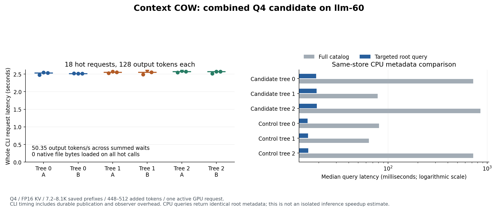

# Combined Q4 tree reuse and publication candidate

The reviewed retention, publication-ownership and root-query changes work
together on the bounded real-GPU workload. This is a focused result, not
cumulative G1-G5 certification. Q8 is deferred; the ordinary chat server stayed
off and no public repository was updated.

Source checkpoint: `97bab1a24ee53df036a3ac5bd083e18ec7f5cc71`, branch
`work/native-client-combined-20261016`. The runtime overlays four reviewed Python
files onto the previously qualified runtime; the profile records every exact
file hash. The native executable and model did not change.

## Executed checks

| Check | Result |
|---|---|
| Combined CPU, filesystem and HTTP regressions | 200/200; no failures/skips/xfails; source unchanged |
| G0 reference verifier | 51/51; command/wrapper exits 0/0; evidence written outside frozen source |
| Separate legacy branch-action suite | 6/7; missing-checkpoint rejection expectation fails; corruption assertions pass |
| Real Q4 smoke | One eight-output request; 12 full-vector comparisons, maximum error 0 |
| Three-tree real Q4 campaign | 32 requests, 4,096 actual output tokens, no pipeline failures |
| Independent numerical audit | 12 new uncached native reference processes; 818 full-vector comparisons, maximum error 0 |

The user subsequently approved correcting the old missing-checkpoint test:
fork/retry may move canonical references after numerical eviction; continuation
may rebuild and must notify the user. That correction and the CLI notice are
being developed separately in `context-cow-eviction-notice`. The historical
failure above remains an executed failure, not a retrospective pass.

The fixtures contain three actual Strata source bundles with 7,231, 7,845 and
8,087 prefix tokens, and two questions per tree adding 448-512 tokens. The
campaign alternates A/B branches, retries from a retained root, compares plain
and observed clients, shuts down both HTTP/native processes, then starts new
processes and restores all three roots from disk. Root checkpoint bytes stay
unchanged. Native work counters show suffix/output work only, and maximum
active GPU requests is one.

Candidate vectors are checked at saved-prefix and final consumed frontiers.
Fresh-repeat vectors are checked at every dumped generated frontier. The 818
count does not mean every intermediate candidate vector was exported.
All generated token sequences and full greedy controller records agree.

## Timings

Eighteen hot requests each produced 128 tokens; all loaded zero native checkpoint
file bytes. Startup/model loading and the independent audit are separate.

| Measurement | Value |
|---|---:|
| Summed hot CLI request waits | 45.76149 seconds |
| Aggregate output / summed waits | 50.348 TPS |
| Median request wait | 2.54563 seconds |
| Median time to first token | 0.36927 seconds |
| Median mean token interval | 8.51508 ms |
| Median last token to durable receipt | 1.02918 seconds |

CLI waits include process startup, observer serialization/fsync and durable
checkpoint publication. Loaded native file bytes may stage through RAM; they
are not physical disk-read measurements. No new peak-memory measurement or
isolated native-only validation-tax estimate was made. Earlier policy controls
have different accumulated histories, so these figures do not establish a
causal percentage improvement over those controls.

On the same six retained stores, the unchanged full-catalog query and targeted
root query return identical root descriptors. One warmup plus three alternating
measurement pairs per context give full-catalog medians of 64-854 ms and targeted
medians of 15-20 ms. This isolates avoidable metadata traversal, not inference
or whole-request throughput. Selected root integrity checks remain enabled.

## Reproduction and identities

Run artifacts on llm-60:
`/home/dflanag3/spatial-artifacts/native-client-combined-20261016-v1`.
The approved runner, commands, receipts and source manifests are recorded in
`NATIVE-COMBINED-Q4-PRIMARY-2026-10-16.json` and the archived raw evidence.

- GPU: RTX PRO 6000 Blackwell, driver 595.91.07; GPU UUID
  `GPU-2d2b1358-9abf-ef75-fc3b-892135ea6e58`.
- Model: Qwen3.8-Flash-Next UD-Q4_K_XL, FP16 KV, capacity 98,304;
  native Prefill chunk 8,192, generated `normal-verifier-decode`.
- Resume contract: `identical-native-operators-v1`, deterministic greedy.
- Profile SHA-256: `fb2d32373103536d13186abd9051ae0600cbeefa6012c84d080e40d5f21c2ff6`.
- Execution identity: `b5ce30f2f15ea06d73ad2eb7dc63c9d62b0a177299d588cbedc4ef0435294898`.
- Model contract: `ff923fd4e0fb068eea3a39a79f130860fdbdda8f686ecb0c470fa09a27808827`.
- Native executable: `4bd5d715d460371458be8cadad28d881977dbeea57219039187d05aa12148451`.
- Independent oracle: `f946253dfd05f58d93585d9436dae5076e306aa5feef3eca1f4b4a1b3766b129`.

Prompt/conversation reuse is disabled in each fresh oracle; no checkpoints are
imported. Cross-arrangement equivalence, broader controllers, sustained pressure,
sanitizers and the cumulative original gates remain outside this result.

The SSD holds actual durable checkpoints. Independent reference arrays were
written under an owned 0700 directory in `/dev/shm`, then streamed directly into
private box-git evidence without creating a second local tar. The private backup
receipts give the exact archive identity and independent member readback result.
The initial profile-builder attempt failed on absolute source-path keys; the
initial metadata measurement failed on an unannotated event. Both setup failures
are retained, corrected before inference, and are not numerical failures.

Private archive:
`box-git:/srv/data/git/private_context_cow.evidence/20261016-native-client-combined-v1/evidence.tar`,
1,687,490,560 bytes, SHA-256
`d70e93c1ca3fc665886dc3ee41f53bb82feff2364c6d7b0d60787f6ff83a8331`.
Independent readback verified all 1,325 members / 1,685,987,778 data bytes.
After verification, narrowly audited eviction of completed child numerical
copies freed 2,340,659,200 allocated bytes; all 226 canonical files and three
original prefix checkpoints stayed byte-identical. Re-auditing the removed
child state files requires recreation; raw reference arrays and executed
comparison records remain preserved. No canonical history was deleted.

## Approved policy correction and final CPU integration

The user approved the missing-checkpoint expectation correction. Source0a156901
now retains all corruption rejection assertions while testing successful metadata
fork/retry, exact targets, namespace and idempotency with zero forward work.
Its CLI announces actual history reconstruction on stderr and keeps generated
text on stdout. Ordinary cached restoration does not print the notice. An
explicit reconstruction failure cannot be followed by an accepted success.

The final combined union passes233/233 CPU/filesystem/socket tests, zero failures,
skips or xfails, plus G051/51. The old6/7 result remains preserved as historical
evidence. Full final CPU logs and source manifests are independently backed up:
296960B,23 members/263887 data bytes,
SHA-256 `14d9be091a71b183785b0345077c66d664d6554d92a6450a866d39bcc361e161`.
The CLI/test-only overlay has CPU/socket qualification. The real-GPU numerical
and speed evidence above remains explicitly tied to source97bab1a2/profilefb2d3237.
