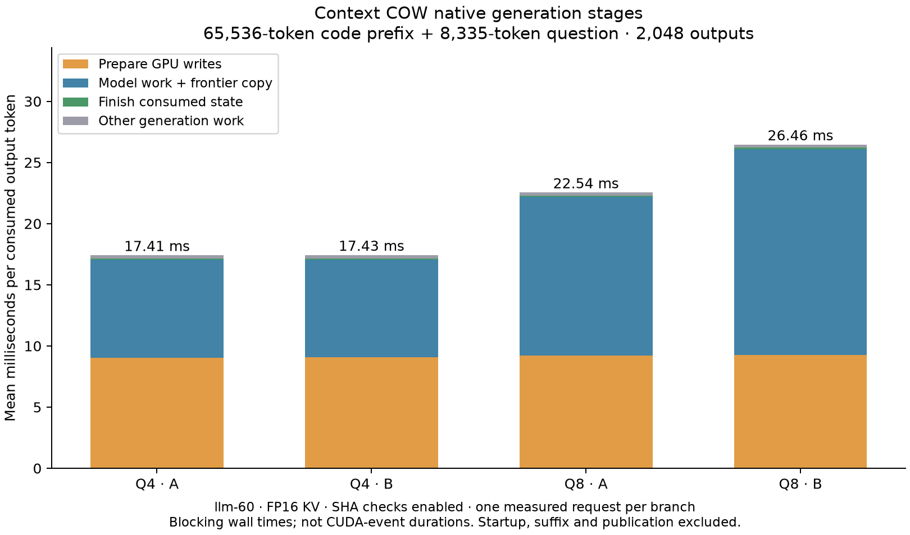
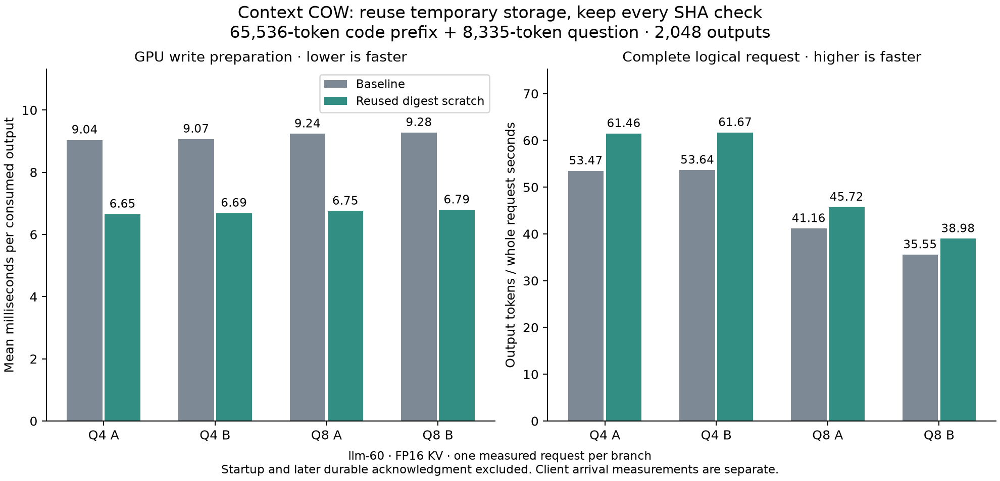

# Native write preparation: measured costs

These measurements keep the sealed-byte SHA-256 checks enabled. They do not
qualify the original G1–G5 contract or arbitrary batch-boundary equivalence.

## Complete real-code request measurements

On llm-60, the timing-v1 frozen implementation passed independent native A, B
and A-repeat comparisons. Each branch consumed a 65,536-token real-code prefix,
an 8,335-token question and 2,048 generated tokens. Both models used FP16 KV,
8,192-token input chunks and one active request. Full final frontiers, prefix
frontiers and generated tokens matched; the repeated fresh reference matched
every dumped frontier. COW frontier checking is not an every-token certification.

| Model/branch | Prepare, ms/output | Compute, ms/output | Finish, ms/output | Generation TPS | Logical request TPS |
|---|---:|---:|---:|---:|---:|
| Q4 A | 9.038 | 7.996 | 0.117 | 57.438 | 53.471 |
| Q4 B | 9.068 | 7.982 | 0.119 | 57.376 | 53.638 |
| Q8 A | 9.235 | 12.937 | 0.126 | 44.367 | 41.159 |
| Q8 B | 9.276 | 16.798 | 0.129 | 37.793 | 35.549 |

There is one measurement per branch, not a repeated-performance confidence
interval. Timers surround the actual blocking native calls. Compute includes
forward, commit and logit copy; preparation includes integrity checking and COW
write preparation. These are not CUDA-event-only times. Logical request times
include restoration, suffix ingestion, capture and canonical publication, but
exclude process/model startup and later durable checkpoint acknowledgment.



Each long request recorded 4,742,273,040,384 device-hashed bytes and
37,049,008,128 downloaded digest bytes, including suffix preparation. These
are repeated work totals, not unique memory allocations. The numerical result
is zero logit error within this pinned, matching-schedule prototype contract.
The complete worker exited and restored the unchanged chat configuration with
authenticated HTTP 200. Raw evidence remains on llm-60 under
`/home/dflanag3/branching-g3/native-stage-v1-20261014`.

## Supplemental SHA timing witness

Added blocking timers specifically around page-address upload, page hashing
and synchronization, and digest download. The new real-CUDA test first failed
to compile because those counters were absent, then passed after implementation.
It checks every resulting digest against independent Python hashlib, actual
work counts, no per-call device workspace allocations, and workspace release.
The existing reordered-page test passed unchanged across its three fixtures.

A separate 512 MiB probe ran three independent processes. Each warmed once,
then hashed every byte three times. Per-pass measurements were:

| Repetition | Whole call, ms | Address upload, ms | Hash + sync, ms | Digest download, ms |
|---|---:|---:|---:|---:|
| 1 | 2.408 | 0.006 | 1.152 | 0.282 |
| 2 | 2.400 | 0.006 | 1.154 | 0.283 |
| 3 | 2.356 | 0.006 | 1.151 | 0.287 |

The roughly 0.91–0.97 ms remainder includes host digest-buffer allocation and
other host work. It was not separately timed, so it cannot all be attributed
to allocation. This probe excludes the BranchPages comparison loop, inference,
and COW tail preparation. The restored chat server was resident and the GPU
was idle before the probe; this was not an exclusive model-throughput campaign.
No inference TPS or long-request speedup can be inferred from these figures.

Reproduce the probe with a compiled `tests/core/branch_digest_timing_gpu.cpp`
linked with `src/core/branch_digest.cu`, then:

```sh
python3 experimental/branching_context/scripts/benchmark_branch_digest.py \
  --binary /absolute/path/digest-timing --mib 512 --output result.json
```

These are Linux commands. Use `python` for local Windows commands. The store's
POSIX `fcntl` requirement still prevents the local Windows G0 suite from
passing: this attempt ran 11 tests with two import errors. The Linux G0 run
passed 51/51 and all four reference mutants were detected. No portability fix
or mocked substitute was introduced.

## Integrity choices

A remembered successful hash proves the bytes checked at that moment. It does
not prove that a later stray writer obeyed ownership rules. The current guard
rehashes every sealed byte before preparing writes across any pool. A corrupt
last pool must prevent detachment of earlier tails. Unused sealed capacity is
also covered; deleting that coverage would weaken the corruption contract.

Caching expected hash metadata is compatible with fresh verification; caching
a successful verification result is not. Ownership-only write admission with
boundary audits would be a different integrity guarantee and requires explicit
qualification. GPU ECC does not detect a kernel writing to the wrong address.

These measurements motivated reusing the host digest workspace and investigating
comparison on the GPU. The baseline alone did not establish their benefit.

The newly added detailed counters are compiled and tested in the standalone
CUDA witnesses only. The long request results use the previously frozen
timing-v1 binary, which predates those counters. A rebuilt inference binary
must carry a new build/profile identity and pass its own comparisons.

## Persistent host digest scratch candidate

The candidate now allocates the ordered host digest buffer in `reserve_pages`,
before execution. `digest_pages_view` borrows its fresh results for the immediate
all-pool comparison. The borrowed pointer is not retained by a snapshot or page
seal; it expires on the next view operation, reservation or workspace destruction.
Every call still uploads the ordered page addresses, rehashes every sealed byte,
downloads every digest and compares against the original seals before detaching
any tail. No successful-check result is cached. The owned-vector digest operation
remains available for snapshot seals and audits.

The new real-CUDA test was written first and failed to compile on the absent
operation. After implementation it checked independent hashlib outputs, zero
hot-loop host workspace allocations, changed page order, smaller result extent,
failure output clearing, a later byte mutation, retained owned results and full
device/host workspace release. It passed. This does not substitute for a model
reference.

The 512 MiB candidate microbenchmark passed three process repetitions. Median
whole-call time fell from 2.400 to 1.484 ms/pass, about 38.1%. Hashing remained
about 1.15 ms and digest download about 0.29 ms. Both measurements use the same
deterministic input, GPU, compiler target and timed calls; each process warms
once then measures three passes. This is a scratch-buffer measurement, not an
inference speedup. The chat server stayed resident and was idle at inspection.

The inference probe rebuilt the changed digest and BranchPages objects, all
BranchSession users and generated programs, with a copied staged header tree.
The pinned static archives and ordinary serving executable are untouched.
Changed class layouts must never be linked to their old compiled users. Build
commands, object/source hashes and the new profile identities are retained.

Unchanged real-GPU regression programs passed: preparation 546 checks, session
434, integrity 30 and lifecycle 14,728. These cover FP16, INT8, Q4 and hybrid KV
fixtures, including corrupt-last-pool rejection before any earlier tail copy,
preserved ownership after rejection and balanced page/image lifetimes. They
do not run a model forward. Linux G0 passed 51/51 and all four reference mutants
were detected. Q4 tiny model A/B/A-repeat comparisons also passed. Long model
timings are reported below; Q8 process-separated disk restart is still pending
at this checkpoint.

New raw campaign:
`/home/dflanag3/branching-g3/digest-reuse-v1-20261014`, worker PID 1575823.
The worker stops on unexpected failure and restores the original chat server.
Inspect the actual PID and current result files before continuing; do not
restart because a heartbeat observation expired.

## Q8 timing candidate PASS; continuation scopes

The new Q8 real-code timing case completed PASS in 610.560 seconds. Both branches
generated 2,048 actual tokens and matched fresh A/B/A-repeat references with zero
error. Before/after fixture files have identical SHA-256 values within each
model. Generated tokens and final full-frontier hashes match the old baseline;
hashed-byte and digest-download totals are unchanged. Hot-loop host workspace
allocation deltas are zero. This supports retaining scratch reuse.

| Q8 branch | Prepare before/after, ms/output | Generation before/after, TPS | Logical request before/after, TPS |
|---|---:|---:|---:|
| A | 9.235 / 6.750 | 44.367 / 49.705 | 41.159 / 45.721 |
| B | 9.276 / 6.789 | 37.793 / 41.677 | 35.549 / 38.975 |

The 49.705 and 41.677 rates describe generated continuations from GPU-resident
COW prefix snapshots. Their interval includes native COW write preparation,
model work and finish during generation. It excludes initial prefix prefill,
question prefill, restoring the selected prefix image, process/model startup
and boundary publication. Logical-request rates include restoration of the
resident image, question prefill, capture and canonical publication; they still
exclude startup and the later durable-save acknowledgment. Neither is a RAM
upload, disk-resume or ordinary stock-serving rate.



All four before/after branch measurements are single runs, not performance
confidence intervals. Matching native operator/batch boundaries remain the
prototype contract; original cross-boundary mismatch evidence is unchanged.

After the current Q8 disk/generated-token restart campaign completes and the
original chat server is restored, queue PID 1580633 will launch two CLI arrival
campaigns, resident and disk, against that exact new-profile case. Each has one
warm-up pair followed by three measured requests per branch. Startup is separate;
TTFT, median/p95/max received gaps, logical receipt and durable acknowledgment
are distinct. This is a same-host subprocess client, not HTTP serving. A pending
queue is not a measurement. A read-only resource sampler waits for the client
worker and records native and Python descendants; samples are not exact peaks.

The newer full raw campaign backup is queued after client timing, using explicit
frozen API/build/profile directories. It has not completed. Model weights and
web configuration are excluded. Source/destination checksum verification will
establish copied bytes, not power-loss qualification. The separate probe-root
resource trace is outside this ZIP selection and needs its own backup when closed.

## Pause update

The Q8 disk/process restart subsequently passed 13 sampled comparisons, with
1,829,608,952 bytes restored in 4.108 seconds and zero saved-prefix forward work.
Its resumed resident continuations generated 2,048 outputs each at 52.108/41.813
TPS. Those rates exclude the preceding disk-load interval.

The user requested review and pause. The newly started client warm-up was
interrupted after 1,271 consumed token events, with no snapshot or durable
acknowledgment and no completed measured request. Queues, sampler and archive
worker are stopped. The chat server is off as requested; no follow-up starts
automatically. See experimental/branching_context/evidence/CURRENT-HANDOFF.md
for the completed work, remaining phases and safe restart instructions.
