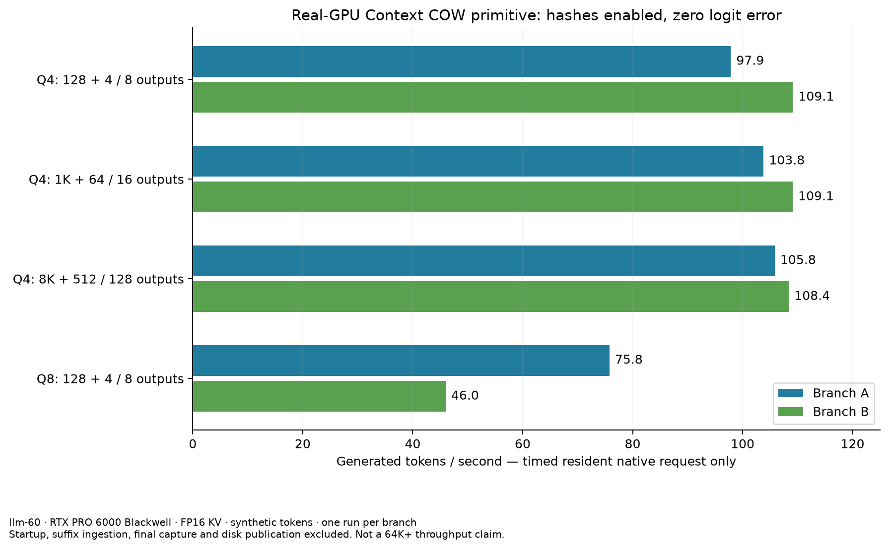

# Native resident Context COW request — private prototype

The new request primitive keeps one owned execution state resident while it
selects and consumes generated tokens. It still prepares protected GPU writes
and hashes sealed pages. It captures state at the completed request boundary,
instead of capturing and restoring each generated token through Python.

## Executed real-GPU results

All rows below ran on llm-60's RTX PRO 6000 Blackwell with FP16 KV. Inputs are
synthetic token IDs, not a codebase/chat benchmark. Each row contains one timed
request per branch. A and B restore the same immutable prefix separately.

| Model | Prefix / suffix / actual outputs per branch | A TPS | B TPS | Full-vector comparisons | Max logit error |
|---|---|---:|---:|---:|---:|
| Q4 | 128 / 4 / 8 | 97.86 | 109.14 | 16 | 0 |
| Q4 | 1,024 / 64 / 16 | 103.81 | 109.11 | 56 | 0 |
| Q4 | 8,192 / 512 / 128 | 105.84 | 108.40 | 144 | 0 |
| Q8 | 128 / 4 / 8 | 75.78 | 45.99 | 32 | 0 |



The timed loop includes the native computation, write preparation, integrity
checks and per-token acknowledgment. It excludes startup, suffix Prefill,
final capture and canonical/disk publication. Generation had zero captures and
zero restores. Every output was consumed before its progress event. Prefix
restoration performed zero forward work; parent serialized-byte audits and
consumed-boundary cancellation passed.

The independent reference starts a fresh native session without BranchSession
or checkpoint imports, then executes the same recorded input request boundaries
and generated-token operator. It must repeat exactly before the comparison
qualifies. Tiny/medium runs check every generated frontier using separate
resident reruns. The 8K run samples generated counts 1, 16, 64 and 128; its
144 comparisons also include the independent reference repeat. This is not
every-token COW frontier certification for 8K.

The first tiny Q4 result predates those separate per-frontier reruns. Its
16 comparisons cover the repeated reference and prefix/suffix/terminal/cancel
boundaries. Retain that scope instead of retroactively increasing its coverage.

## Canonical publication and disk restart

`BranchingModel.run_greedy_request` now adds suffix input and consumed output as
one immutable child at the request boundary, with one native capture. Its
callback reports provisional consumed progress; callback failure does not
publish a child. `save_branch` supplies durable checkpoint publication followed
by revision-checked reference publication. Returning a logical child alone is
not a durable-save acknowledgment.

An empty suffix continues a supported active greedy controller, preserving its
stream identity, draw cursor, seen-token counts and decoder state. A new suffix
starts a fresh greedy generation scope. Unsupported active sampling policies
are rejected before native restoration. Nonzero stochastic sampling, grammar
and other policies are not qualified by this new request path.

`identical-native-operators-v1` uses checkpoint manifest schema 3, with successful
native Prefill chunks and normal Verifier token windows bound to exact token
digests and absolute positions. Original batch-only schema 2 remains distinct.
Missing, changed or incompatible schedules fail before native import. Receipts
describe execution; immutable history/controller records remain canonical.

These controls passed 38 supplemental CPU methods, G0 51/51 and four reference
mutation detections. The integrated real-GPU restart campaign is separate from
the passing primitive results above. Its initial
prepare attempt failed because the harness operation ID exceeded the store's
64-character limit. The first hash-only repair also failed a CPU counterexample
because operation IDs must start with a letter. The corrected identifier uses
a letter prefix and the complete SHA-256 digest encoded as URL-safe base64.
Original failure evidence and both test failures are retained.

Corrected campaign:
`/home/dflanag3/branching-g3/resident-resume-20261014-r2` on llm-60. Inspect
`worker.json`, real process identity and each case's `result.json`; a launch
or heartbeat is not a pass. It runs Q4 tiny, 1K, 8K, then Q8 tiny, stopping at
the first unexpected exit. The maintenance worker restores the original chat
server configuration in `finally` and checks authenticated availability.

Q4 tiny, 1K and 8K completed PASS. Each tested separate producer/resumer Python
and native processes, zero prefix forward work, exact tokens/frontiers/controllers,
and a second restore from four consumed generated tokens. Both branches and the
generated restart matched independent matching-operator reference boundaries.
The 8K restored prefix loaded 332,013,048 native disk bytes in 0.883 seconds
after startup; the generated checkpoint restored in 0.795 seconds. Its two
128-output generation loops took 1.205 / 1.175 seconds. Complete API requests
(restore, suffix Prefill, generation, final capture and logical publication)
took 1.955 / 1.741 seconds: 65.47 / 73.50 TPS. Those request times exclude
startup and the subsequent disk-save acknowledgment. No longer-context or
long-output claim follows from this measurement. Q8 integrated tiny restart
subsequently completed PASS, including separate process exit and independent
matching-native references. The earlier Q8 primitive speed result is separate.

The next v4 source removes an unused duplicate legacy host-cache park, adds
bounded reference-extent admission and expands boundary checking. Its 42 CPU
regressions, G0 51/51 and four mutation checks pass. GPU validation is live at
`/home/dflanag3/branching-g3/resident-resume-v4-20261014`; it is not yet qualified.
Its larger Q4 capacity profile is distinct and cannot import smaller-profile
checkpoints. The planned 64K/8K/2048 synthetic case does not establish a realistic
codebase workload or measured throughput before it actually finishes.

Raw archive storage/verified direct backup:
[private transport](PRIVATE_TRANSPORT.md). The complete raw archive is on llm-60
and private box-git; no full raw PC copy is required.

Example command, after verifying GPU availability and stopping the authorized
chat server through the maintenance worker:

```sh
python3 scripts/resident_resume.py campaign --profile /absolute/profile.json \
  --output /new/result-directory --prefix 128 --suffix 4 --generated 8
```

On this Windows PC use `python`, not `python3`. GPU qualification and POSIX
durability in this campaign run on Linux. This runner creates and exits separate
Python/native processes, restores prefix and generated checkpoints from disk,
requires zero prefix forward tokens, and compares exact tokens/frontiers and
controllers against uninterrupted execution plus separate native references.

## Limits and provenance

This is a private branch-driver implementation using real native Verifier and
Prefill code. It is not connected to ordinary `--serve` or the browser workspace.
No full G1–G5 status is upgraded. Cross-operator/request-boundary equivalence
remains the accepted separate prototype limitation, with original failure
evidence retained. Q8 long-context speed, multiple parked codebase contexts,
end-to-end disk-publication latency, >=2K-output runs and the requested >30 TPS
at 64K+ starting context remain outstanding.

Raw result/build/profile JSON and red/green logs:
[native-resident-20261014](results/native-resident-20261014/).
Profiles pin executable/source/static-library hashes, complete model/pack hash
receipts, execution configuration and GPU identity. The tested primitive source
tree remains frozen; the integrated contract has a separately compiled binary
and profile. No tolerance was increased and no integrity check was removed.

Private branch: `feat/native-resident-context-cow`; remote:
`box-git:/srv/data/git/private_context_cow.git`. No GitHub publication.
