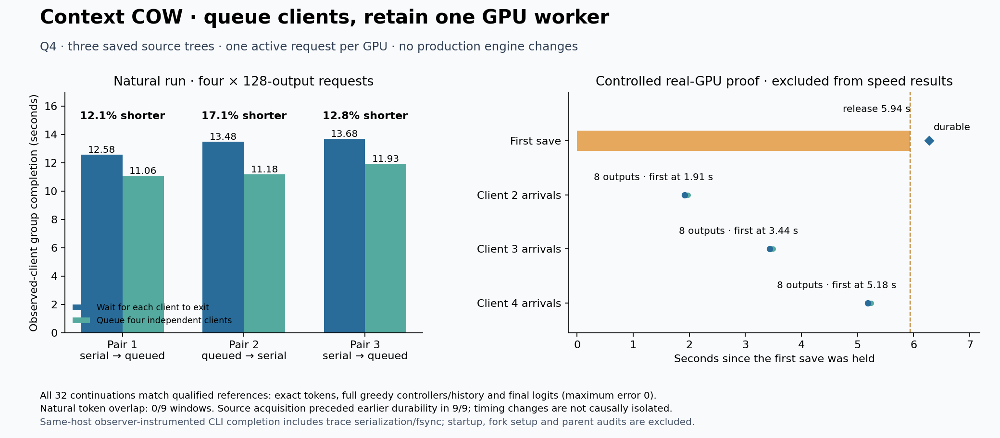

# Four CLI clients, one GPU, background publication

The existing COW service passed a bounded four-client Q4 campaign on llm-60.
One request computes on GPU0 at a time. Independent branch requests can queue
while another answer is being saved. No engine or production API change was
needed for this result.

## What ran

The actual authenticated loopback HTTP service and terminal CLI served four
clients using three retained Strata source bundles. Prefix lengths were 7,231,
7,845 and 8,087 tokens; questions were 448–512 tokens. The fourth client used
a different question on the first prefix. These are three parts of one
repository, not three unrelated codebases.

The configuration was Qwen3.8-Flash-Next UD-Q4_K_XL, FP16 KV, context capacity
98,304, Prefill chunk 8,192 and the qualified native normal-verifier-decode
generated-token operator. Continuation is deterministic greedy under the
identical-native-operators-v1 execution contract. This does not extend the
older batches-only contract or promise arbitrary batch-arrangement equivalence.

## Controlled proof and natural measurement

A test interposer held the first publication before its normal writer for
5.940 seconds. The other three clients produced their eight-token answers
while that publication was held. All four branch heads remained unchanged,
all four clients remained pending, and no durable acknowledgment appeared
until release. Source acquisition followed admitted FIFO order and measured
maximum active GPU requests was one. The hold is a scheduling proof, not a
speed measurement or a simulated power failure.

The separate natural benchmark used the unchanged service, with no publication
hold. One four-request warm-up preceded three paired repetitions; each request
produced 128 actual output tokens.

| Repetition | Serial clients | Queued clients | Elapsed-time reduction |
|---|---:|---:|---:|
| 1 | 12.579 s | 11.060 s | 12.1% |
| 2 | 13.481 s | 11.176 s | 17.1% |
| 3 | 13.681 s | 11.932 s | 12.8% |

Median elapsed time was 13.481 seconds serial and 11.176 seconds queued,
a 17.1% reduction when comparing those medians. The median of the three paired
percentage reductions was 12.8%. Observed client-group throughput was 37.98
and 45.81 output tokens/second respectively.

The interval starts with CLI subprocess launch and ends when every subprocess
exits. It includes the observer's per-event recording and final trace
serialization/fsync. Service/model startup, branch creation and subsequent
numerical/controller audits are outside that interval. This is not native-only
throughput, LAN latency or an uninstrumented serving control.

There was **no natural generated-token/save overlap in the nine transitions**:
the next client's first token arrived 0.293–0.400 seconds after the previous
client's durable receipt. Source acquisition preceded the previous server-side
durable event in all nine transitions, but source acquisition includes metadata
and pinning; it does not prove GPU computation overlapped. The measured whole
path benefit must not be attributed entirely to overlapped GPU generation.

## Correctness and limits

Across the controlled and natural runs, 32 generations produced 3,616 tokens.
All tokens, full greedy controller records and canonical histories matched the
qualified references. All 32 final full-vector comparisons had zero error.
Original prefix payload bytes remained unchanged, work counters showed no
saved-prefix forward computation, and all four owned HTTP/native processes
exited successfully and were confirmed absent.

The references were independently initialized, uncached runs from the preceding
three-tree qualification. Their fixture/profile/schedule/token/vector hashes
were revalidated before reuse; no new oracle process ran in this campaign.
Candidate numerical checks cover final frontiers, not every intermediate
candidate frontier. Nine synthetic CPU scheduler/admission checks and G0's
51 reference tests also passed with no skips or expected failures. All 224 files
in the integrated CPU source manifest match the local working source.

Retained setup failures include an initially absent guard module, a CPU test
which expected a synchronous rather than queued conflict, an incomplete first
G0 source package and a summary helper's string/Path mismatch. Corrected frozen
attempts passed; the original attempts remain in the private evidence archive.

Concurrent real-GPU save failure, sustained pressure, broader samplers, physical
peak memory, multi-GPU inference and power-loss durability remain unqualified.
This is a focused pass, not cumulative G1–G5 certification. Q8 remains deferred.

## How clients should use it

Independent branches can submit their next requests without waiting for other
branches' saves. Work dependent on a newly advanced branch must wait for that
branch's durable receipt and use its returned revision. Streamed text alone is
not a committed save point. Keep the operation ID when retrying the same work.

## Reproduction and fingerprints

The committed runner is
`experimental/branching_context/scripts/run_q4_cli_overlap.py`; its admission
guards and the publication-overlap CPU tests are under `tests/implementation`.
Exact launchers and analysis/backup scripts are preserved under
`experimental/branching_context/evidence/reproducers/q4-cli-publication-overlap-20261016`.
They pin the existing external runtime, fixtures, observer and oracle results.
Use a new output directory and acquire the GPU lock; do not overwrite the
frozen completed runs. Run tests on llm-60, not the Windows controller.

| Identity | SHA-256 / ID |
|---|---|
| Native executable | `4bd5d715d460371458be8cadad28d881977dbeea57219039187d05aa12148451` |
| Independent oracle | `f946253dfd05f58d93585d9436dae5076e306aa5feef3eca1f4b4a1b3766b129` |
| Profile file | `a7d53c45ebd7a1aa841ee10a7f5ef55472d5c761be928551a176b94f7d3f1755` |
| Execution profile | `fed7e7d5e4b2405fc75e6d300deef7576fe4a0a8ddec88841331144568ada450` |
| Model weights aggregate | `32759e8867f3e52a7fa559761d003950dd4449e7e970a6de1550bc11c02b8827` |
| Harness | `9e146f3cc6abed0df2ef4d30ccf53b8f3289172ab7f60067a0866af3a2b41e3a` |
| CLI observer | `20149f9face52ffa0afa2962824f364b9765e7b954a3da90e6084a8c974d7b28` |

Raw runs: `/home/dflanag3/spatial-artifacts/q4-cli-overlap-20261016-v1`.
Machine-readable summaries: `Q4-CLI-PUBLICATION-OVERLAP-{PRIMARY,CPU9,BACKUP}-2026-10-16.json`
under the experimental evidence directory. Command and wrapper receipts are
0/0 for both GPU runs, integrated CPU checks, corrected G0, transfer and readback.

Private archive:
`box-git:/srv/data/git/private_context_cow.evidence/20261016-q4-cli-publication-overlap-v1/evidence.tar`.
Independent streaming readback verified 1,602 regular members, 161,715,155 data
bytes; archive size 163,809,280 bytes, SHA-256
`67a2640dafea4357f52f2fe110d82cb2951bdbfc73a6f169092881513b24618d`.
No extraction was needed. The archive retains canonical history, fixtures,
selected reference vectors, traces and harnesses; model and native numerical
payloads are excluded. Original retained checkpoints remain on llm-60. The
unchanged runtime source is also covered by the preceding recovery archive
`9ee31f352a332522b7510e07356d676be1032a5161777d9d487d967e0ccb7fd3`.

The next speed investigation is source activation and capture across alternating
trees: inspect the current unconditional root-switch cache clear and post-job
pruning before proposing bounded resident-image retention. Preserve byte
integrity, pool accounting, failure cleanup and the canonical representation.
No cache policy change is qualified by this report. Chat remains off; all
publication is private local Git and box-git only.
