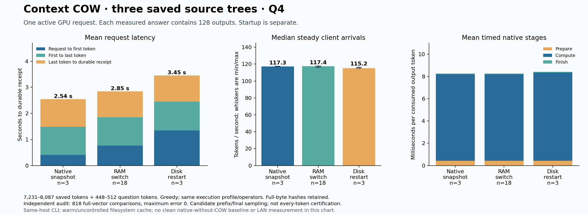

# Three saved source trees through the real CLI

The bounded Q4 campaign passed on llm-60. Thirty-two requests produced 4,096
tokens. Every request reused its saved prefix without computing those tokens
again. All generated tokens, full greedy controllers and canonical histories
matched independent fresh references using the same native execution profile.
The numerical audit passed 818 full-vector comparisons with maximum error 0.

This is the dedicated COW CLI/HTTP path. It does not qualify ordinary Strata
conversation caching, arbitrary batch arrangements, or cumulative G1–G5.

## What ran

The three inputs contain different real Strata source bundles: native COW
engine code, canonical API/store code, and serving/template tooling. They are
not three unrelated repositories. Saved prefixes contain 7,231, 7,845 and
8,087 tokens. Each has two different questions adding 448–512 tokens. Every
answer reached its 128-output limit; none stopped early.

The actual `tools/cow_cli.py` creates/forks branches and sends questions to
the actual COW HTTP service. The service uses the canonical immutable Store
and the pinned CUDA backend. The campaign uses three separate client journals,
one active GPU request, 96 GiB RAM/128 GiB disk pool limits, FP16 KV,
98,304-token capacity, and native prefill chunks up to 8,192 tokens.

The 32 generations comprise three warm-ups, two before/after logical-retry
requests, 18 alternating-tree requests, six paired plain/observed controls and
three requests after terminating and recreating both server and native worker.
The warm-ups and extra controls are excluded from the 18-request main median.

The logical retry moves a completed branch back to its root, then asks again
under a new operation ID. Its previous immutable future remains unchanged and
reachable. The earlier eight-output smoke separately checks completed-operation
retry from the local CLI journal. That local read is not a lost-ack server test.

## Measured client behavior

These are medians of per-request measurements. Startup is separate. The
client runs on the inference host; filesystem-cache warmth is uncontrolled.
Native-snapshot samples use the third tree's A question; alternating samples
cover all six questions, and restart samples use A on all three trees. These
are descriptive workload groups, not a controlled experiment isolating storage
tier as the sole cause of every timing difference.

| Path | Requests | First token | Steady arrivals | Median token gap | Per-request p95 gap | Request to durable receipt |
|---|---:|---:|---:|---:|---:|---:|
| Native snapshot reuse | 3 | 0.406 s | 117.28 TPS | 8.52 ms | 8.57 ms | 2.534 s |
| Alternate trees from RAM | 18 | 0.785 s | 117.44 TPS | 8.51 ms | 8.55 ms | 2.865 s |
| Disk restore after process restart | 3 | 1.337 s | 115.23 TPS | 8.68 ms | 8.79 ms | 3.453 s |

The last token precedes the durable receipt by approximately one second.
That interval includes remaining controller/history work, capture/serialization,
integrity validation and durable checkpoint/reference publication. It is not
all disk I/O, and this experiment does not yet split that interval further.

“Native snapshot reuse” still restores required recurrent state; it does not
mean every byte is already resident on the GPU. “RAM pool” and “disk restore”
come from direct pool transitions, bound to each operation and request clock.
Native `loaded_file_bytes` alone cannot distinguish them because a RAM-backed
restore also uses the native file-loading interface. The complete run records
20 RAM acquisitions, eight native-snapshot acquisitions and four disk loads;
the fourth disk load is an initial warm-up, separate from the three restarts.

Preparing GPU writes accounts for about 5.2% of the measured native generation
stages. Full sealed-byte hashing remains enabled. This percentage is not a
measurement of all validation overhead. Three paired observer controls show a
median wall-time change of -0.075%, consistent with negligible overhead in
this small sample; the user's 8% reporting threshold was not exceeded for the
observer. No claim of a speed gain follows from that small negative value.

Internal RAM-pool peak accounting reached 4,170,959,892 bytes. Maximum disk-pool
file accounting reached 3,302,817,655 bytes. These exclude model storage and are
not measured peak system RAM or VRAM. There is no clean native-without-COW
baseline in this campaign, so it establishes throughput rather than a new
percentage speedup. The chart uses mean latency components and median throughput;
the table uses medians throughout.

## Correctness evidence and limits

Two independent native processes run each of the six prefix/question fixtures
without importing checkpoints or using prompt/conversation caches. They preserve
the candidate's batch/request boundaries and generated-token operator sequence.
Fresh repetitions agree at every dumped frontier: 780 comparisons. Candidate
saved prefixes contribute six comparisons, and candidate final consumed states
contribute 32, totaling 818. Candidate intermediate logits were not all checked.
The current profile generates through `normal-verifier-decode`; this is separate
from the historical batches-only experiment.

All 32 token sequences and full greedy controller records match. Prefix payload
hashes remain unchanged. Actual counters account only for each question and its
128 consumed outputs. Both HTTP services, both native workers and all twelve
fresh-reference processes exited successfully; all sixteen PIDs are absent.
Combined harness CPU checks pass 22/22; G0 passes 51/51, with zero skips.

Source/build/model/profile identities, every measured request and executed
failure limitations are recorded in:

- `experimental/branching_context/evidence/Q4-CLI-THREE-TREES-PRIMARY-2026-10-16.json`
- `experimental/branching_context/evidence/Q4-CLI-THREE-TREES-QUALIFIED-2026-10-16.json`
- `experimental/branching_context/evidence/Q4-CLI-INTEGRATED-HARNESS-CPU-2026-10-16.json`

The compact private archive is
`box-git:/srv/data/git/private_context_cow.evidence/20261016-q4-cli-trees-v1/evidence.tar`.
Independent streaming readback verified all 1,010 members without extraction:
194,344,960 archive bytes, SHA-256
`d9baaa04ca96ae6b22818a7e3716e8c679021615aa61ca218ff3d72e78ca6efa`.
It retains selected raw generated frontiers, full frontier hashes, fixtures,
timings, traces and failure records. Model files and numerical `.state` payloads
are excluded; original checkpoints and full fresh arrays remain on llm-60.

## Repeat the experiment

Use the existing pinned Linux runtime, Q4 profile and generated fixture set.
Do not modify a running/frozen source stage. Run one GPU inference job at a
time under the existing GPU lock. The harness starts its own loopback service;
it does not require restarting the ordinary chat server.

Run `experimental/branching_context/scripts/run_q4_cli_trees.py` with
`--runtime-root`, `--profile`, `--fixtures`, `--store`, a new `--run-dir`,
`--phase campaign --outputs 128 --repetitions 3`, and the pinned
`--observer`/`--observer-sha256`. The observer is `observe_cow_cli.py`, a separate
measurement wrapper around unchanged CLI bytes. The complete exact command and
hash guards are in `evidence/reproducers/q4-cli-trees-20261016/launch_q4_cli_campaign_v1.sh`.

After the candidate processes exit, run `verify_q4_cli_tree_frontiers.py` with
the same runtime/profile/fixtures, the candidate `--campaign result.json`, and
a new `--run-dir`. It launches the separate uncached references and checks the
published canonical states. A pipeline pass remains numerically pending until
this independent audit succeeds. Reused references must match the fixture/profile,
exact token IDs, schedules, work receipts, process receipts and frontier hashes.

Next investigate multi-client admission while a preceding request persists in
the background: one active GPU computation, several trees, explicit durable
receipts and no state crossover. Then extend complete-client pressure,
disconnect/lost-ack and crash coverage before repeating longer histories/output
runs. Q8 remains deferred. The ordinary chat server stays off; publication
remains restricted to local Git and private box-git.
