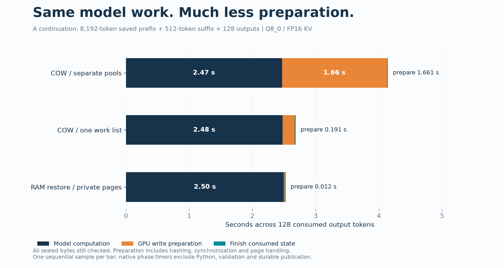
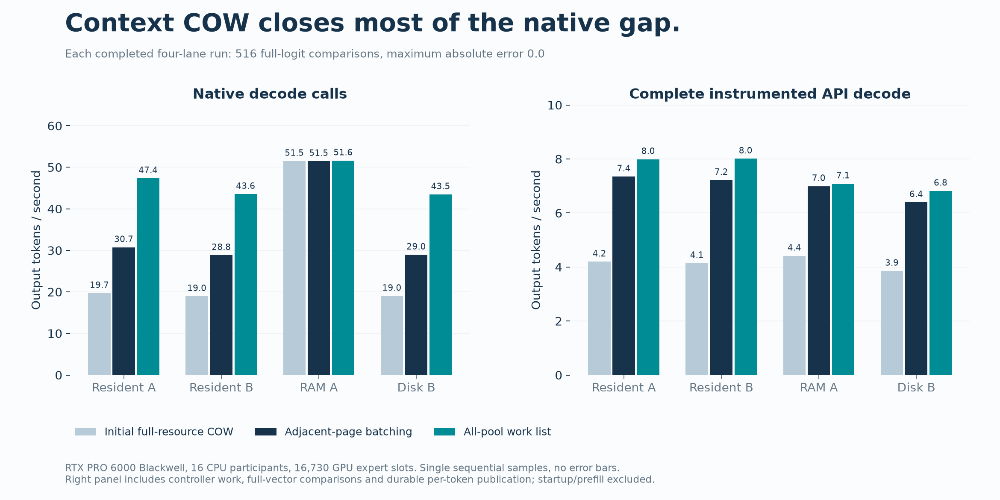
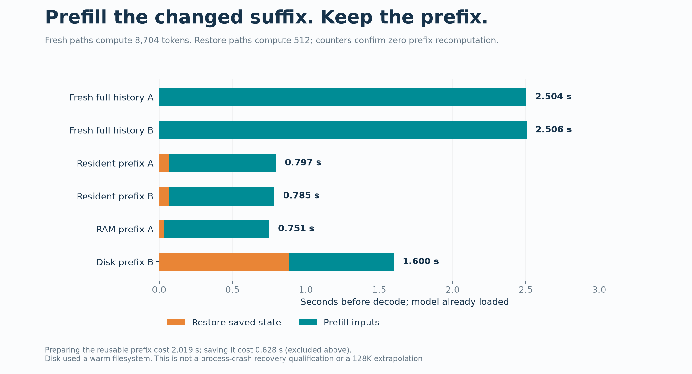
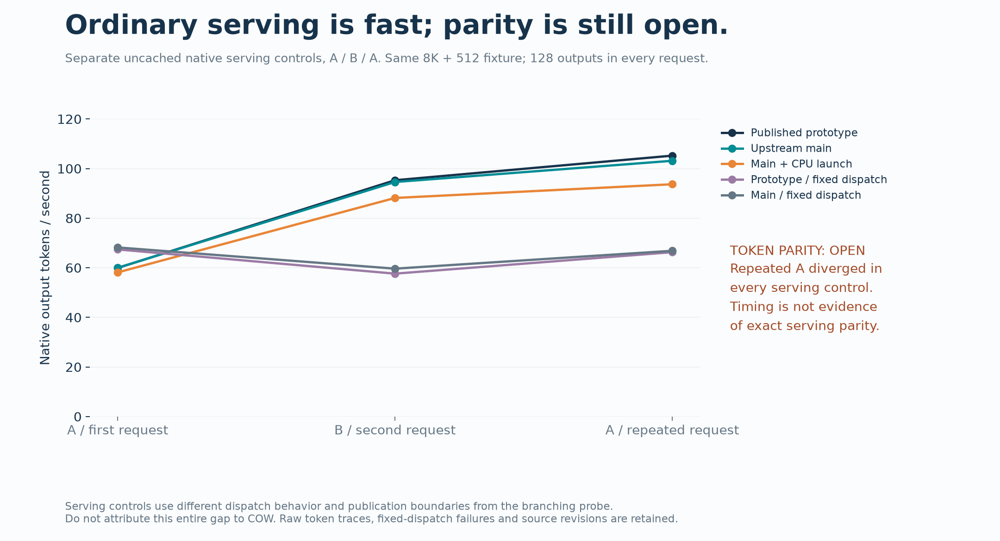

# Executed results — 2026-10-13

The bounded 8K experiment passes exact fresh-oracle comparisons, and the largest
native COW overhead has been reduced substantially. This is experimental
validation, not G1–G5 certification. All timing rows below are individual serial
measurements, not statistical distributions.

## Workload and hardware

One 8,192-token prefix, two different 512-token suffixes, and 128 generated
tokens per request. Prefill uses the real batched operator, chunk size 8,192;
decode consumes one selected output token per step. Every output in the API
measurement is consumed before its immutable history and controller are
durably published.

The model runs used llm-60: RTX PRO 6000 Blackwell, 97,887 MiB, NVIDIA driver
595.91.07, CUDA 13.2, GCC 13.3, Qwen3.8-Flash-Next Q8_0, FP16 KV, context
capacity 12,288, no MTP, fixed PCIe fraction 0.55. There were 16 participating
CPU threads, 16,730 GPU expert slots (81.37 GiB), and a 38.16 GiB resident CPU
expert complement within a 40 GiB budget. The final run sampled 94,217–94,841
MiB of total GPU use after requests; these samples are not peak KV memory.

Earlier supporting native component tests used llm-49's RTX 4090. The final
all-pool preparation change was built and tested on llm-60.

## Write preparation: the measured bottleneck

For continuation A, preparation fell from **1.6610 to 0.1908 seconds** across
128 outputs: **8.71× faster**, an 88.5% reduction. Model computation stayed
essentially unchanged: 2.4672 to 2.4760 seconds. Finishing consumed state took
0.0132 to 0.0144 seconds. The separate RAM A control measured 2.4964 seconds
of model computation and 0.0118 seconds of preparation.

Previously each bound pool launched and synchronized its own verification.
The new code reserves all-pool GPU scratch during binding, builds an ordered
list of the currently sealed pages, hashes them in one launch before each
write transaction, compares every tile, then prepares the private tails.
It does not cache a successful hash or omit a byte from the integrity check.
This also rejects corruption in a later pool before copying an earlier tail.

Across resident A's complete request, integrity launches fell **6,420 → 369**.
Both runs hashed exactly **33,193,721,856 bytes** and checked 15,792 pages.
These request counters include restore/capture; the hot write transaction
uses one all-pool launch. The internal timing does not separately attribute
hash arithmetic, page-protection calls and synchronization.

## Throughput and prefix reuse

| Lane | Native TPS, separate pools | Native TPS, all-pool list | Complete instrumented API TPS, latest |
|---|---:|---:|---:|
| Resident A | 30.74 | 47.37 | 7.99 |
| Resident B | 28.85 | 43.56 | 8.01 |
| Host RAM A | 51.50 | 51.63 | 7.09 |
| Disk B | 28.95 | 43.48 | 6.82 |

Native TPS measures the native decode calls. Complete API TPS also includes
Python controller work, full-vector transfer/comparison and durable per-token
history publication. Both exclude initial model loading, prefix creation,
restore and suffix prefill. The complete loop still spends seconds serializing
and publishing controller/history data; do not describe 47 TPS as the complete
durable API rate. Differences in this I/O-heavy loop are not controlled enough
to claim that COW beats RAM overall.

The dedicated RAM A/B/A sequence passed 387 full-logit comparisons with zero
error and measured 50.31 / 45.63 / 51.45 native TPS. That control retains a
parent GPU image as an audit witness; it is not a minimal-GPU-memory baseline.
It records real RAM cache hits, with zero COW pages and zero COW bytes copied.

The latest prepared-prefix lanes took 0.797 / 0.785 / 0.751 / 1.600 seconds
for restore plus suffix prefill. Independent fresh forwards took 2.504 / 2.506
seconds to prefill the entire 8,704-token history. Preparing the reusable root
cost 2.019 seconds and saving it cost 0.628 seconds; those setup costs are
excluded from the reuse bars. Disk restoration used a warm filesystem.

Each request's direct counters report **512 prefill tokens + 128 decode
tokens**, with zero recomputation of the 8,192-token prefix. Resident A/B and
disk B each copied 36 actual GPU pages, 75,497,472 bytes. Parent audits read
446,244,912 bytes and found no change. The checkpoint contained 333,006,328
actual bytes; the disk lane loaded 332,013,048 native state bytes, with the
frontier carried in the outer checkpoint.

## Correctness and instrumentation

Two independent fresh processes prefilled each complete history without
BranchSession, checkpoint import or a cache lookup. The branching runs compare
all 248,320 logits after the suffix and after every consumed output token:
129 comparisons per lane, **516 per completed four-lane run, maximum absolute
error 0.0**. All four lanes generated all 128 requested outputs. The latest
run reused the already executed clean-build oracle traces only after matching
the oracle binary, arguments, model contract, GPU identity, fixture and trace
hashes. Reused traces are explicitly marked in the JSON.

| Check | Actual result | Scope |
|---|---|---|
| G0 reference | 51/51 PASS, no skips | Linux, model-free |
| Reference mutants | 4/4 detected | Sibling leakage, RNG reset, logits, ABA |
| New preparation test, old implementation | 51 failures out of 546 checks | Expected red: repeated launches and partial preparation before late corruption |
| Same preparation test, new implementation | 546/546 PASS, four KV formats | Actual CUDA allocations; no model forward |
| Targeted CTest | 6/6 PASS, no skips | Pages, adjacent batch, preparation, session, integrity, lifecycle |
| Independent SHA tests | 3 unittest methods PASS | Host/CUDA vectors plus reordered page list; compared with hashlib |
| Preparation CUDA memcheck | PASS, 0 reported errors | New four-format native fixture |
| Latest four-lane model run | PASS, 516 exact comparisons | 8K aligned boundary, 512 suffix, 128 output tokens |
| Separate RAM A/B/A run | PASS, 387 exact comparisons | Same controller/history checks |

The existing lifecycle test executes 14,728 checks; session has 434 checks and
integrity has 30. These are component evidence, not completed registered
G1–G5 methods. No unsupported/skipped case is counted as a gate pass.

The red build initially reported an unregistered CMake target; reconfiguration
fixed that setup failure before the deterministic test was run. Both receipts
are retained. The original host-only conversation-file executable exited 255
under Compute Sanitizer because it made no instrumented CUDA API call; it is
not a GPU sanitizer pass. An earlier binary built on llm-49 was incompatible
with llm-60's glibc and was rebuilt on llm-60. These failures are retained in
the exported logs/reports where collected.

## Ordinary serving controls and open failures

Prototype serving measured 59.94 / 95.31 / 105.23 TPS, upstream main measured
60.01 / 94.60 / 103.16 TPS, and main plus the forced CPU launch fix measured
58.15 / 88.17 / 93.69 TPS. This does not show a large ordinary throughput
regression. It does show a correctness question: repeated A diverged within
every control. Prototype/main automatic traces matched on the first A and B,
but diverged on the third A at output index 29. Fixed-dispatch traces differed
on all three cross-build comparisons. The source is not isolated, and ordinary
serving's dispatch/publication boundary differs from the exact branching probe.

Arbitrary batched-prefix partitioning also remains open: the retained two-token
split diagnostic reaches maximum absolute logit error **3.0646746**, including
without COW. This demo demonstrates an aligned 8K prefix, not arbitrary splits.
The earlier restricted-resource 32K experiment is retained as partial; 64K was
not completed. Earlier 1–3 TPS observations used two workers and 512 GPU expert
slots and do not describe the full-resource 8K results above. No 128K Q8 COW
speedup is inferred from earlier IQ2_XS disk-restore measurements.

Formal G1 remains paused/unqualified, with zero completed registered methods
in that partial attempt and 48 exact comparisons. The cumulative G0+G1 suite
has not passed. Current G2 crash/restart/OOM qualification, G3 full sharing and
pressure matrix, G4 cumulative requalification, G5 sanitizer suite and 24-hour
soak remain outstanding. Native Windows POSIX locking, HIP and SYCL are not
qualified. The final CMake configure also did not register optional expert-pack
and iq-parity tests without their prerequisites; the six targeted CTests do
not stand for the whole Strata suite.

## Provenance and reproducing the figures

This package descends from public Strata PR #2094 head
`3445371f6b127575c44fd6e108c2b6683fea4ffa` (underlying main `7695859a`).
The ordinary-main control is `a0116b2782a5b82622358c04a06496485d12b2d6`;
its CPU launch control is `5d2f39be`. Package code checkpoints are `eeb12f3c`
(initial full-resource optimization/runners) and `c053ddbb` (all-pool verification).
Builds were measured with uncommitted candidates atop their recorded base;
use file/binary fingerprints, not the base revision alone, to identify them.

| Artifact | SHA-256 |
|---|---|
| Latest branching probe | `f8e08ae5bc80448ed3d7a39ddc9939b1bd80e857e3d4b8105bb9badb66d6c2c2` |
| Independent fresh probe | `347a14026e57706bc9572c02d99cb8a48406766fee3f2c6a98093ce65432bade` |
| Token fixture | `f9703b78ad6ac6e1626ee6b758d30ea7546ad58bd8159ef708f06aaab9b92679` |
| Saved checkpoint | `614f4043eac742e9d00c0a77fa76c24ad562c28007c9e6ee848afa803e117ef1` |
| Parent audit | `755d4699ea40808f5ef20e7453f22050cce975a95241157b241e631110540fbc` |

The expanded clean-build model/pack inventory identity is
`e0b14dc76ddd46f22bbb71ddb84f2ac8e0ca9347f294fd824c0810240dcf0b75`.
The earlier profile identity is
`846b74d30a22552ad8cc2fabe5b17103049fe68ffdacf56daa457db8ecaa356f`;
the inventory/path scope changed, not the GGUF weight contents. Per-file hashes
and metadata are in the model receipts. Latest preparation reused 27 previously
measured file hashes after unchanged size/mtime/ctime checks, hashing zero
model bytes anew. Clean preparation had hashed 10,081,728 new bytes and reused
10 earlier receipts.

[Raw reports](results/) include passing, failing and partial results, build
receipts, tokens, commands, profiles and collected logs. Personal path roots
are redacted; [MANIFEST.json](results/MANIFEST.json) records original and
exported hashes. Exported profiles are evidence, not directly reusable local
execution profiles. The multi-hundred-MB full-logit traces, model weights,
binaries and cache payloads are not bundled in Git; their measured hashes are
retained. The runners regenerate them.

Run `python tools/plot_context_cow.py` with matplotlib installed to regenerate
all four PNG/SVG figures. [PROVENANCE.json](figures/PROVENANCE.json) binds the
plot script and input JSON files. Publication figures used matplotlib 3.11.2.
