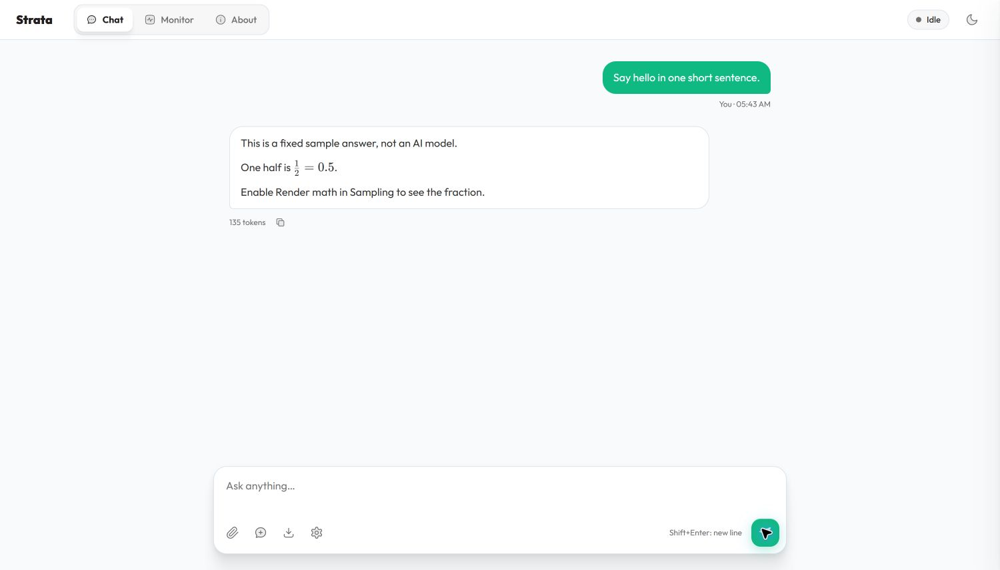
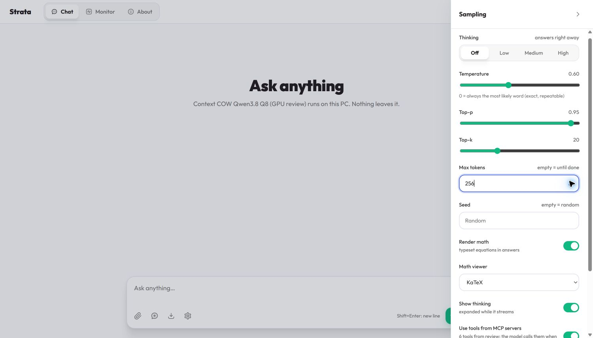
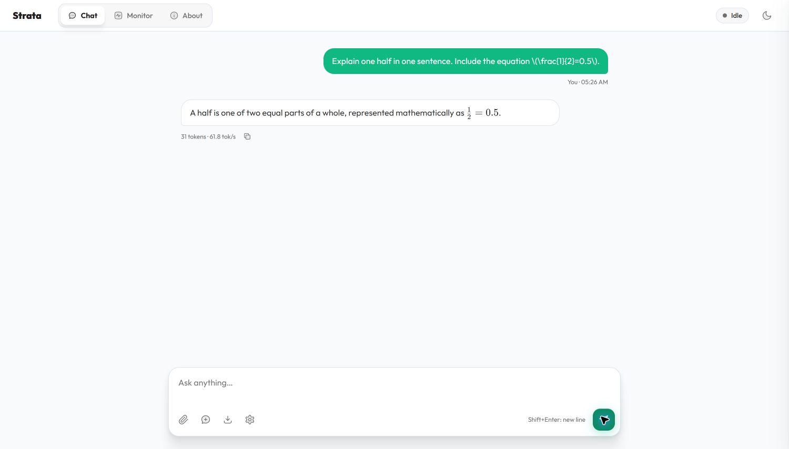
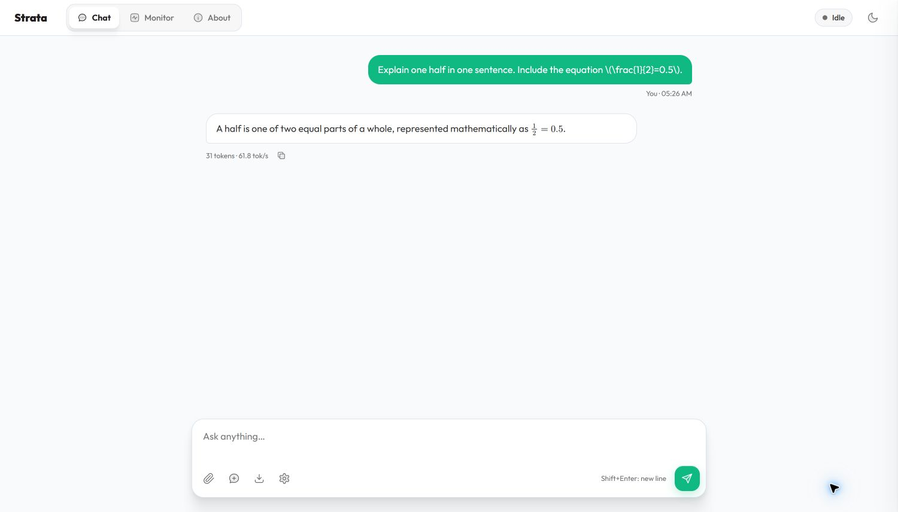
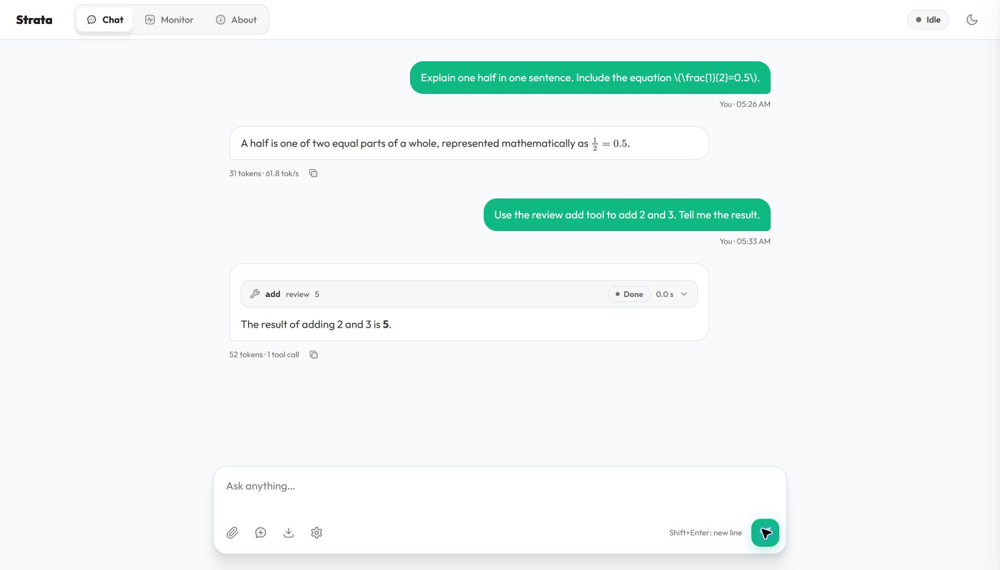

# Start Context COW and see your first equation

Use this page if you have not installed Python before.
Do each step in order. You do not need an AI assistant.

You have two choices:

| Choice | What you get | What you need |
|---|---|---|
| **A. Sample app** | The web app with a fixed sample answer and an equation | A Windows or Linux computer. No graphics card or model download. |
| **B. Real model** | The web app with answers from a model on your computer | A supported graphics card, enough memory and disk space, and a large download. |

Start with A to check the app. Then use B to talk to a real model.
The sample app repeats the same answer. It cannot answer your questions.

## Words you will see

- **Python** is a program that runs part of this app.
- A **model** is the large set of files that the AI uses to make an answer.
- A **server** is the program that runs the model and sends answers to your browser.
  It can run on the same computer as your browser.
- A **browser** is a program such as Edge, Chrome or Firefox.
- A **terminal** is a window where you type commands. PowerShell is a Windows terminal.
- A **virtual environment**, or **venv**, is a private folder for this app's Python
  and extra Python packages. It keeps this app's packages separate from other apps.
  We name this folder `.venv`. Do not move it or edit its files.
- A **token** is a small piece of text. A model reads and writes tokens.

## 1. Download this version

1. Open [the Context COW repository](https://github.com/CC-David-CC/Public_Context_COW).
2. Click the green **Code** button.
3. Click **Download ZIP**.
4. Wait for the download to finish.
5. On Windows, open **Downloads**. Right-click the ZIP file. Click **Extract All**.
6. Select a folder that you can find again. For example, `C:\ContextCOW`.
7. Open the extracted folder. Open the folder inside it if there is one.
8. Check that you can see `START-HERE.bat`, `setup.sh` and `README.md`.

Use these files from this repository. Do not download Strata main instead if
you want this repository's two math viewers.

## A. Run the sample app

### A1. Install Python on Windows

If you already have 64-bit Python 3.12 or 3.13, go to A2.

1. Open [Python 3.13.15](https://www.python.org/downloads/release/python-31315/).
   This is the version tested on the Windows computer used for this guide.
2. Scroll to **Files**. Click **Windows installer (64-bit)**.
3. Open the downloaded installer.
4. Select **Add python.exe to PATH** on the first page.
5. Click **Install Now**.
6. Wait for **Setup was successful**. Click **Close**.

Python is free. You do not need the Microsoft Store for these steps.
If a school or work computer prevents installation, ask the person who manages it.

### A2. Open PowerShell in the app folder

1. Open the folder that contains `START-HERE.bat` in File Explorer.
2. Click the address bar at the top of File Explorer.
3. Type `powershell` and press **Enter**.
4. A PowerShell window opens in that folder.
5. Type this command. Press **Enter**:

```powershell
python --version
```

You should see `Python 3.13.15`, or your installed Python version.
If the Microsoft Store opens, close it. Install Python as in A1. Close PowerShell
and open it again. Use `python` on Windows, not `python3`.

### A3. Make the private Python folder

Copy each line below into PowerShell. Press **Enter** after each line.
Wait for one command to finish before you run the next command.

```powershell
python -m venv .venv
.\.venv\Scripts\python.exe -m pip install jinja2==3.1.6
.\.venv\Scripts\python.exe tools\web_demo.py
```

The first command makes `.venv`. It can finish without showing a message.
The second command installs one package inside it.
The third command starts the sample server and opens your browser.
These commands use the private Python directly. You do not need to activate
the venv or change PowerShell's execution policy.

If the browser does not open, type `http://127.0.0.1:8095` into its address bar.
Keep the PowerShell window open while you use the app.

### A4. Linux sample app

Open a terminal in the extracted app folder. On Ubuntu, install Python's venv
support if it is missing:

```bash
sudo apt update
sudo apt install python3 python3-venv
```

Then run these commands, one at a time:

```bash
python3 -m venv .venv
.venv/bin/python -m pip install jinja2==3.1.6
.venv/bin/python tools/web_demo.py
```

Open `http://127.0.0.1:8095` in your browser if it does not open by itself.
No model files are downloaded for this sample.

## B. Install and run a real model

The real model is large. Check your computer before the download.
For the full model choices and exceptions, see [hardware and model requirements](../INSTALL.md#what-you-need).

On Windows, you can find these details without commands:

1. Open **Start → Settings → System → About**. Read **Installed RAM**.
2. Press **Ctrl+Shift+Esc** to open Task Manager.
3. Select **Performance**. Select **GPU**. Read the card name and
   **Dedicated GPU memory**. Use the total amount, not the amount in use.
4. Open File Explorer. Select **This PC**. Read the free space below the drive
   where you will keep the model.

1. Check that your computer runs Windows 10/11 or Linux. The automatic Linux
   setup is intended for Ubuntu 22.04/24.04.
2. Check your graphics card. Start with a supported NVIDIA RTX or AMD Radeon
   card with at least 12 GB of graphics memory. An integrated graphics chip
   is not sufficient for this path.
3. Check that you have at least 32 GB of system memory. The model choice depends
   on memory. More memory permits larger model files.
4. Leave at least 80 GB of free disk space for a smaller supported model.
   Larger Q4 and Q8 models need more. Read the size shown by setup before you agree.
5. Check your internet connection. The model download can be tens of gigabytes.
   It can take hours. It can use much of a monthly data allowance.
6. Install a current graphics driver. Use the graphics card maker's official
   instructions. Restart the computer if those instructions require it.

### B1. Windows setup

1. In File Explorer, open the downloaded app folder.
2. Double-click **START-HERE.bat**.
3. Read the computer check and the model choices.
4. Select a model that fits your memory and disk space. Use Q4 or Q8 if your
   computer has enough memory and those choices are available. This project's
   measured COW experiments use Q8 on a much larger computer.
5. Read the download size. Continue only when you want that download.
6. Let setup finish. It can install Python if Python is missing. It makes the
   private `.venv` folder and installs the model and engine.
7. Keep the setup window open. Wait for the server to say it is ready.
8. Open `http://127.0.0.1:8080` in your browser if it does not open by itself.

Setup can download a Strata prebuilt engine. The web app and math viewers come
from this checkout. This is the ordinary chat path. It does not turn the chat
screen into the experimental immutable branching API.

### B2. Linux setup

1. Open a terminal in the downloaded app folder.
2. Run `bash setup.sh`.
3. Read the computer check. Select a model that fits your computer.
4. Read the download size. Continue when you want that download.
5. Enter your computer password if the package manager needs it.
6. Wait for the server to be ready. Keep the terminal open.
7. Open `http://127.0.0.1:8080` in your browser.

### B3. Start and stop next time

- On Windows, double-click `START-HERE.bat` again.
- On Linux, run `bash setup.sh` again.
- Select the installed model if setup lists more than one.
- Wait for the model to load. Later starts do not download the same files again.
- To stop, click the server's terminal window. Press **Ctrl+C**. Wait for it to stop.
- Closing the browser tab does not stop the server.

## 2. Send your first message

1. Open the **Chat** tab.
2. Click the box labelled **Message** at the bottom.
3. Type `Say hello in one short sentence.`
4. Click **Send**. Wait for the answer.
5. To type a new line in a message, press **Shift+Enter**.
6. To stop an answer, click **Stop**.

The sample app returns its fixed answer. A real model makes its own answer.
Answers can be wrong. Check facts that matter to you.
You can also press **Enter** to send a message.



## 3. Show a math equation

1. Click the **Sampling and thinking** button beside the message box. Its icon
   looks like adjustment sliders.
2. For this short first test, set **Thinking** to **Off**.
3. Turn on **Render math**.
4. Set **Math viewer** to **KaTeX**.
5. The math controls take effect immediately. To save the **Thinking** change
   too, scroll down inside the settings panel if needed and click **Apply**.



6. Send this message to a real model:

```text
Explain one half in one sentence. Include the equation \(\frac{1}{2}=0.5\).
```

The equation uses `\(` and `\)` to mark its beginning and end.
`\frac{1}{2}` means a fraction with 1 above 2.
The model can choose different wording. If it does not include the equation,
ask it to copy the equation in your message.



7. Open **Sampling and thinking** again.
8. Change **Math viewer** to **MathJax**. The answer updates immediately.
9. Check the same answer. The app changes the viewer without asking the model again.



These pictures were captured from this Windows PC, connected to a Q8 model
server on llm-60 through SSH. That server has a 96 GB NVIDIA GPU. The pictures
show a real model answer. Your model and speed can differ. The inherited app
header says **Strata**. You opened the correct Context COW web app.

The app supports math fragments, not whole LaTeX documents. Text inside a code
block stays code. Bad equations stay readable as source. You do not need to
install TeX, KaTeX or MathJax separately.

## 4. Keep your chat

- Click **Copy the answer** below an answer to copy its original text.
- Click **Save this chat** beside the message box to download a Markdown file.
  Markdown is a plain text file with simple formatting marks.
- Click **New chat** to start a fresh conversation in the browser.
  This is not a COW snapshot or a branch operation.
- Chats and viewer settings are kept in this browser. They are not shared with
  another browser. Save a file before you clear browser data.

### Reuse text files for separate questions (when enabled by your server)

Some Context COW servers show **Save files as context** beside the message box.
This optional path keeps uploaded file contents as user-provided context and
does not send your typed question while saving them.

1. Attach one or more text files. Images are not supported by this action.
2. Type your question, then click **Save files as context**. Wait for the
   saved-history confirmation. Your question stays in the message box.
3. Click **Send** to ask that question using the saved file context.
4. To ask a different question from the same code-only point, open **Paths**.
   Select **Start**, the root point before the message path; all saved file
   context is held there, rather than at a separate point for each file. Use
   its fork icon (**Fork here**), switch to the new branch and send the other
   question there.

If the server does not show **Save files as context**, use the normal chat flow
above. A file is always user data; text that looks like a prompt tag remains
literal file content.

## 5. Thinking, templates and tools

**Thinking** controls how much reasoning the model is asked to do. Start with
Off for short answers. A larger setting can take longer. **Show thinking**
controls whether you see that text. If a turn ends while the model is still
thinking, the app must not invent a final answer. Ask again, turn Thinking Off,
or increase Max tokens. The server's optional retry is a separate setting.

A **chat template** arranges messages for the model. Setup loads the model's
template. You do not need to write one to chat. Do not paste a template into
the message box to install it. Pasted tags such as `<|im_start|>` are message
text. They must not open another conversation turn.

A **tool** is a function that a model can ask another program to run. The app
can use configured **MCP servers** to provide tools. MCP is the protocol that
connects those programs. Tools are optional. You do not need them for chat or
math. The [MCP configuration guide](../DETAILS.md#tools-from-mcp-servers) explains configuration, if you want it.
Only configure tools whose actions you understand. A tool that can edit files
can change your files.



This picture shows a test tool that adds two numbers. The model requested
`2 + 3`. The tool returned `5`. The model then wrote the answer. This test tool
does not read or edit files. It is not enabled by the beginner setup steps.

Quoted tags and fenced code are text. A complete tool call written by a model
in the protocol form can be interpreted as a call. To ask for a literal example
of a tool call, ask the model to put it in a fenced code block. A byte stream
alone cannot distinguish a perfectly formed protocol call from the same
unquoted text that the model intended as an example.

## 6. If something goes wrong

| What you see | What to do |
|---|---|
| The browser cannot connect | Keep the server window open. Wait for Ready. Use 8095 for the sample or 8080 for setup's default real model. Type the address into the address bar, not the search box. |
| Port already in use | Stop the old sample/server window with Ctrl+C. Wait for it to stop. Then start one server. |
| Python is not found, or the Store opens | Install Python as in A1. Close PowerShell. Open it again. Run `python --version`. |
| `No module named jinja2` | Run the install command in A3 with `.venv\Scripts\python.exe`. Do not install it into a different Python. |
| API key needed | Open **About**. Enter the key supplied by the server owner in **API key**. Do not publish that key. The default local setup does not need one. |
| You see `\frac{1}{2}` instead of a fraction | Turn on Render math. It takes effect immediately. Check that the formula has `\(` and `\)` around it and is outside a code block. |
| An equation still does not render | Try the other viewer. Keep the raw source. See [supported syntax and limits](../WEB_MATH.md). |
| You see only thinking | Turn Thinking Off for a quick test. A stop inside thinking does not prove that the model produced a final answer. |
| Setup stops with a memory or driver error | Read the last error in the server window. Check the hardware requirements. Do not repeatedly download the model to fix a driver error. |
| Answers always repeat the same sample | You started choice A. Stop it and complete choice B for a real model. |

## 7. Use a server on another computer

`127.0.0.1` means **this computer**. An address on your own PC does not directly
refer to a server on another PC. Ask the server owner for its connection
instructions and key. An SSH tunnel can connect your browser to a server that
listens only on the server's own loopback address.

Do not use `--host 0.0.0.0` without an API key. Do not copy the test server's
name, key or port from a screenshot and expect it to work on your computer.

## 8. Try the actual Context COW experiment

The chat app is the beginner entry point. The immutable history store, branch
operations and GPU/RAM/disk checkpoint runners are a separate research path.
They require the [Linux/CUDA build and measurement instructions](GETTING_STARTED.md).
Native Windows history-store execution remains unqualified because its current
locking uses POSIX `fcntl`. A successful browser chat does not certify the
branching gate matrix.

The sample route and screenshot workflow were exercised. A clean Windows
installer, driver installation and complete model download were not repeated
for this guide. The installer procedure is based on the checked-in setup code.
For Python environment background, see [Python's venv documentation](https://docs.python.org/3.13/tutorial/venv.html).
