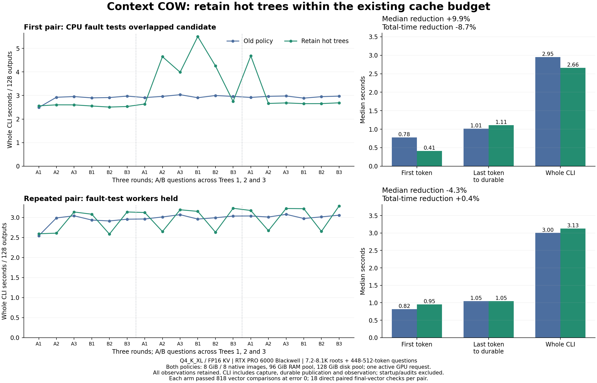

# Equal-budget hot-tree retention measurements

The retention candidate eliminates native checkpoint loading when switching
between the three tested trees. Both policies use the same 8 GiB/eight-entry
native cache, 96 GiB shared RAM pool and 128 GiB disk pool. Retention remains an
isolated candidate; the stable implementation is still `7c97c1d7`.

These measurements qualify Q4 greedy continuation under the pinned
`identical-native-operators-v1` profile. They do not qualify cumulative G1-G5,
arbitrary batch equivalence, general samplers, or the separate publication
ownership fix.

## Controlled inputs and numerical result

Each arm executes 32 actual requests with 128 outputs each: 4,096 outputs.
The primary timing sample contains 18 requests: three rounds of A/B questions
against each of three source trees. The roots contain 7,231 / 7,845 / 8,087
tokens; question suffixes contain 448-512 tokens. Warm-up, logical retry,
observer controls and process-separated disk restoration are recorded separately.

Both arms use the same model, native binaries, hardware, execution settings,
token fixtures and operator boundaries. The source closure differs only in
`coordinator.py`: old policy `bb6a1f8d...`, retention `7042b31f...`.
Profile identities differ because their source pins differ. No checkpoint is
imported or relabelled across profiles.

The first pair passed 818 full-vector comparisons per arm at maximum error zero.
Eighteen additional direct comparisons found identical final vectors and output
tokens between arms. Each pipeline also checks the complete greedy controller,
canonical history, actual suffix/output work and unchanged original prefix bytes.
Candidate checks cover saved-prefix and final consumed frontiers; independent
fresh repetitions compare every dumped frontier. This is not every-boundary
candidate certification.

The control ran 12 new independently initialized uncached oracle processes.
The candidate reused its preceding 12 independently initialized references only
after exact profile, fixtures, schedule, process receipt and vector-hash checks.
Reusing those references did not execute another 12 oracle processes.
All owned HTTP, native and reference processes were confirmed exited/absent.

## First pair: retain the outliers

| Metric, 18 primary requests | Old policy | Retention |
|---|---:|---:|
| Median whole CLI request | 2.952 s | 2.659 s |
| Sum of whole CLI requests | 52.606 s | 57.173 s |
| Aggregate whole CLI output TPS | 43.80 | 40.30 |
| Median first-token wait | 0.779 s | 0.410 s |
| Median token interval | 8.510 ms | 8.533 ms |
| Median last-token-to-durable interval | 1.014 s | 1.107 s |
| Native checkpoint file bytes loaded | 5,448,560,644 | 0 |
| Requests with zero native file loading | 1/18 | 18/18 |

The ratio of median latencies improves 9.93%; median paired improvement is
9.49%. Total time worsens 8.68%. All outliers remain in the result. CPU fault
tests overlapped the candidate campaign, so this pair is not a quiescent causal
speed comparison. Overlap is a confound, not proof that it caused every outlier.
The control's first A request legitimately remains hot after logical retry;
it is included rather than discarded.

Whole CLI timing includes Python process startup, observer trace serialization
and fsync, checkpoint capture and durable publication. Model/service startup
and numerical audits are separate. Native file loading can stage from RAM;
these counters are not measurements of physical disk reads. There is no clean
native-only overhead comparison or physical peak-memory measurement here.

## Repeat with CPU fault-test workers held

The second pair reverses arm order: retention first, old policy second. Both
again complete 32 requests / 4,096 outputs and pass 818 vector comparisons at
zero error. Eighteen direct paired final vectors also agree exactly. Each arm
reuses only its own previously executed independent references after full
profile/schedule/hash validation; this pair launches zero new oracle processes.

| Metric, 18 primary requests | Old policy | Retention |
|---|---:|---:|
| Median whole CLI request | 3.002 s | 3.130 s |
| Sum of whole CLI requests | 53.577 s | 53.341 s |
| Aggregate whole CLI output TPS | 43.00 | 43.19 |
| Median first-token wait | 0.819 s | 0.955 s |
| Median token interval | 8.518 ms | 8.501 ms |
| Median last-token-to-durable interval | 1.047 s | 1.049 s |
| Native checkpoint file bytes loaded | 5,448,560,644 | 0 |
| Requests with zero native file loading | 1/18 | 18/18 |

The total-time improvement is only 0.44%; median latency is 4.27% worse.
This does not support a general end-to-end speedup claim. The prior outliers
cannot all be attributed to overlapping CPU tests. Both stores retain their
own earlier qualification histories, in different quantities; the same cache
budgets and token fixtures do not remove that control-plane confound.

Both complete pairs together execute 128 generations / 16,384 outputs.
Each of the four arm audits passes 818 vector checks; each pair adds 18 direct
paired final-vector checks. These include repeated verification against reused
references and must not be described as thousands of new independent runs.

An additional audit streams and hashes all twelve distinct physical child
payload files across the two stores: 4,037,996,648 bytes. All 36 paired payload
identity checks agree, covering native serialized state plus next logits.
This excludes manifests/controller bindings, which are checked separately.
No original prefix work repeats or parent bytes change in the tested requests.

## Attribution from existing traces

No inference or runtime instrumentation was added for these analyses. The native
protocol response clocks show median source-restore gaps of 336 ms old policy
versus 67 ms retention; suffix-feed gaps remain about 274 ms in both. These are
host-observed adjacent response gaps including Python/protocol work, not GPU
event timings. Recorded decode computation totals are 17.903 versus 17.900
seconds across the 18 requests. The numerical model computation is not the
observed slowdown.

Same-host monotonic event analysis separates the remaining time:

| Median observed interval | Old policy | Retention |
|---|---:|---:|
| HTTP request to server `request_started` marker | 93 ms | 602 ms |
| That marker to first token arrival | 726 ms | 351 ms |
| Last token to captured snapshot event | 688 ms | 702 ms |
| Checkpoint preparation/reservation, nested in the preceding interval | 533 ms | 543 ms |
| Snapshot event to durable acknowledgment | 364 ms | 350 ms |

The server marker is emitted after initial worker checks/counter reads; the
first interval is not a pure queue-wait measurement. It includes HTTP admission,
presentation/history preparation, routing and any worker work before the marker.
The remaining regression is before that marker, while actual restored execution
improves. A catalog-query profile investigates that existing control-plane work;
it does not prove a cause merely from the endpoint intervals.

The subsequent CPU profile confirms a substantial full-catalog cost. Candidate
namespaces have 25 / 21 / 35 heads; one warmed query reads 106,479,960 /
68,057,758 / 115,681,412 snapshot bytes. Two unprofiled query repetitions have
medians 0.793 / 0.321 / 0.889 seconds. A third, cProfile-instrumented repetition
shows most time inside stored presentation validation; these instrumented
durations must not be compared directly with unprofiled request latency.
Only the root's formatting capability is needed by the request admission call.
The full catalog intentionally validates earlier answers, doing substantially
more work. A targeted root-query implementation is in a separate worktree,
not integrated or GPU-qualified by this report.

The initial catalog profiler incorrectly treated the constructor's `refs.lock`
mtime update as canonical history mutation and failed its guard. Its failed
receipt remains. The corrected version excludes OS lock files from that guard;
no acceptance test or backend behavior was changed.

## Private evidence and space management

Raw control artifacts:
`/home/dflanag3/spatial-artifacts/q4-tree-policy-control-20261016-v1`.
Candidate artifacts:
`/home/dflanag3/spatial-artifacts/q4-tree-retention-20261016-v1`.

The first comparison archive is on private box-git:
`/srv/data/git/private_context_cow.evidence/20261016-q4-tree-policy-pair-v1/evidence.tar`.
Size 253,071,360 bytes; SHA-256
`45e0632d675544c29ab72f918746e1006e564212548b935e792b130f300821c4`.
Independent no-extraction readback verified 1,540 members / 251,474,488 data bytes.
The archive includes traces, runtime pins, canonical histories, checkpoint
manifests and selected reference vectors; model/native payloads and complete
per-token reference arrays are excluded. Reference arrays remain on llm-60.

After backup verification, narrowly audited eviction removed 4,038,287,360
allocated bytes of completed child checkpoints across the two stores. All
220 control and 322 candidate canonical files remained byte-identical, and
all six original prefix manifests/payloads remained byte-identical.
Free space rose from 1,677,291,520 to 5,715,574,784 bytes. Earlier child-cache
eviction released another 2,831,065,088 allocated bytes, retaining all original
prefixes and all 130 canonical files then present. These are cache evictions,
not deletion of retained conversation history.

The second comparison and attribution archive is also receiver/readback verified:
`/srv/data/git/private_context_cow.evidence/20261016-q4-tree-policy-pair-v2/evidence.tar`.
Size 323,368,960 bytes; SHA-256
`eb197dec541536ec745a5f7057f9e8f656f6daf1469ab7a1a3747d999bdcbaac`.
All 1,803 members / 321,208,584 data bytes passed independent streaming readback,
without extraction. Both backup and readback command/wrapper exits are 0/0.
The same exclusions apply; original prefixes and full oracle arrays remain
on llm-60. After the second verified backup, another audited eviction removed
4,038,291,456 allocated bytes of recreated child checkpoints. All 412 control
and 514 candidate canonical files, and all six original prefix manifests and
payloads, stayed identical. Available space rose from 1,042,513,920 to
5,080,805,376 bytes. Completed child payloads are no longer retained; their
already-executed numerical evidence and canonical histories remain. A new
full child-payload audit requires recreating those optional numerical copies.

Machine-readable results are `TREE-RETENTION-PAIR{1,2}-2026-10-16.json`,
`TREE-RETENTION-FINAL-CONSISTENCY-2026-10-16.json` and the EVENT / PROTOCOL /
CATALOG attribution JSONs under `experimental/branching_context/evidence`.
Reproducers are in `evidence/reproducers/tree-policy-pair-20261016`.
They retain original absolute artifact paths and refuse existing output paths;
choose fresh versioned destinations when reproducing. The PNG was rendered
and visually checked. No raw archives or native state were copied to Windows.

## Outstanding qualification

The expanded CPU aggregate still has 100 passes and one reproduced baseline
missing-checkpoint expectation conflict. It is not green. Retained-image
pressure and current combined-source recovery qualification remain incomplete.
Full byte-integrity hashing remains enabled. Q8 is deferred; the ordinary chat
server remains off. No public GitHub/upstream changes were made.
