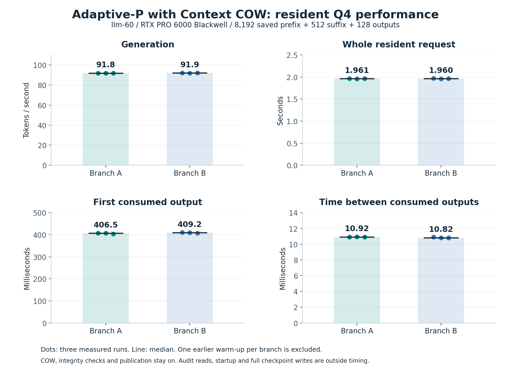

# Adaptive-P: exact restart and resident Q4 timing

Adaptive-P now has bounded Q4 and Q8 restart evidence. The complete Python
Context COW API also generated about 92 tokens/second on Q4 with an 8K saved
prefix. All code and measurements remain private.

| Median | Branch A | Branch B |
|---|---:|---:|
| Generation, tokens/second | 91.806 | 91.947 |
| Complete resident request, seconds | 1.9608 | 1.9602 |
| Request tokens/second, including suffix work | 65.279 | 65.299 |
| First consumed output, milliseconds | 406.5 | 409.2 |
| Median inter-output time, milliseconds | 10.92 | 10.82 |
| Native host sampler, milliseconds/output | 1.1666 | 1.1672 |
| Native decode computation, milliseconds/output | 7.7632 | 7.7634 |

The host was llm-60, RTX PRO 6000 Blackwell GPU0, Qwen3.8-Flash-Next
UD-Q4_K_XL with FP16 KV. Each request reused 8,192 saved prefix tokens,
prefilled its own 512-token suffix, and consumed 128 generated tokens. One
warmup and three measured repetitions ran per branch, one request at a time.
The figure shows individual repetitions and medians; it is a small sample.

Policy: temperature 0.70, Min-P 0.05, Top-K 0, Top-P 1.0, Adaptive-P target 0.55
and decay 0.90. The separate combined-filter test enabled DRY, Top-K 60,
Top-P 0.95, Typical 0.95 and DynaTemp range 0.10 before Adaptive-P. That small
combined case passed correctness; these timing rows use the simpler policy.

COW, hashes, native integrity checks and canonical consumed-state publication
remain enabled inside the timed path. The complete request includes suffix
prefill and generation. Startup, independent references, per-token full-frontier
audit reads, whole-parent audits and full durable checkpoint writes are outside
its timer. No saved-prefix forward work or checkpoint disk loading occurred
in the resident requests. This is API timing, not HTTP/CLI timing. Native phase
timers may overlap or nest; they are not an exclusive wall-time breakdown.

The expanded collector reread 420 complete finite candidate/reference vector
pairs across the combined tiny and 8K audits, all byte-identical. It also checked
eight timed final-frontier hashes. The timed harness compared every answer's
tokens and full controller to independent references; timed per-token raw
vectors were not retained. Canonical snapshot object hashes and full controllers
were independently checked in the audit. All candidate/reference processes exited.

Separate Q4 API 128/64/8 and Q4/Q8 HTTP/CLI 1024/64/16 campaigns compared 98
raw vector pairs and 88 native selections, all exact. The API's three structured
strict-restore receipts performed zero prefix forward work; CLI continuations
separately recorded zero prefill and output-only forward work. Settings changed
on continuation while preserving the saved Adaptive-P feedback and RNG cursor.

Q8 throughput, answer quality, arbitrary batch equivalence, longer contexts,
HIP/SYCL and cumulative G1-G5 qualification are not established by these runs.
Earlier inference and collector failures remain recorded. The collector failure
comparing a compact controller summary to a full object was fixed without
changing engine behavior, references, gate assertions or numerical tolerances.

`measurements.csv` contains the six plotted rows. `plot-inputs.json` binds the
report, source, model execution profile, native binary, fixtures and figure bytes.
`plot_adaptive_p_q4_v1.py` redraws retained measurements with Matplotlib 3.10.7;
run it on a Linux Python with Matplotlib, passing `--input` as the retained
expanded qualification JSON and `--output` as a new directory. No inference or
model is needed to redraw. Source commit `747d5d4b`; native ELF SHA begins c674659d.

Machine reports under `experimental/branching_context/evidence`:

- `ADAPTIVE-P-QUALIFICATION-2026-10-16.json`: Q4/Q8 bounded API/CLI restart.
- `ADAPTIVE-P-Q4-EXPANDED-2026-10-16.json`: combined filters and 8K timing.
- `ADAPTIVE-P-PREVIEW-SOURCE-VERIFICATION-2026-10-16.json`: 58 executed files
  compared byte-for-byte with committed source.
- `ADAPTIVE-P-PREVIEW-INTEGRATED-CPU-2026-10-16.json`: 745 CPU tests and G0 51/51.

The raw private backup is tracked separately in the evidence status/index.
Model weights and full checkpoint state payloads are excluded from that archive.
