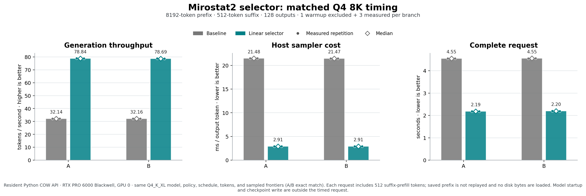

# Exact Mirostat 2, before and after linear retention

On llm-60's RTX PRO 6000 Blackwell GPU 0, the same Q4 model, Mirostat settings,
input schedule and output tokens were tested before and after removing the
full-vocabulary score sort. Hash validation and Context COW remained enabled.

| Median, branches A / B | Sorted selector | Linear selector |
|---|---:|---:|
| Generation, tokens/second | 32.14 / 32.16 | 78.84 / 78.69 |
| Host sampler, ms/output | 21.48 / 21.47 | 2.91 / 2.91 |
| Complete request, seconds | 4.549 / 4.554 | 2.186 / 2.200 |

Each request reused an 8,192-token prefix, prefills its own 512-token suffix,
and consumes 128 output tokens. Three measured repetitions follow one excluded
warmup per branch. The dots show individual repetitions, and diamonds show
medians. This sample is too small for broad statistical claims.

The complete request includes suffix prefill, COW write preparation, native
sampling, model computation and consumed-state publication. Engine startup,
independent full-frontier oracle reads, whole-parent byte audits and a full
per-answer durable checkpoint write are outside this timer. No saved-prefix
forward work or checkpoint disk loading occurred in these resident requests.
The host sampler timer is CPU wall-clock time; it is not GPU kernel time.

Before/after token IDs and sampled frontier hashes agree. Full final controller
JSON is not retained in the timing rows; the matched comparison checks starting
controller hashes and RNG cursors, while the preceding independent audit checks
whole controllers during execution. The broader linear-selector qualification
has 458 exact vector comparisons across Q4/Q8 and six zero-work strict restores.
This figure measures Q4 throughput only; it does not establish Q8 throughput,
answer quality, cold-start speed, arbitrary execution arrangements or G1-G5.

`matched-measurements-v4.csv` contains the 12 plotted measured rows.
`plot-inputs-v4.json` binds source results, profiles, policies and output hashes.
`plot_mirostat2_matched_timing_v4.py` is the executed recipe, using Matplotlib
3.10.7 from an existing isolated dependency target on llm-60. It reads the raw
result paths recorded in that script; set BASE, BACKUP and a fresh OUT path when
reproducing elsewhere. It needs no model or inference to redraw retained data.
The SVG is provided for vector export. All files remain private.

Machine evidence is in the branching evidence directory:
`MIROSTAT2-LINEAR-MATCHED-TIMING-2026-10-16.json`,
`MIROSTAT2-LINEAR-QUALIFICATION-2026-10-16.json` and
`MIROSTAT2-LINEAR-BACKUP-2026-10-16.json`. The full receiver-verified raw archive
is on private box-git; model weights and checkpoint state files are excluded.

The CSV is stored without newline conversion to preserve the raw measurement
bytes and recorded SHA. The renderer's SVG contains trailing spaces inside
multiline path attributes; those harmless renderer bytes are retained. The
Git whitespace review excludes only that exact generated SVG, while checking
all authored files. This exception changes no measurements or equations.
