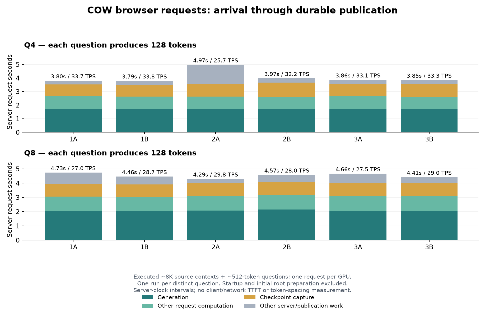

# Measured COW request latency

These are executed Q4/Q8 requests on llm-60, not simulated timings. Each model
used three distinct 7,231/7,845/8,087-token code contexts, two different roughly
512-token questions per context and 128 output tokens per question. The bounded
pressure run used a 9GiB RAM pool to force eviction; production defaults remain
96GiB RAM / 128GiB disk. Execution profiles and raw report/trace hashes are in
[measurements.json](measurements.json).

| Metric | Q4 | Q8 |
|---|---:|---:|
| Generation-only median output tokens/s | 74.63 | 62.29 |
| Median output tokens / whole durable request seconds | 33.20 | 28.35 |
| Median request seconds | 3.855 | 4.516 |
| Cold disk revisit, 128 output tokens, seconds | 4.606 | 6.018 |

The total uses one server monotonic clock, joined by operation, branch, model,
profile, source snapshot and result snapshot. It begins at request receipt and
ends at durable completion. It includes suffix prefill and checkpoint capture /
publication, but excludes engine startup, initial root preparation and the last
network delivery to the client. It is not TTFT or inter-token TPOT. This is one
observation for each different question, not three repeated benchmarks.

The residual phase is unassigned server/boundary work; it must not all be
attributed to disk writes. Native-request timing contains generation, so the
plot subtracts generation before stacking it. Each initial answer evaluated only
its question suffix plus output, with zero native file-load bytes. The disk
revisit evaluated 128 generated tokens and zero prefix tokens, loading
323,649,780 native bytes. Its request total includes the disk load.

Reproduce with `experimental/branching_context/scripts/summarize_cow_browser_latency.py`
and `--case Q4 BROWSER_REPORT POOL_TRACE --case Q8 BROWSER_REPORT POOL_TRACE
--output-directory NEW_DIRECTORY`. Use `python` on Windows. Raw inputs are in
`cow-client-pipeline-integration-20261015-v1/q4-three-context-pressure-v1/` and
`q8-three-context-pressure-v2/` on llm-60 and in private box-git evidence archives.
The producer hash is embedded in the machine result. Numerical evidence is
separate: these timings do not qualify a correctness gate or an 8% serving
overhead target.
