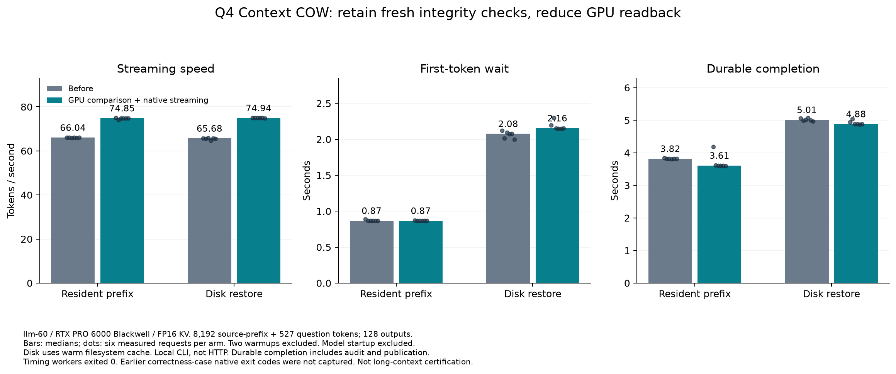

# Executed Q4 comparison: device seal comparison and native streaming

The new combined CUDA path streamed about 13–14% faster than the preceding
COW profile in these repeated local CLI measurements. Whole-request latency
improved less; disk first-token latency increased 3.76%. This compares two COW
profiles, not COW against stock serving.



| Profile and mode | Streaming TPS | First token (s) | Snapshot complete (s) | Durable acknowledgment (s) | Median token gap (ms) | Per-request p95 gap (ms) |
| --- | ---: | ---: | ---: | ---: | ---: | ---: |
| Before, resident | 66.04 | 0.868 | 2.967 | 3.820 | 15.11 | 15.31 |
| New, resident | 74.85 | 0.868 | 2.744 | 3.611 | 13.41 | 13.43 |
| Before, disk | 65.68 | 2.077 | 4.156 | 5.013 | 15.21 | 15.37 |
| New, disk | 74.94 | 2.155 | 4.024 | 4.884 | 13.39 | 13.41 |

Each entry is a median across six measured requests: three per branch. Each
arm also executed one excluded warmup per branch. All 32 requests produced
128 tokens; 24 measured requests total 3,072 output tokens. Token-gap p95 is
calculated within each request and then the six values are summarized; it is
not a pooled p95. Arm order was before/resident, before/disk, new/resident,
new/disk. No randomized pairing or confidence interval is claimed.

The host was llm-60, RTX PRO 6000 Blackwell, Q4 weights, FP16 KV, one active GPU
request, capacity 98,304 and prefill chunks of 8,192. The real-code fixture had
8,192 saved prefix tokens and distinct 527-token questions. Every measured
request evaluated exactly 527 suffix tokens and 128 generated tokens, with
one capture and one restore. Disk restoration receipts report zero prefix
forward work. The filesystem cache was warm; model startup is separate.

All four timing clients/workers passed; command/wrapper exits and recorded
native worker codes were zero. Worker PIDs were 2245094, 2247045, 2247852 and
2249058. The numeric-code-aware summarizer validated each report. The separate
old/new correctness cases each made 13 exact numerical comparisons; their
older producer/resume native exit codes were not recorded. Timing success
does not retroactively supply those missing codes.

Fresh device hashing remained 329,898,786,816 cumulative bytes per request.
That is repeated checking work, not resident memory consumption. Digest
readback fell from 2,577,334,272 to 40,501,248 bytes. The new hash-and-compare
timer was about 662 ms/request, plus about 1 ms of result download; the old
hash-only timer was about 638 ms. The fields cover different operations. The
zero old timer in the new implementation does not mean hashing disappeared.

Durable completion includes final validation and publication; repeated
deterministic answers may reuse an existing durable payload. The caller is a
local subprocess, not a browser or HTTP client. This is native streaming;
Python still reads the outer checkpoint in full. No current 64K performance,
non-greedy controller, cumulative G2, or portability qualification follows.
The informational 8% cost target relative to stock serving is **unmeasured**;
this experiment has no matched stock arm.

The [machine-readable measurements](q4-seal-stream-comparison.json) retain
individual samples, per-branch summaries, work records, numeric exits and
input hashes. Raw directories on llm-60 are under
`/home/dflanag3/spatial-artifacts/cow-seal-stream-candidate-20261015-v1/`:
`client-{old,new}-{resident,disk}-v2/` and their matching `runs/` directories.
GNU time records give maximum RSS, not aggregate system RAM or GPU peak memory.
Raw V2 backup remains separate from the already archived V1 campaign.

To reproduce the chart from that raw directory, run on Linux with matplotlib:

```sh
python3 experimental/branching_context/scripts/plot_seal_stream_comparison.py \
  --results /home/dflanag3/spatial-artifacts/cow-seal-stream-candidate-20261015-v1 \
  --output /path/to/a/new/chart-directory
```

Use `python` for controller-side artifact analysis on Windows. The plotter
rejects incomplete campaigns, absent/nonzero native exits, changed work or
hashing coverage, and mismatched numerical/timing profile identities. The
committed PNG was visually inspected; its SHA-256 is
`ac934a2309e74739c0060aecc406bec53b5fd0c6f0ea108fdecb72926f598aca`.
