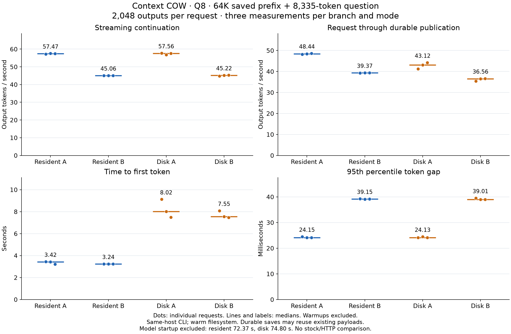

# Q8 long-context client run



This artifact compares resident and disk modes for the same pinned Q8 case: 65,536 context tokens, an 8,335-token question, and a 2,048-token output bound. The native client ran one excluded A/B warmup followed by three measured A and three measured B requests per mode. Every measured response reached 2,048 tokens and the strict summaries require worker numeric native exit code 0.

| Mode | Branch | Median stream TPS | Median durable TPS | Median TTFT (s) | Median p95 TPOT (s) |
|---|---:|---:|---:|---:|---:|
| resident | A | 57.47 | 48.44 | 3.42 | 0.0242 |
| resident | B | 45.06 | 39.37 | 3.24 | 0.0392 |
| disk | A | 57.56 | 43.12 | 8.02 | 0.0241 |
| disk | B | 45.22 | 36.56 | 7.55 | 0.0390 |

Profile `3e3bf375e730d87b220a1516f5d8480fe18a46ccab93e272969aa530e6398529` uses the pinned Q8 configuration (capacity 98,304, prefill chunk 8,192, FP16 KV, GPU 0). The disk-mode runs use the existing host filesystem cache state; no cold-device or cold-page-cache claim is made.

Resident means the prepared numerical prefix remains available in the native
checkpoint cache, including GPU-backed KV pages. This is not a host-RAM-only
offload-and-upload measurement. Disk mode explicitly reloads the checkpoint
before each request; neither mode recomputes the saved prefix.

Startup time is reported separately: resident 72.37s; disk 74.80s. Durable throughput is client-observed output tokens divided by request-to-durable duration. Shared payload deduplication means per-request serialized bytes are not independent full copies. GNU `time -v` max RSS is not a dedicated aggregate host-RAM peak measurement; no GPU-memory peak sampler ran. This is a private native-client result, not an HTTP or stock/upstream comparison.

See `q8-long-client-speed.json` for per-request metrics and exact profile, case,
binary and harness hashes. Root independently checked all 12 measured rows and
their four plotted medians against the raw client files, then rendered and
visually inspected the Matplotlib figure. Reproduce this figure from the API
directory with:

```text
python scripts/plot_q8_long_client_comparison.py evidence/figures/2026-10-15-q8-long-client/q8-long-client-speed.json OUTPUT_DIRECTORY
```

Use the verified remote interpreter (`python3` on llm-60) when running there.
The plot receipt records Matplotlib 3.11.2, source/input hashes and figure hashes.
Plotting does not execute inference. The raw report-gathering scripts remain
with the private remote artifact bundle.

Actual native counters showed 10,383 forward tokens per request: 8,335 new
input tokens in two prefill chunks plus 2,048 generated-token consumes. All
eight restores in disk mode evaluated zero prefix tokens and loaded
1,829,608,952 native payload bytes apiece; that counter is not physical disk IO.
Fresh GPU integrity hashing remained enabled. Repeated deterministic requests
can deduplicate saved payloads, so durable time is not the cost of writing a
new full checkpoint every time. The original cumulative gates remain separate.
