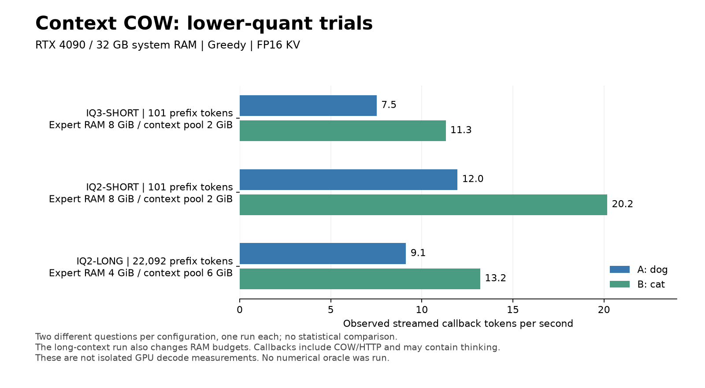

# Lower-quant trials on a 32 GB RAM server

The pinned GSQ-RCO **IQ3_XXS and IQ2_XS models loaded and generated text through Context COW on a real RTX 4090**. A fresh IQ2 installation with the corrected memory budget also passed a 22,092-token shared-prefix branching probe and an interactive BranchWrite chat from a separate Linux VM.

**This is bounded functional validation. Full coding and recovery failures remain below. No numerical oracle ran; numerical max error is null. G1–G5 are not qualified.**



## What ran

All runs used FP16 KV, 32,768-token capacity, 8,192-token prefill chunks and greedy sampling. The server had 32 GB nominal system RAM and 24 GB RTX 4090 VRAM. One GPU worker served one request at a time. The separate VM used the public BranchWrite dev66 client, installed from commit `9e96ebdf29cca68d61bea8303646b8abb9e8b4e9`.

| Configuration | Shared prefix | Expert RAM / context pool | A output / streamed TPS | B output / streamed TPS |
|---|---:|---:|---:|---:|
| GSQ-RCO IQ3_XXS | 101 tokens | 8 / 2 GiB | 113 / 7.52 | 128 / 11.31 |
| GSQ-RCO IQ2_XS | 101 tokens | 8 / 2 GiB | 106 / 11.96 | 93 / 20.18 |
| Fresh IQ2, corrected budget | 22,092 tokens | 4 / 6 GiB | 121 / 9.13 | 106 / 13.21 |

A asks about Buddy the dog; B asks about Luna the cat. Both fork the unchanged saved prefix. IQ3 B reached the 128-token limit and its paragraph was incomplete. Output counts and stop flags are retained in [result.json](result.json). These are two different prompts per configuration, one measured run each. Filesystem caches were not cleared. The long case changes both context length and RAM budgets, so it does not isolate either variable. These GSQ-RCO preparations also differ from the default Unsloth Q4 model.

Streamed TPS measures client callback spacing, including COW/HTTP overhead and possibly thinking text. It is not isolated GPU decode. Whole-request times, first-callback delays, native stage timings and actual counters are recorded separately. A first thinking callback is not the first finished-answer word.

## Successful prefix reuse and saved bytes

The long prefix took **165.35 seconds** to prepare. Its native receipt records three successful batches: **8,192 + 8,192 + 5,708** tokens. See [prefix-manifest.json](prefix-manifest.json).

The two subsequent requests took **18.20 and 11.36 seconds** including generation, capture, persistence and HTTP. Native counters show exactly **19 suffix-prefill tokens** per request. Total forward work was **140 = 19 + 121** and **125 = 19 + 106** tokens. Neither forwarded the 22,092-token prefix again. This establishes measured resident-prefix work reuse for these calls; it does not establish numerical equivalence to fresh inference or successful disk restoration across a restart.

Five state payloads totaled **2,899,046,412 bytes**. Independent whole-file SHA-256 measurements matched all five payload filenames. Payloads plus their manifests totaled **2,899,182,835 bytes**, matching the disk-pool counter. Peak accounted context RAM was **3,833,780,732 bytes** within the 6 GiB pool. Full system/GPU memory peaks were not measured.

The native write-preparation stage accounted for about **2.7% and 4.5%** of prepare/compute/finish wall time in the two long continuations. This component measurement is not a validation-on/off benchmark and does not qualify the overall 8% overhead objective. Hash/integrity checks remained enabled; their mismatch counters were zero. That is distinct from logit error, which was not measured.

## Installation and the capacity correction

The complete fresh IQ2 guided installation took **534.06 seconds**, using already-local, fully verified model shards. It created a new Python environment, built the native engine, prepared the pack and generated a separate fingerprinted profile and key. A complete Internet model download was not repeated. Startup through `cow-start` took **28.02 seconds**. Repeat setup preserved configuration/key bytes; requesting IQ3 in that same configured folder was rejected without changing them.

The new installer supports `--model IQ3_XXS` and `--model IQ2_XS`; Q4 remains the default. Downloads use immutable revisioned URLs and explicit sizes/SHA-256 values from [the model catalogue](../../data/cow-gsq-models.json). Each model has its own pack and should use a separate data folder. Model/controller checkpoints cannot be interchanged across incompatible profiles. AMD COW inference remains unsupported.

The old 2 GiB context pool was insufficient for the longer workflow. The successful long-prefix capture reserved **2,171,360,288 bytes**, already above that limit. Fresh planning now reserves a 6 GiB context working set and reduces expert residency to pay for it. On this host it selected **4 GiB expert RAM, 6 GiB context RAM and an 8 GiB minimum-available-RAM guard**. Hosts unable to provision the staging budget are rejected before installation. Existing configurations are preserved rather than silently resized.

A real interactive `/chat` from the separate VM completed in **141.46 seconds**, answered “Hello!” and exited cleanly without printing or saving the API key. This is whole workflow latency, not decode time. The native worker remained healthy, with zero restarts and no active request after testing.

## Failures retained

| Case | Outcome |
|---|---|
| Initial IQ3 website request, 2 GiB pool | Timed out at 600.58 seconds; paused cleanly; no HTML produced. |
| Initial IQ2 website request, 2 GiB pool | Failed at 367.03 seconds: `Checkpoint/staging reservation exceeds RAM pool`. |
| Original IQ2 session after restarting with a larger pool | `/continue` still reported `original native request is unresolved; reconcile it without a new work ID`. The original IDs and prior acknowledged work were retained. This recovery gap remains open. |
| Complete website creation with the fresh corrected budget | Not executed. Long-prefix generation and CLI chat passes do not establish a coding pass or repair the old failed session. |

The initial IQ3 website stage incurred **156.64 GB of native-process disk reads** over 604.11 seconds. Model streaming remains substantial on this host. These runs do not establish comparable usability on the intended 128 GB RAM gaming PC.

## Checks and reproduction

Final setup/model tests: **44 PASS**, zero failures/skips. G0: **51 PASS**. Thirteen additional named campaign cases are recorded: **10 PASS, 2 FAIL, 1 TIMEOUT**. These are separate from the registered G1–G5 acceptance matrix. Test-first failures, fixture/launcher corrections and full transcripts remain in the raw operator archive. No registered assertions, equations or tolerances were changed.

Run `python check_results.py` in this directory to verify the recorded evidence. It checks native work accounting and preserves the failed/timeout case statuses; a successful evidence check does not make every case pass.

[probe.py](probe.py) uses the ordinary BranchWrite HTTP client and its operation journal. Run it with a Python environment that has BranchWrite installed:

```bash
python probe.py --server http://YOUR-SERVER-LAN-IP:8099 --output-dir ./new-probe-run --label IQ2 --context-file long-context.txt
```

It prompts privately for the API key. Use a new output folder for a new experiment. Keep an interrupted run's journal and operation IDs for reconciliation. The included fixture has 21,991 plaintext tokens with the tested tokenizer; chat framing makes the actual consumed prefix 22,092. Other templates or profiles need their own qualification.

Source/build/model fingerprints, raw native counters, timings, file hashes and limitations are in [result.json](result.json). [plot.py](plot.py) renders the chart from that data with Matplotlib. This campaign did not test fresh full-history numerical equivalence, other samplers/grammar/controller combinations, vision, successful cold restore, power loss, soak or the full compatibility matrix.
